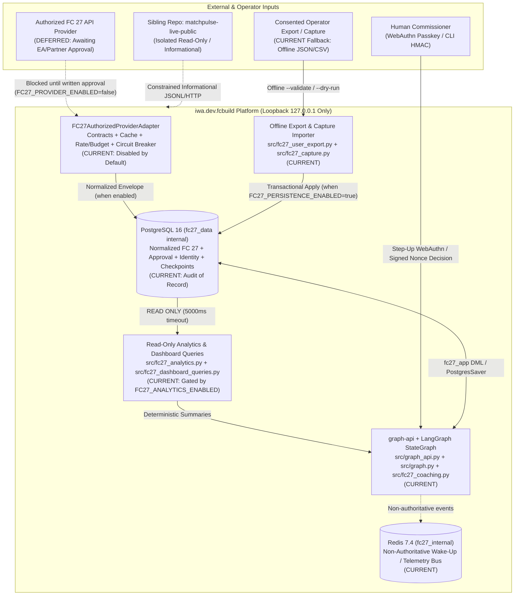
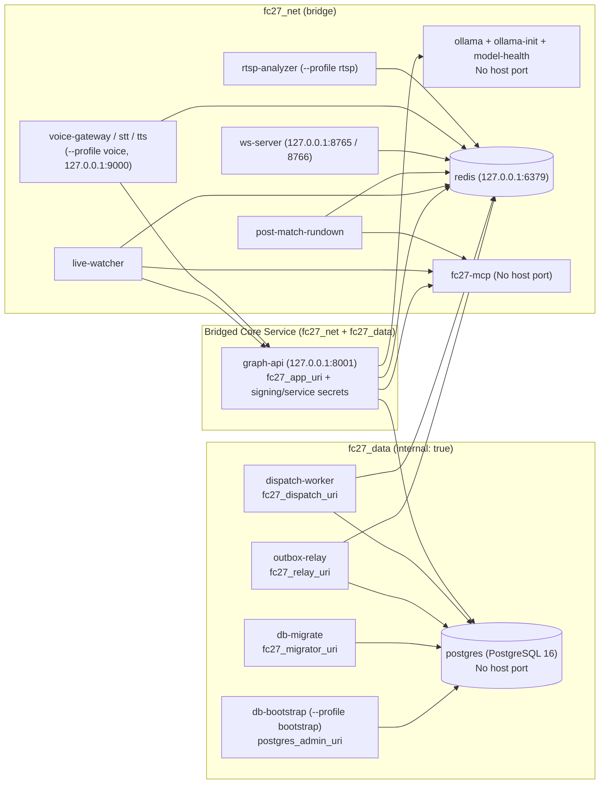

# East Coasters FC 27 Platform Architecture

- **Status**: Current
- **Audience**: Architects, Developers, Security Reviewers
- **Last verified commit**: `b2c7bbda0d4a5f5788caa5e2cb74844c9bf5c5f0`
- **Source of truth**: `src/`, `migrations/`, `docker-compose.yml`, `docker-compose.cpu.yml`, `docker-compose.gpu.yml`, `docker-compose.langfuse.yml`, `docker-compose.community-eval.yml`, `docker-compose.community-worker.yml`, `tests/`
- **Supersedes**: `docs/archive/prompts/PHASE2_VICTORY_AUDIT_REQUEST.md`, `docs/archive/reports/IMPLEMENTATION_REPORT.md`, `docs/archive/reports/HACKATHON_ALIGNMENT.md`

This document defines the authoritative architecture of `iwa.dev.fcbuild` derived directly from executable source code (`src/`), database migrations (`migrations/0001_initial.sql` through `migrations/0012_fc27_performance_and_quarantine.sql` and `migrations/post/grants.sql`), Docker Compose topology (`docker-compose.yml`, `docker-compose.cpu.yml`, `docker-compose.gpu.yml`, `docker-compose.langfuse.yml`, `docker-compose.community-eval.yml`, `docker-compose.community-worker.yml`), and automated test suites (`tests/`).

## 0. Current Supported Real-Data Operational Path

For **East Coasters (`club_id="330323"`, `platform="common-gen5"`, `game_version="FC27"`)**, the current working end-to-end architecture is:

```text
pinned FC27 community provider (fc-clubs-api-community-v1 / LIVE_EA_CLUBS_COMMUNITY_CLIENT)
  -> one-shot CLI (`scripts/fc27_community_eval.py`) OR disabled-by-default polling worker (`src/fc27_polling_worker.py` / `fc27-community-worker`)
  -> repository endpoint contracts & response schema validation (src/fc27_clubs_api_contracts.py)
  -> normalization, recursive sensitive-field rejection & plr_ecf_<12-hex> pseudonymization
  -> optional single-transaction PostgreSQL 16 persistence (src/fc27_repository.py)
  -> Search context assembly (src/fc27_search_scout.py)
  -> Scout evidence synthesis (src/fc27_search_scout.py)
  -> Analyst evidence synthesis (src/fc27_analyst.py)
  -> existing local dashboard & JSON API (src/fc27_demo_api.py:create_demo_app)
```

See [`docs/FC27_COMMUNITY_PROVIDER_EVALUATION.md`](FC27_COMMUNITY_PROVIDER_EVALUATION.md), [`docs/FC27_POLLING_WORKER.md`](FC27_POLLING_WORKER.md), and [`docs/FC27_DEMO.md`](FC27_DEMO.md) for exact execution commands.

## 1. Architectural Status Classifications

Every subsystem in this document is labeled with one of five explicit states:
- `CURRENT` — Implemented in active source code and verified by automated tests.
- `OPTIONAL` — Implemented behind an opt-in Docker Compose profile or feature flag (`voice`, `rtsp`, `langfuse`, `LM_STUDIO_FALLBACK_ENABLED`).
- `PROPOSED` — Planned for a subsequent roadmap phase (such as normalized `Coach`, `Tactics`, and `Director` synthesis phases).
- `DEFERRED` — Intentionally gated off or postponed (`DISPATCH_ENABLED=false`, `FC27_RECOMMENDATIONS_ENABLED=false`, `Windhover` mobile view).
- `REJECTED` — Evaluated and permanently prohibited (`Impit`/Chromium TLS impersonation sidecar, SQLite persistence, raw payload retention, cookie/session scraping).

---

## 2. System Context Diagram



---

## 3. Component & Network-Boundary Diagram

Docker Compose (`docker-compose.yml` and `docker-compose.langfuse.yml`) partitions containers across isolated bridge networks (`fc27_data`, `fc27_net`, plus optional `fc27_obs` and `fc27_obs_edge`):



### Network Boundary Invariants (Enforced by `tests/test_compose_isolation.py`)
1. **`fc27_data` (`internal: true`)**: Joined **only** by `postgres`, `db-bootstrap`, `db-migrate`, `graph-api`, `outbox-relay`, and `dispatch-worker`. `fc27-mcp`, `live-watcher`, `post-match-rundown`, `ws-server`, `ollama`, `voice-gateway`, `stt`, `tts`, and `rtsp-analyzer` have **zero** network route to PostgreSQL.
2. **`fc27_net` (`bridge`)**: Shared application network for `redis`, `fc27-mcp`, `ollama`, `graph-api`, `live-watcher`, `post-match-rundown`, `ws-server`, and optional `--profile voice` / `--profile rtsp` services.
3. **`fc27_obs` (`internal: true` in `docker-compose.langfuse.yml`)**: Isolates optional `--profile langfuse` datastores (`langfuse-postgres`, `langfuse-clickhouse`, `langfuse-minio`, `langfuse-redis`, `langfuse-worker`), joined only by `graph-api` and `langfuse-web` (`127.0.0.1:3000` via `fc27_obs_edge`).
4. **Loopback Host Bindings (`127.0.0.1`)**: Every host-published port (`8001`, `8765`, `8766`, `6379`, `9000`, `3000`) binds strictly to `127.0.0.1`. `postgres`, `ollama`, and `fc27-mcp` publish no host ports.

---

## 4. The 16-Stage Safe Provider-to-Decision Pipeline

The platform enforces a strictly gated, fail-closed pipeline from data acquisition to human decision:

1. **Approved Provider Declaration (`src/fc27_authorized_provider.py`)**: Requires an explicit `FC27AuthorizedProviderDeclaration` with classification in `{"EA_DIRECT_APPROVED", "LICENSED_PARTNER_API"}`, valid HTTPS host allowlist, current terms/privacy versions, and future `expires_at`.
2. **Authorized Transport (`src/fc27_authorized_transport.py`)**: Standards-compliant HTTPS `GET` only (`allow_redirects=False`, `trust_env=False`, `max_response_bytes=524288`, `timeout<=10.0s`), with zero browser/TLS impersonation, zero cookies/sessions, and file-loaded credentials (`*_FILE`).
3. **Endpoint Contract (`src/fc27_clubs_api_contracts.py`)**: Restricts requests to the `11` fixed `FC27ClubsEndpointOperation` descriptors pinned to East Coasters (`club_id="330323"`, `platform="common-gen5"`, `game_version="FC27"`, `maxResultCount<=10`).
4. **Response Validation (`src/fc27_clubs_api_contracts.py`)**: Validates HTTP `200`, `application/json` content-type, UTF-8 decoding, and strict Pydantic models (`ALL_RESPONSE_SCHEMA_MODELS`), quarantining unknown schema drift paths as metadata only.
5. **Sensitive-Field Scan (`src/fc27_user_export.py`, `src/fc27_clubs_api_contracts.py`)**: Recursively scans keys and values for prohibited personal/session/account identifiers (`email`, `password`, `token`, `cookie`, `account_id`, `persona_id`, `nucleus_id`, `gamer_tag`, `psn_id`, `xbox_id`) and fails closed before normalization.
6. **Normalization (`src/fc27_clubs_api_contracts.py`)**: Normalizes club identity, club statistics, match records, 23-bit match event bitmaps (`ev`), member/career statistics, and playoff achievements, then discards the raw response buffer (`raw_response_retained=False`).
7. **Pseudonymization & Collision Check (`src/fc27_clubs_api_contracts.py`)**: Maps external member/player keys to `plr_ecf_<12-hex>` via SHA-256 and checks `FC27PseudonymCollisionDetector` (`PSEUDONYM_COLLISION` on distinct-digest collision); sets `display_alias=None`.
8. **Cache & Rate Controls (`src/fc27_api_cache.py`, `src/fc27_api_rate_limit.py`)**: Bounded normalized-object cache (`FC27BoundedNormalizedCache`, default `disabled`, `max_entries=128`, `max_value_bytes=262144`) and provider token-bucket limiter (`FC27ProviderTokenBucketLimiter`, default `disabled`, `1` token / `300s` mock default, `max_queue_depth=0`).
9. **Request Budget & Circuit Breaker (`src/fc27_api_rate_limit.py`)**: `FC27RequestBudget` (`max_attempts=1`, `max_retries=0`, `max_elapsed_seconds=10.0`, requires `authorization_reference`) and `FC27AdapterCircuitBreaker` (`FC27_API_CIRCUIT_BREAKER_ENABLED=true`, defaults to `OPEN` when no approved provider is selected; trips on `401`/`403`/redirect/CAPTCHA/drift).
10. **Replay & Idempotency Planning (`src/fc27_repository.py`, `src/fc27_user_export.py`)**: Computes deterministic `payload_sha256` and `match_hash`; skips identical replays idempotently and rejects changed-hash conflicts (`REPLAY_CONFLICT`).
11. **Separately Gated PostgreSQL Persistence (`src/fc27_repository.py`, `migrations/0012_fc27_performance_and_quarantine.sql`)**: Requires `FC27_PERSISTENCE_ENABLED=true` plus explicit `--apply --confirm-apply`; writes normalized records to `fc27_clubs`, `fc27_export_batches`, `fc27_matches`, `fc27_player_match_stats`, and `fc27_quarantine_records` under `pg_advisory_xact_lock`.
12. **Separately Gated Read-Only Analytics, Search/Scout Foundation, & Analyst Evidence Synthesis (`src/fc27_analytics.py`, `src/fc27_dashboard_queries.py`, `src/fc27_search_scout.py`, `src/fc27_analyst.py`)**: Pure Search context assembly (`build_fc27_search_context`), Scout evidence/hypothesis synthesis (`build_fc27_scout_report`), and Analyst evidence validation, clustering, counter-evidence, confounder/uncertainty analysis, and bounded observational finding synthesis (`build_fc27_analyst_report`) operate deterministically over normalized East Coasters records (`club_id="330323"`, `platform="common-gen5"`, `game_version="FC27"`, `FORMULA_VERSION="fc27-v1.0"`). PostgreSQL reads (`PostgresFC27AnalyticsReader`) require `FC27_ANALYTICS_ENABLED=true`, run inside PostgreSQL `READ ONLY` transactions (`5000ms` timeout) over `COMPLETED` matches only, suppress display aliases (`include_aliases=False`), and emit bounded `FC27SearchScoutStateUpdate` and `FC27AnalystStateUpdate` dictionaries via `search_node`, `scout_node`, and `analyst_evidence_node` without changing graph topology or executing LLM calls.
13. **Separately Gated Recommendation Generation (`src/fc27_coaching.py`, `src/graph.py`)**: Requires `FC27_RECOMMENDATIONS_ENABLED=true`; role agents (`Scout`, `Analyst`, `Coach`, `Tactics`, `Director`) produce bounded `RoleOutput` adjustments (`±10`) reduced into immutable `LeadPackageSet` (`package_version` SHA-256).
14. **Deterministic Pre-Approval Validation (`src/fc27_coaching.py`)**: Validates sample-size tier (`>=10` completed matches), evidence references, and blocks unverified tactical hypotheses (`EXTERNAL_TACTICAL_HYPOTHESIS`) before the graph pauses at `interrupt()` in node `approval`.
15. **Authenticated Commissioner Decision (`src/approval_store.py`, `src/identity/`)**: Committed in a single PostgreSQL transaction via WebAuthn step-up (`require_user_verification=True`, 14-field `fc27_decision_evidence`) or CLI HMAC-SHA256 (`approval_nonces`), after which the resumed graph re-reads PostgreSQL and transitions to `APPROVED, NOT DISPATCHED` or `REJECTED, NO ACTION TAKEN`.
16. **Separately Gated Dispatch (`src/dispatch/`, `docs/DISPATCH_ACTIVATION.md`)**: Blocked by `DISPATCH_ENABLED=false`, `DISPATCH_WORKER_ENABLED=false`, and the 6 rollout gates (`G-MIGRATION`, `G-GRANTS`, `G-WORKER`, `G-ID`, `G-ATOMIC`, `G-OUTBOX`).

---

## 5. Subsystem Boundaries

### 5.1 Storage Boundaries
- **Authoritative Relational Store**: PostgreSQL 16 is the sole source of truth for workflow threads, recommendation packages, approval requests/decisions, identity/WebAuthn credentials, domain events, outbox rows, and normalized FC 27 performance data. SQLite was formally **rejected**.
- **`PostgresSaver` Separation**: LangGraph checkpoint tables (`checkpoints`, `checkpoint_blobs`, `checkpoint_writes`, `checkpoint_migrations`) store execution state only. Application triggers and normalized FC 27 tables never modify `PostgresSaver` tables, and checkpoint state is never treated as approval authorization.
- **Redis Non-Authority**: Redis stores only transient pub/sub signals and live-watcher processing leases. Compromising or flushing Redis cannot approve a package, alter a decision, or trigger dispatch.

### 5.2 Approval & Identity Boundaries
- **Service vs. Human Principals**: `GRAPH_SERVICE_TOKEN` and `BFF_SERVICE_TOKEN` are machine credentials (`is_service=True`) that can never call decision routes (`AgentImpersonationError`, HTTP 403).
- **WebAuthn & CLI HMAC**: Human Commissioner decisions require either a hardware-verified WebAuthn step-up assertion bound to the 14-field `fc27_decision_evidence` record or a CLI HMAC-SHA256 signature over RFC-8785 canonical JSON using the shared secret `APPROVAL_SIGNING_SECRET`.
- **Single-Winner Concurrency**: Row locks (`fc27_decision_evidence` -> `approval_requests` -> `graph_threads`) and conditional `UPDATE ... WHERE status = 'awaiting_approval' RETURNING` guarantee exactly one winner under concurrent submissions.

### 5.3 Provider, Analytics, Recommendation, & Dispatch Boundaries
- **Provider Boundary**: No browser/TLS impersonation sidecar is part of the production architecture. The experimental `feature/fc27-proclubs-sdk-sidecar` branch was evaluated and **rejected** for merge to `main`. The verified safe-adapter bundle (`iwa.dev.fcbuild-safe-adapter-verified.zip`, SHA-256 `eb9c42745f9966aa6af197c1b289809575c703d0d4ccef05e4c9678370f301a8`) is integrated strictly as tracked repository-native Python modules (`src/fc27_*.py`) governed by `config/fc27_safe_adapter_bundle_manifest.json` (`fc27-safe-adapter-manifest-v1`) and `THIRD_PARTY_NOTICES.md`, while any local ZIP archive or inspection workspace under `.local-artifacts/` remains git-ignored, unreferenced at runtime, and never required by CI.
- **Analytics Boundary**: Pure deterministic calculations (`src/fc27_analytics.py`), Search/Scout foundation (`src/fc27_search_scout.py`), Analyst evidence synthesis (`src/fc27_analyst.py`), read-only SQL queries (`src/fc27_dashboard_queries.py`), and the local loopback-only one-shot ingestion and analytics demo (`src/fc27_demo.py`, `src/fc27_demo_api.py`, `scripts/fc27_demo_fixture_server.py`, `scripts/fc27_demo_ingest.py`; documented in [`docs/FC27_DEMO.md`](FC27_DEMO.md)) cannot mutate database state unless both `--persist` and `FC27_PERSISTENCE_ENABLED=true` are enabled, and never enable recommendations, approvals, or dispatch.
- **Recommendation & Tactical Hypothesis Boundary**: External FC 27 formations (`4-2-1-3`, `4-1-2-1-2 Narrow`), player roles, attribute thresholds, PlayStyle+ claims, and tactics codes are cataloged as `EXTERNAL_TACTICAL_HYPOTHESIS` (`NOT_APPROVABLE`) in [`docs/FC27_TACTICAL_HYPOTHESES.md`](FC27_TACTICAL_HYPOTHESES.md).
- **Dispatch Boundary**: `DISPATCH_ENABLED=false` and `DISPATCH_WORKER_ENABLED=false` are enforced at startup and in `/health/ready`.

### 5.4 Observability & Sibling-Repo Boundaries
- **Observability (`src/tracing.py`, `src/correlation.py`, `src/fc27_performance.py`)**: Every request carries a validated UUID `X-Correlation-Id`. Optional Langfuse tracing (`docker-compose.langfuse.yml`) redacts secrets before export and omits prompt/candidate content unless `LANGFUSE_CAPTURE_CONTENT=true`. Bounded local performance telemetry (`src/fc27_performance.py`, [`docs/FC27_PERFORMANCE_BASELINE.md`](FC27_PERFORMANCE_BASELINE.md)) is disabled by default (`FC27_PERFORMANCE_TELEMETRY_ENABLED=false`) and writes sanitized aggregate metrics only to `.local-artifacts/performance/`. Any future local inference runtime (`ONNX Runtime`, `CTranslate2`, `llama.cpp`, `Ollama`) is strictly isolated behind a non-authoritative read-only sidecar boundary ([`docs/FC27_LOCAL_INFERENCE_BOUNDARY.md`](FC27_LOCAL_INFERENCE_BOUNDARY.md), [`docs/FC27_LANGUAGE_DECISION_MATRIX.md`](FC27_LANGUAGE_DECISION_MATRIX.md)). Windhover mobile integration remains `DEFERRED`/`UNVERIFIED` ([`docs/FC27_COMPONENT_STATUS.md`](FC27_COMPONENT_STATUS.md)).
- **MatchPulse Live Isolation (`docs/MATCHPULSE_INTEGRATION_BOUNDARY.md`)**: Product development for MatchPulse belongs exclusively in `..\matchpulse-live-public`. `iwa.dev.fcbuild` never imports MatchPulse Python code, shares datastores, or treats MatchPulse output as authorization.

---

## 6. Threat Assumptions & Fail-Closed Behavior

| Threat / Failure Scenario | Fail-Closed Platform Response |
|---|---|
| Missing or malformed feature flag in environment | `safe_env_bool()` defaults to `False` (or `True` for `FC27_API_CIRCUIT_BREAKER_ENABLED` and `FC27_PROVIDER_DRY_RUN`) |
| `DISPATCH_ENABLED=true` set in environment | `/health/ready` returns HTTP `503` (`Phase 1 safety invariant violation: DISPATCH_ENABLED must be false`) |
| `graph-api` connected as superuser or `fc27_owner` member | `check_runtime_posture()` fails startup and `/health/ready` |
| Unapproved or expired FC 27 provider declaration | `FC27AuthorizedProviderAdapter` raises `FC27ProviderError` before any transport call |
| Upstream HTTP `401`, `403`, redirect, HTML challenge, or CAPTCHA | Circuit breaker trips immediately to `OPEN`; `classify_fc27_retry_decision` returns `should_retry=False` |
| Sensitive field (`gamer_tag`, `email`, `cookie`, `account_id`) in payload | Rejected before normalization or caching; circuit breaker trips; zero raw values logged |
| Distinct player IDs hash to same `plr_ecf_<12-hex>` pseudonym | `FC27PseudonymCollisionDetector` aborts with `PSEUDONYM_COLLISION` |
| Forged `Command(resume={"approved": True})` or `POST /v1/runs/{id}/resume` | `approval` node re-reads PostgreSQL and raises `ApprovalNotCommitted` |
| Tampered candidate, stale `package_version`, or replayed nonce/evidence | Transaction rolls back with HTTP `409` / `400`; `graph_threads` and `approval_requests` remain unchanged |

---

## 7. Deployment-Validation Status

- **Validated in Automated Suites**: Python bytecode compilation, static MatchPulse and preflight boundaries, Docker Compose secret/network/pinning isolation (`tests/test_compose_isolation.py`), and all PostgreSQL 16 schema migrations, role grants (`v14`), transactional approval/identity flows, normalized FC 27 storage, read-only analytics, and safe-adapter contract/cache/rate-limit suites.
- **Not Yet Validated on Target Production Host (`IMPLEMENTED_NOT_DEPLOYMENT_VALIDATED`)**: Multi-container live Docker stack startup with GPU/CPU Ollama model inference, optional `--profile voice` / `--profile rtsp` hardware capture, optional `--profile langfuse` stack, and live EA provider traffic (blocked pending EA authorization).
