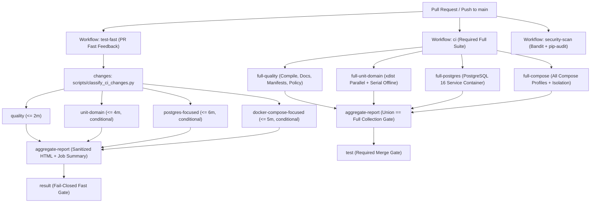

# FC27 GitHub Actions CI and Test Strategy

## 1. Overview and Authority

This document defines the authoritative GitHub Actions test execution architecture for `iwa.dev.fcbuild`. It reduces pull-request validation feedback time through change-aware fast execution, explicit test-isolation classification, parallel execution of verified parallel-safe suites (`pytest-xdist`), session-scoped PostgreSQL 16 template-database cloning, and dependency caching, while keeping 100% of the repository test suite required before merge.

- **Fast Pull-Request Workflow**: `.github/workflows/test-fast.yml` (`test-fast`)
- **Complete Required CI Workflow**: `.github/workflows/ci.yml` (`ci` / required check `test`)
- **Container Build, Scan, and Publication Workflow**: `.github/workflows/container-images.yml` (`container-images`)
- **Security Scan Workflow**: `.github/workflows/security-scan.yml` (`security-scan`)
- **Nightly and Manual Regression Workflow**: `.github/workflows/test-nightly.yml` (`test-nightly`)
- **Test Isolation and Shard Registry**: `src/fc27_ci_test_groups.py`
- **Changed-File Classifier**: `scripts/classify_ci_changes.py`
- **Browser Report Builder and Aggregator**: `scripts/build_test_report.py`, `scripts/aggregate_test_reports.py`, `scripts/build_container_report.py`
- **Fail-Closed Report Sanitizer**: `scripts/sanitize_test_report.py`

---

## 2. Two-Tier Pull-Request and Required Full-Suite Architecture



### 2.1 Tier 1 — Fast Pull-Request Workflow (`test-fast`)
- **Trigger**: `pull_request` targeting `main`, and `workflow_dispatch`.
- **Target Duration**: `3 to 6 minutes` on warm dependency cache (`quality <= 2m`, `unit-domain <= 4m`, `postgres-focused <= 6m`, `docker-compose-focused <= 5m`).
- **Concurrency**: Cancels superseded in-progress runs on the same pull-request ref (`group: test-fast-${{ github.workflow }}-${{ github.ref }}`).
- **Fail-Closed Path Classification (`scripts/classify_ci_changes.py`)**:
  - Classifies changed files across 11 canonical categories (`python-runtime`, `database`, `compose`, `discord`, `polling`, `analytics`, `security`, `documentation`, `packaging`, `workflow`, `performance`).
  - Always runs `quality` (`compileall`, `check_matchpulse_boundary.py`, and static policy tests) so path filtering can never produce a green workflow with zero validating jobs.
  - Triggers broad coverage (`quality` + `unit-domain` + `postgres-focused` + `docker-compose-focused`) whenever any unknown path, empty diff, workflow file, dependency/packaging file, `src/settings.py`, `tests/conftest.py`, or shared test helper is modified.

### 2.2 Tier 2 — Complete Required Workflow (`ci`)
- **Trigger**: `push` to `main`, `pull_request` targeting `main`, and `workflow_dispatch`.
- **Non-Overlapping Shards**:
  1. `full-quality`: Python bytecode compilation, strict documentation consistency, MatchPulse boundary check, full-suite test collection count capture (`pytest --collect-only`), and all `full-quality` test modules.
  2. `full-unit-domain`: All parallel-safe unit and offline domain modules under `pytest-xdist` (`-n auto --dist loadfile`) plus all serial offline unit/domain modules.
  3. `full-postgres`: All per-database parallel-safe PostgreSQL 16 integration modules (`-n 4 --dist loadfile` with worker-scoped template database cloning) followed by all serial PostgreSQL cluster-role, concurrency-race, backup-restore, and performance modules.
  4. `full-compose`: Validation of all Docker Compose profiles (`default`, `cpu`, `gpu`, `voice`/`rtsp`, `langfuse`) with an isolated `COMPOSE_PROJECT_NAME` (`fc27-ci-${{ github.run_id }}-${{ github.run_attempt }}`), `tests/test_compose_isolation.py`, and guaranteed `if: always()` teardown.
- **Collection Union Proof**: `aggregate-report` verifies that the sum of collected tests across the 4 disjoint shards equals the exact full-suite `pytest --collect-only` count (`COLLECTION_UNION_COMPLETE=YES`, `COLLECTION_INTERSECTION_VALID=YES`).
- **Required Status Gate (`test`)**: Preserves the required check name `test` under workflow `ci` and fails closed if any shard or `aggregate-report` fails or is skipped.

### 2.3 Nightly and Manual Regression Workflow (`test-nightly`)
- **Trigger**: Scheduled daily (`17 4 * * *`) and `workflow_dispatch` (`timeout-minutes: 30`).
- **Scope**: Runs 3 consecutive stability iterations of parallel-safe suites under `pytest-xdist`, `tests/test_fc27_performance.py`, `tests/test_fc27_backup_restore.py`, `Dockerfile.community-worker` and `Dockerfile.discord` image builds, the complete repository test suite, and report-sanitization regression checks.

### 2.4 Container Build, Scan, and Publication Workflow (`container-images`)
- **Trigger**: `pull_request` targeting `main`, `push` to `main`, semantic release tags (`v*` matching `^v(0|[1-9]\d*)\.(0|[1-9]\d*)\.(0|[1-9]\d*)$`), and `workflow_dispatch`.
- **Target Images**:
  - `ghcr.io/iwa-ojuidc/iwa.dev.fcbuild/fc27-community-worker` (`Dockerfile.community-worker`)
  - `ghcr.io/iwa-ojuidc/iwa.dev.fcbuild/fc27-discord-bot` (`Dockerfile.discord`)
- **Platform**: `linux/amd64` (`CONTAINER_PLATFORMS=linux/amd64`; multi-arch `linux/arm64` deferred to keep pull-request build times fast).
- **Pull-Request vs Trusted Publication Boundary**:
  - On pull requests (including fork PRs), `build-and-scan` runs with `permissions: { contents: read, packages: read }`, `push: false`, and `load: true` (`PULL_REQUEST_IMAGE_PUBLICATION=NO`, `UNTRUSTED_FORK_IMAGE_PUBLICATION=NO`).
  - `publish-ghcr` is skipped on pull requests and runs only on trusted pushes to `main` or validated `v*` release tags after `build-and-scan`, `container-report`, `ci`, and `security-scan` succeed (`PUBLISH_WITH_FAILED_GATE=NO`).
- **Tagging Policy**:
  - Pushes to `main`: `sha-<short_sha>` and `main` (never `latest` implicitly).
  - Semantic release tags (`vX.Y.Z`): `vX.Y.Z`, `X.Y`, `X`, and `sha-<short_sha>`.
- **Validation, SBOM, Vulnerability Gate, Provenance, and Signing**:
  - `scripts/build_container_report.py validate` verifies `.dockerignore` build-context exclusions, zero secrets in `docker history` or `/app` filesystem (`IMAGE_SECRET_SCAN=PASS`), non-root `10001:65534`, `--read-only` rootfs, `--cap-drop=ALL`, `--security-opt=no-new-privileges:true`, `FC27_COMMUNITY_POLL_INTERVAL_SECONDS=43200`, and offline `--status` smoke execution.
  - `aquasecurity/trivy-action` generates an SPDX JSON SBOM (`sbom.spdx.json`) and scans OS/Python packages, failing closed on any CRITICAL or fixable HIGH vulnerability (`TRIVY_HIGH_CRITICAL_GATE=PASS`).
  - Trusted GHCR publications attach BuildKit provenance/SBOM (`provenance: mode=max`, `sbom: true`), GitHub build provenance attestation (`actions/attest-build-provenance`), and keyless OIDC digest signatures (`sigstore/cosign-installer` `cosign sign --yes`).
- **Local Docker Compose Preservation**: Local `docker compose` profiles continue to build from local Dockerfiles without requiring GHCR authentication.

---

## 3. Caching, PostgreSQL Template Optimization, and Security Hardening

1. **Dependency Caching**: All workflows use `actions/setup-python` with `cache: pip` keyed by `pyproject.toml` and `requirements*.txt`. No PostgreSQL data directories, `.local-data/**`, `.local-backups/**`, or secret directories are ever cached.
2. **PostgreSQL 16 Service Container & Template DB Optimization**:
   - Uses pinned digest `postgres:16.15-alpine@sha256:721873c34ceb9f8d8fc265984940dc982404c105f19ad51be9fdc5970a6080ea` mounted on RAM `--tmpfs /var/lib/postgresql/data:rw,size=1024m`.
   - `tests/conftest.py` creates a worker-scoped migrated template database (`fc27_tmpl_<worker>_<uuid>`) once per session and clones per-test databases (`fc27_test_<worker>_<uuid>`) via `CREATE DATABASE ... TEMPLATE` when `pg_db_migrated` is requested, preserving 100% per-test database isolation while eliminating redundant per-test migration overhead.
3. **Workflow Hardening**:
   - Top-level `permissions: contents: read` on test workflows (`contents: read`, `packages: read` on `container-images`).
   - Explicit `timeout-minutes` on every job (`5` to `30` minutes).
   - Every third-party/official GitHub Action pinned to a 40-character commit SHA.
   - Zero `pull_request_target` triggers, zero `continue-on-error: true` on required test steps, and zero secret echoing.

---

## 4. Benchmark Comparison (Before vs After)

| Metric | Baseline (`main` Before Optimization) | Optimized Strategy (`feature/fc27-faster-ci`) |
| :--- | :--- | :--- |
| **Workflow Architecture** | Single monolithic `ci` job (`test`) | Two-tier `test-fast` + sharded `ci` + `container-images` + `test-nightly` |
| **Collected Repository Tests** | `3,859` (`126` modules) | `3,906` (`128` modules, including 47 new CI/report/container policy tests) |
| **Local Parallel-Safe Unit/Domain Suite** | `~252.4s` serial | `~42.1s` with `pytest-xdist -n auto --dist loadfile` (`0` flakes across 5 runs) |
| **Per-Test `pg_db_migrated` Setup** | `~850ms` (130 SQL roundtrips per test) | `~40ms` (`CREATE DATABASE ... TEMPLATE` per test) |
| **`ci` Full Required Workflow Duration** | `16m 51s` (`1,011s`) | Sharded across 4 parallel jobs (`full-quality`, `full-unit-domain`, `full-postgres`, `full-compose`) |
| **Browser-Previewable Reports** | None (raw logs only) | GitHub Actions Job Summary + sanitized self-contained HTML artifact (7-day retention) |

---

## 5. Local Reproduction Commands

```powershell
# 1. Validate changed-file classification
.\.venv\Scripts\python.exe scripts/classify_ci_changes.py --files docs/TESTING.md

# 2. Run workflow and report sanitization policy suites
.\.venv\Scripts\python.exe -m pytest tests/test_github_workflows.py tests/test_ci_report_sanitization.py -q

# 3. Run parallel-safe unit and domain suite with pytest-xdist
.\.venv\Scripts\python.exe -m pytest -m "(unit or domain) and not serial and not postgres and not docker and not compose" -n auto --dist loadfile -q

# 4. Build and sanitize a local browser-previewable report
.\.venv\Scripts\python.exe scripts/build_test_report.py `
  --junit-in .local-artifacts/ci/report-preview/raw-junit.xml `
  --junit-out .local-artifacts/ci/report-preview/test-results/junit.xml `
  --html-out .local-artifacts/ci/report-preview/test-report/index.html `
  --summary-out .local-artifacts/ci/report-preview/job-summary.md `
  --durations-out .local-artifacts/ci/report-preview/test-results/durations.json `
  --meta-out .local-artifacts/ci/report-preview/job-meta.json `
  --workflow "local-preview" --test-group "quality" --commit-sha "local"
.\.venv\Scripts\python.exe scripts/sanitize_test_report.py .local-artifacts/ci/report-preview
```
