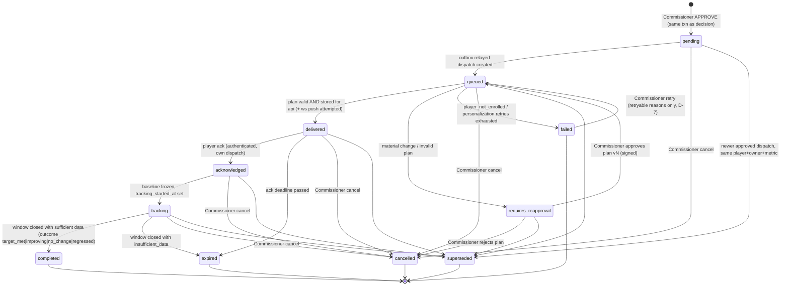

> Archived document
>
> This file is retained for historical context and is not an authoritative
> operational guide. See `docs/ARCHITECTURE.md, docs/FC27_DATA_MODEL.md, and docs/DISPATCH_ACTIVATION.md` for the current implementation.
> Archived on `2026-10-29` from `docs/superpowers/specs/2026-10-02-player-dispatch-design.md`.
>
> Warning: Do not execute commands in this archived document.

# Player observer agents and approved-recommendation dispatch: architecture specification

| | |
|---|---|
| Status | **DRAFT. Awaiting Commissioner approval. No implementation may begin before approval.** |
| Date | 2026-10-02 |
| Repository | `iwa-ojuidc/iwa.dev.fcbuild` (base `main` @ `13a6d19`) |
| Scope tags | `fc_version: "27"`, `platform: "common-gen5"` |

Labels used in this document:

- **[A-n]** marks an assumption. It must be confirmed or corrected during review.
- **[D-n]** marks an unresolved decision. It must be answered before or during implementation planning. Each one lists a recommended default.

---

## 1. Goals and non-goals

### Goals
1. When the Commissioner approves a recommendation, the system must turn it into a durable, auditable **dispatch** addressed to exactly one player. The approval and the dispatch commit together, or not at all.
2. A per-player agent turns the approved recommendation into a **personalized action plan** for that player. It may only reformat, explain, break the objective into steps, add drills and propose metrics. It may never change the objective, the target player or the scope.
3. A **deterministic policy check** validates every generated plan before delivery. Any material change goes back to the Commissioner for re-approval.
4. The approved instruction and the plan reach the player through the **authenticated dashboard API and a per-player WebSocket feed**.
5. The player **acknowledges** receipt with their own authenticated identity.
6. A **tracker** compares observations from the following matches against a recorded baseline using deterministic calculations. It then reports one of: `insufficient_data`, `no_change`, `improving`, `target_met`, `regressed`, `expired` or `tracking_error`.
7. Progress and outcomes are reported back to the coach and analyst layers and become input to later graph runs.
8. Every step is auditable:
   - the approval
   - each plan version
   - each delivery attempt
   - the acknowledgment
   - the raw observations
   - the calculated metrics
   - the assessments

### Non-goals
- No write actions against EA or FC27. The EA Clubs API is read-only, and no component may claim it changed a build, position, tactic or any other FC27 setting. "Execution" means only human delivery, acknowledgment and follow-up tracking.
- No Discord delivery in this phase; only an adapter seam (§16).
- Voice cannot deliver authoritatively, acknowledge, approve, modify or complete anything (§17).
- No dashboard UI in this phase. "Dashboard" means the authenticated HTTP API that a UI will use [A-1].
- No permanently running process or model instance per player (§6).
- No automatic approval of re-personalized plans.

---

## 2. Approval-to-dispatch semantics

### 2.1 What the Commissioner approves
The existing signed decision binds the following fields:

- `thread_id`
- `decision`
- `owner`
- `selection`
- `candidate_id`
- `player_id`
- `notes`
- `package_version`
- `nonce`
- `issued_at`
- `expires_at`

The sources are `src/approval.py` (`SIGNED_FIELDS`) and `src/approval_store.py`.

This specification defines that an `APPROVE` decision authorizes exactly:
- the **recommendation**: the persisted candidate identified by `(owner, selection, candidate_id)` in the lead package at `package_version`, including its structured objective (§7.1);
- the **permitted target**: `player_id`;
- **delivery** of that recommendation to that player, with a plan that satisfies §7 and §8.

It authorizes nothing else. A `REJECT` decision creates no dispatch.

### 2.2 Atomic creation
`ApprovalStore.apply_decision` already performs four steps in one PostgreSQL transaction:

1. nonce validation and consumption
2. the conditional `awaiting_approval → approved` update
3. the `approval_audit` insert
4. the final state write

For `APPROVE`, the **same transaction** must also:

1. insert one `dispatches` row with `dispatch_status = 'pending'` (§4), populated from the persisted candidate and the signed payload;
2. insert one `dispatch_events` history row (`null → pending`);
3. insert one `outbox` row (`event_type = 'dispatch.created'`) (§5).

If any insert fails, the entire decision rolls back. Existing test `test_failed_audit_rolls_back_decision` is extended to cover the dispatch and outbox inserts. Once committed, a dispatch can never exist without its approval, and an approval can never exist without its dispatch.

### 2.3 Source references
| Field | Source |
|---|---|
| `approval_id` | `approval_audit.id` |
| `approval_payload_hash` | `approval_nonces.payload_sha256` (SHA-256 of the canonical signed payload) |
| `created_by_authenticated_principal` | The authenticated principal's name (`COMMISSIONER_ID`), never a body field |

### 2.4 Legacy state
The old `state["dispatch"]` dictionary inside `graph_threads.state` stays as a historical display field. It is **not** consumed by anything; the `dispatches` table is authoritative.

---

## 3. Trust boundaries

| Principal / component | May | May not |
|---|---|---|
| Commissioner (commissioner token + signing secret) | Approve or reject recommendations; approve or reject re-personalized plans; cancel dispatches | — |
| graph-api | Create dispatches inside the approval transaction; serve the player and commissioner dispatch APIs | Approve without a signed Commissioner decision |
| **dispatch-worker** (new, holds player-agent and tracker logic) | Read approved dispatches; write plans, delivery attempts, observations and assessments; relay the outbox; call MCP read tools; call local models | Read or write `graph_threads` decision fields, `approval_audit` or `approval_nonces`; hold the commissioner hash or signing secret; call EA directly |
| Player (player token) | Read **own** dispatches; acknowledge **own** dispatches; subscribe to **own** WebSocket feed | See or affect any other player's dispatch; approve, complete or modify a plan |
| Player agent (logical, inside dispatch-worker) | Produce a typed plan proposal for one dispatch | Choose its own player, persist directly, mark anything complete, contact EA |
| Voice gateway | Read an already-delivered instruction aloud | Acknowledge, approve, modify, complete or cancel |
| MCP proxy | The only EA caller (read-only) | Writes of any kind |
| Redis | Transport for notifications | Act as the source of truth for any state |

**Database least privilege [D-1].** PostgreSQL is reachable only on the internal `fc27_data` network. This spec adds a second role, `fc27_dispatch`, used by dispatch-worker.

- Grants for `fc27_dispatch`:
  - `SELECT` on `dispatches`, `players`, `dispatch_plans`
  - `INSERT` / `UPDATE` on `dispatch_plans`, `dispatch_delivery_attempts`, `player_observations`, `dispatch_assessments`, `dispatch_events` and `outbox` (publish columns only)
  - `UPDATE` on `dispatches`, **through a `SECURITY DEFINER` transition function only** (§4.3)
- Not granted: anything on `graph_threads` decision fields, `approval_audit` or `approval_nonces`.
- graph-api keeps the owner role `fc27`.
- **Recommended:** the role is created by a bootstrap script outside the migrations, using a secret `DISPATCH_DB_PASSWORD`. Migrations never contain secrets.

---

## 4. Dispatch schema and state machine

### 4.1 Player identity
- `player_id` is the **EA player identifier**: the key of `match.players[<clubId>]` in `clubs/matches` responses [A-2]. It is stored as an ASCII-digit string.
- Gamertags and display names are **untrusted presentation data**, kept in `players.display_name`.
- The current fallback in `lead_packages.players_from_dashboard` keys members by name or gamertag. That fallback must be removed or mapped through `players`. Otherwise those candidates are **not dispatchable** (§7.1, acceptance AC-5).
- A dispatch whose `player_id` has no `players` row with `active = true` and at least one active credential goes to `failed` with `last_error = 'player_not_enrolled'` [D-2].

### 4.2 Tables (migration `0003_player_dispatch.sql`)
Every timestamp is `timestamptz`. Every JSON column is `jsonb` with a `CHECK (jsonb_typeof(...) = 'object')` where relevant. All SQL is parameterized.

```sql
players(
  player_id        text PRIMARY KEY CHECK (player_id ~ '^[0-9]{1,20}$'),
  club_id          text NOT NULL CHECK (club_id ~ '^[0-9]{1,12}$'),
  display_name     text,                 -- untrusted, presentation only, <= 64 chars
  active           boolean NOT NULL DEFAULT true,
  created_at       timestamptz NOT NULL DEFAULT now()
)

player_credentials(
  credential_id    bigserial PRIMARY KEY,
  player_id        text NOT NULL REFERENCES players,
  token_sha256     text NOT NULL UNIQUE CHECK (token_sha256 ~ '^[0-9a-f]{64}$'),
  created_by       text NOT NULL,        -- commissioner principal
  created_at       timestamptz NOT NULL DEFAULT now(),
  revoked_at       timestamptz
)

dispatches(
  dispatch_id          uuid PRIMARY KEY,
  source_thread_id     text NOT NULL REFERENCES graph_threads(thread_id),
  approval_id          bigint NOT NULL UNIQUE REFERENCES approval_audit(id),
  approval_payload_hash text NOT NULL CHECK (approval_payload_hash ~ '^[0-9a-f]{64}$'),
  player_id            text NOT NULL,
  candidate_id         text NOT NULL,
  owner                text NOT NULL,          -- recommendation category (SwarmRole)
  selection            text NOT NULL,
  approved_instruction jsonb NOT NULL,         -- frozen copy of candidate + objective
  personalized_plan    jsonb,                  -- current delivered/proposed plan (copy of dispatch_plans row)
  plan_version         integer NOT NULL DEFAULT 0,
  delivery_channels    text[] NOT NULL DEFAULT '{api,websocket}',
  dispatch_status      text NOT NULL CHECK (dispatch_status IN
      ('pending','queued','delivered','acknowledged','tracking','completed',
       'expired','failed','cancelled','superseded','requires_reapproval')),
  created_at           timestamptz NOT NULL DEFAULT now(),
  delivered_at         timestamptz,
  acknowledged_at      timestamptz,
  tracking_started_at  timestamptz,
  tracking_ended_at    timestamptz,
  expiration_at        timestamptz NOT NULL,   -- acknowledgment deadline (§13)
  baseline_metrics     jsonb,
  target_metrics       jsonb,
  observation_window   jsonb,                  -- {"min_matches":n,"max_matches":m,"max_days":d}
  delivery_attempts    integer NOT NULL DEFAULT 0,
  last_error           text,
  created_by_authenticated_principal text NOT NULL,
  acknowledgment_actor text,                   -- 'player:<player_id>' of the authenticated principal
  supporting_match_ids text[] NOT NULL DEFAULT '{}',
  outcome              text CHECK (outcome IN
      ('insufficient_data','no_change','improving','target_met','regressed','expired','tracking_error')),
  outcome_evidence     jsonb,                  -- assessment_id + calculated metrics, never prose
  superseded_by        uuid REFERENCES dispatches(dispatch_id),
  fc_version           text NOT NULL DEFAULT '27' CHECK (fc_version = '27'),
  platform             text NOT NULL DEFAULT 'common-gen5'
)
-- One active dispatch per (player_id, owner, objective metric): partial unique index on
-- (player_id, owner, (approved_instruction->'objective'->>'metric'))
-- WHERE dispatch_status IN ('pending','queued','delivered','acknowledged','tracking','requires_reapproval')

dispatch_plans(                         -- append-only plan history
  dispatch_id     uuid REFERENCES dispatches,
  plan_version    integer CHECK (plan_version > 0),
  plan            jsonb NOT NULL,       -- PersonalizedPlan (§7.2)
  plan_sha256     text NOT NULL,
  validation      jsonb NOT NULL,       -- policy-check result (§8)
  status          text NOT NULL CHECK (status IN ('valid','material_change','invalid','approved_by_commissioner','rejected')),
  model           text, prompt_version text, policy_version text,
  created_at      timestamptz NOT NULL DEFAULT now(),
  PRIMARY KEY (dispatch_id, plan_version)
)

dispatch_delivery_attempts(             -- append-only
  attempt_id bigserial PRIMARY KEY, dispatch_id uuid REFERENCES dispatches,
  channel text NOT NULL CHECK (channel IN ('api','websocket','discord')),
  plan_version integer NOT NULL, attempted_at timestamptz NOT NULL DEFAULT now(),
  result text NOT NULL CHECK (result IN ('stored','pushed','no_subscriber','error')),
  error text
)

dispatch_acknowledgments(
  dispatch_id uuid PRIMARY KEY REFERENCES dispatches,   -- at most one: first valid ack wins
  player_id text NOT NULL, credential_id bigint NOT NULL REFERENCES player_credentials,
  plan_version integer NOT NULL, acknowledged_at timestamptz NOT NULL DEFAULT now()
)

player_observations(                    -- raw, deterministic, append-only
  player_id text NOT NULL, match_id text NOT NULL, match_type text NOT NULL,
  match_ts timestamptz NOT NULL, metrics jsonb NOT NULL,     -- allowlisted metrics only (§12.1)
  source text NOT NULL DEFAULT 'mcp:get_matches', ingested_at timestamptz NOT NULL DEFAULT now(),
  PRIMARY KEY (player_id, match_id)
)

dispatch_assessments(                   -- append-only
  assessment_id bigserial PRIMARY KEY, dispatch_id uuid REFERENCES dispatches,
  assessed_at timestamptz NOT NULL DEFAULT now(),
  result text NOT NULL CHECK (result IN ('insufficient_data','no_change','improving','target_met','regressed','expired','tracking_error')),
  match_ids text[] NOT NULL, calculated jsonb NOT NULL,    -- numbers only
  explanation text, explanation_model text                 -- optional model prose, kept separate
)

dispatch_events(                        -- append-only state history / audit
  event_id bigserial PRIMARY KEY, dispatch_id uuid REFERENCES dispatches,
  from_status text, to_status text NOT NULL, actor text NOT NULL,
  reason text, at timestamptz NOT NULL DEFAULT now()
)

outbox(
  outbox_id bigserial PRIMARY KEY, aggregate_type text NOT NULL, aggregate_id text NOT NULL,
  event_type text NOT NULL, payload jsonb NOT NULL, created_at timestamptz NOT NULL DEFAULT now(),
  published_at timestamptz, attempts integer NOT NULL DEFAULT 0, last_error text,
  locked_until timestamptz
)
```

Plan re-approval reuses the nonce mechanism (§8.3). Migration `0003` adds two columns to `approval_nonces`:

- `subject_type` (`'thread'` or `'dispatch_plan'`)
- a nullable `dispatch_id`

A `CHECK` constraint enforces that exactly one subject is set. `thread_id` becomes nullable for `dispatch_plan` subjects, and its foreign key stays.

### 4.3 State machine



Rules:

- **Single write path.** Status changes go **only** through `fc27_dispatch_transition(dispatch_id, from, to, actor, reason, patch jsonb)`.
  - It is a `SECURITY DEFINER` function with an allowlist of the edges in the diagram above.
  - It runs `UPDATE … WHERE dispatch_status = from`. The update affecting zero rows is a conflict.
  - It inserts the matching `dispatch_events` row in the same statement.
- **Database trigger.** A trigger enforces immutability:
  - Rows in `completed`, `expired`, `failed`, `cancelled` or `superseded` are immutable, except `last_error` and `tracking_ended_at` (both only while still `NULL`) and `superseded_by`.
  - `approved_instruction`, `player_id`, `candidate_id`, `owner`, `approval_id` and `approval_payload_hash` are immutable in **every** state.
- **Model output cannot reach `completed`.** Only the tracker's deterministic assessment (§12) can produce the `tracking → completed` edge. The transition function requires a referenced `dispatch_assessments` row whose `result` agrees with the requested `outcome`.
- **Acknowledgment edge.** The `delivered → acknowledged` edge requires a matching `dispatch_acknowledgments` row.
- **Tracking start [D-3].** The `acknowledged → tracking` edge happens immediately after the acknowledgment, in the same transaction. Tracking does not start for unacknowledged dispatches.

---

## 5. Transactional outbox

1. **Write.** The approval transaction (§2.2) and every later state change that needs a notification insert an `outbox` row in the **same** transaction as the state change.
2. **Relay.** The relay loop runs in dispatch-worker:
   1. Claim rows with `SELECT … WHERE published_at IS NULL AND (locked_until IS NULL OR locked_until < now()) ORDER BY outbox_id FOR UPDATE SKIP LOCKED LIMIT 50`.
   2. Set `locked_until = now() + 30s`.
   3. Publish to Redis, then set `published_at`.
   4. On error, increment `attempts`, store `last_error` and retry with exponential backoff, capped at 5 minutes.
   5. After 20 attempts, raise an alert event and keep retrying.
3. **Delivery semantics.** Delivery is at-least-once. Every consumer is idempotent and keys on `(dispatch_id, event_type, plan_version)`.
4. **Redis is transport only.** The Redis payload carries `{outbox_id, event_type, dispatch_id, player_id, plan_version, fc_version, platform}`. It never carries plan content, tokens or prose. Consumers re-read PostgreSQL.
5. **Startup reconciliation.** At startup, dispatch-worker scans `pending` and `queued` dispatches with no in-flight work and re-enqueues them, so a lost Redis message cannot strand a dispatch.

---

## 6. Player-agent isolation

**What a player agent is.** A player agent is a *logical* context, `PlayerAgent(player_id)`, constructed per job inside dispatch-worker from persistent state. It is not a long-lived process or model instance per player.

Each player agent:

1. Receives a job containing `dispatch_id`. It loads the dispatch and asserts `dispatch.player_id == agent.player_id`. A mismatch aborts the job.
2. Receives only minimal input:
   - the frozen approved instruction and objective
   - the player's allowlisted recent metrics (§12.1)
   - policy bounds

   It does not receive other players' data, tokens, gamertags of other players, club notes or approval payloads beyond hashes and identifiers.
3. Calls models through the existing `invoke_role("player", …)` boundary, with the existing role routing and LM Studio policy.
4. Returns a `PersonalizedPlan` (§7.2). It cannot persist anything. dispatch-worker persists the plan after validation (§8).
5. Records `model`, `prompt_version` and `policy_version` on every `dispatch_plans` row.
6. Holds no approval credential, no EA access (MCP only, read-only, through the tracker rather than the agent) and no capability to write another dispatch.

**Concurrency.** Jobs are serialised per `player_id` with a PostgreSQL advisory lock on a hash of `player_id`. Across players they run in parallel, bounded by `DISPATCH_WORKER_CONCURRENCY` (default 2).

---

## 7. Personalization constraints

### 7.1 Structured objective (prerequisite) [D-4]
The current `Candidate` has only free-text `action` and `rationale`, so there is nothing measurable to compare against. This spec therefore adds a structured objective.

1. **Extend `RoleOutput.assessments[]`** with an optional field:

   ```text
   objective = {metric, direction: "increase"|"decrease", target_delta, min_matches, max_matches}
   ```

   Constraints:
   - `metric` must come from the allowlist in §12.1.
   - `target_delta` is bounded per metric.
   - The match window must satisfy 1 ≤ `min_matches` ≤ `max_matches` ≤ 10.
2. **Copy the objective onto the `Candidate`.** `lead_packages` copies the owner role's objective for that player onto the `Candidate`.
3. **Approve only what has an objective.** A candidate without a valid objective is marked `approvable=false` for dispatch purposes. Approval of it is refused with 409 "candidate has no measurable objective" [D-4].
4. **The objective is fixed at approval.** It is part of the persisted lead package and therefore covered by `package_version` and the signed approval. The player agent copies it and can never author it.

### 7.2 PersonalizedPlan contract (Pydantic, `extra="forbid"`)
```text
approved_objective      Objective (must equal dispatch.approved_instruction.objective exactly)
player_summary          str ≤ 600
action_steps            list[Step] 1..6   Step = {title ≤ 80, detail ≤ 400, metric ∈ allowlist | null}
practice_suggestions    list[str ≤ 300] 0..6
target_metrics          {metric: {baseline: float, target: float, direction}}  (keys ⊆ {objective.metric} ∪ allowlist-secondary)
baseline_metrics        {metric: float}   (filled by the system, not the model; model value ignored and compared)
observation_window      {min_matches:int, max_matches:int, max_days:int}
completion_criteria     {metric, comparator: ">="|"<=", threshold: float, aggregate: "mean"|"last_n_mean", n:int}
explanation             str ≤ 1200
source_approval_id      int   (must equal dispatch.approval_id)
source_payload_hash     str   (must equal dispatch.approval_payload_hash)
material_change_detected bool
material_change_reason  str ≤ 400 | null
```

**System-owned fields.** The system, not the model, fills or overwrites `baseline_metrics`, `source_approval_id`, `source_payload_hash` and `approved_objective` before validation. Any difference between the model-supplied value and the system value is itself recorded as a validation finding.

---

## 8. Material-change and re-approval rules

### 8.1 Deterministic policy check (`policy_version = "dispatch-policy-v1"`)
The check is a pure function `check_plan(dispatch, plan, bounds) -> Validation{status, findings[]}`. Its status is:

- **`material_change`** if any of the following holds:
  - Target player differs: the plan names or addresses a `player_id` other than `dispatch.player_id`, or mentions any other enrolled player's display name.
  - Category differs: `owner`.
  - `approved_objective` ≠ the frozen objective (metric, direction, target_delta).
  - `candidate_id` differs, or the plan references another candidate.
  - Target bounds exceeded: the target differs from `baseline + objective.target_delta` by more than ±`bounds.tolerance[metric]`, or falls outside the physical range of the metric.
  - Observation window outside the approved `[min_matches, max_matches]`, or `max_days` > 30.
  - The model sets `material_change_detected = true`.
- **`invalid`** if the plan contains prohibited content:
  - Claims or instructions to change FC27 or EA settings as an action already performed ("I changed", "has been set", "updated your build"); a regex and phrase list, case-insensitive.
  - Content mentioning approval, authorization or completion of itself.
  - URLs, contact requests or credentials.
  - Instructions directed at other players.
- **`valid`** otherwise.

A plan may *suggest* that the player consider a build or position change within the objective. That is allowed advice, never a performed action.

### 8.2 Outcomes
| Status | Action |
|---|---|
| `valid` | Persist `dispatch_plans(status='valid')`, deliver (§9), then `queued → delivered`. |
| `invalid` | Retry personalization up to 2 times with the findings fed back. If it is still invalid, `→ requires_reapproval` with the best plan as a reviewable proposal. |
| `material_change` | Persist the proposal, then `→ requires_reapproval`. Notify the Commissioner via the outbox `dispatch.requires_reapproval`. **Never deliver under the original approval.** |

### 8.3 Re-approval
1. `GET /commissioner/dispatches?status=requires_reapproval` lists pending plans with their findings.
2. The Commissioner approves or rejects a specific `(dispatch_id, plan_version, plan_sha256)` through the existing challenge, sign, submit pattern:
   - `POST /dispatches/{id}/plan-challenge`, then `POST /dispatches/{id}/plan-decision`.
   - Signed fields: `dispatch_id`, `plan_version`, `plan_sha256`, `decision`, `nonce`, `issued_at`, `expires_at`, `notes`.
   - The nonce is stored in `approval_nonces` with `subject_type='dispatch_plan'`.
3. On approval:
   - set `dispatch_plans.status = 'approved_by_commissioner'`;
   - set `requires_reapproval → queued`;
   - delivery proceeds with that exact plan version and **no further personalization**.
4. On rejection: `→ cancelled`.
5. Approving a re-personalized plan **never** changes `player_id`, `candidate_id` or the frozen objective. Those require a new graph run and a new approval.

---

## 9. Dashboard and WebSocket delivery

**Delivery adapters.** Delivery goes through an adapter interface:

```python
class DeliveryAdapter(Protocol):
    channel: str                                   # 'api' | 'websocket' | later 'discord'
    def deliver(self, dispatch: DispatchView, plan: PersonalizedPlan) -> DeliveryResult  # stored|pushed|no_subscriber|error
```

- **`api`:** marks the plan as retrievable. Delivery counts as successful when the plan is persisted and visible through `GET /player/dispatches/{id}`. This is the authoritative channel.
- **`websocket`:** sends a per-player notification `{type:"dispatch.delivered", dispatch_id, plan_version}` to that player's authenticated sockets only. It carries no plan content; the client fetches the plan over the API.
  - `no_subscriber` is not an error.
  - The WebSocket is served by **graph-api** (`/player/ws`), which has the database access needed for player authentication. The existing club-wide `ws-server` broadcast never carries dispatch content [D-5].
- **Delivery status.** `delivered` requires `api` = `stored`. Every attempt writes `dispatch_delivery_attempts` and increments `dispatches.delivery_attempts`.

---

## 10. Authentication and player identity mapping

1. **Issuing credentials.** The Commissioner issues player credentials with `scripts/commissioner_decide.py player enroll <player_id> [--display-name …]`, which calls `POST /commissioner/players` and `POST /commissioner/players/{id}/credentials` (commissioner role).
   - The response shows the token **once**.
   - Only its SHA-256 is stored.
   - Tokens are at least 32 random bytes.
   - Tokens can be revoked with `revoked_at` [D-2].
2. **Header and principal.** The header is `X-Player-Token`, authenticated with `hmac.compare_digest` over the SHA-256 digest. The principal is `Principal(role=player, name="player:<player_id>")`. The player role is distinct from the service and commissioner roles. A service or commissioner token on a player route returns 403, and a player token on any other route returns 403.
3. **Per-player scoping.** Every player route filters `WHERE player_id = principal.player_id`. Another player's `dispatch_id` returns **404**, not 403, so existence is not disclosed.
4. **WebSocket handshake.** The handshake uses the same token, via `Authorization: Bearer` or the `fc27.player.<token>` subprotocol. It applies the existing Origin allowlist and message limits.
5. **Display names.** Gamertags are never used for authentication or authorization.

---

## 11. Acknowledgment semantics

- `POST /player/dispatches/{id}/ack` with body `{plan_version}`.
- **Allowed only** from a player principal whose `player_id` matches, on a dispatch in `delivered`, for the delivered `plan_version`.
- **Idempotent:**
  - The first valid acknowledgment inserts `dispatch_acknowledgments`, transitions `delivered → acknowledged → tracking`, and freezes the baseline.
  - A repeat by the same player returns `200` with the original `acknowledged_at`.
  - A stale `plan_version` returns `409`.
  - A different player gets `404`.
  - Any non-player principal gets `403`.
- **Meaning.** Acknowledgment means receipt and acceptance of responsibility to review the plan, nothing more. The API response and the UI text must say so. The acknowledgment never sets `outcome` and never implies a change to FC27.
- **Voice** has no acknowledgment route (§17).

---

## 12. Baseline and follow-up tracking

### 12.1 Metric allowlist (deterministic, per player per match) [D-6]
Each metric is derived from `clubs/matches` `players[clubId][player_id]`:

| Metric | Formula | Physical range |
|---|---|---|
| `pass_accuracy` | passesmade / max(passattempts, 1) × 100 | 0–100 |
| `rating` | rating | 0–10 |
| `goals` | goals | 0–30 |
| `assists` | assists | 0–30 |
| `tackle_success` | tacklesmade / max(tackleattempts, 1) × 100 | 0–100 |
| `shot_accuracy` | shotsontarget / max(shots, 1) × 100 | 0–100 |

Matches where the player has fewer than 1 attempt for a ratio metric are excluded for that metric, not counted as zero.

### 12.2 Baseline
- The baseline is the mean of the metric over the player's last **N = 5** matches strictly before `dispatches.created_at`.
- It is computed at plan generation (shown in the plan) and **frozen at acknowledgment** into `baseline_metrics`, together with its match IDs.
- With fewer than 3 baseline matches, the baseline is marked `provisional`, and the result can be no stronger than `insufficient_data` until the window ends.

### 12.3 Observations
- dispatch-worker consumes `fc27:match:end` and polls MCP `get_matches` as a fallback.
- For each `tracking` dispatch it inserts `player_observations` rows. These are idempotent on `(player_id, match_id)` and are only for matches after `tracking_started_at`.
- Raw allowlisted values are stored. No model is involved.

### 12.4 Assessment (pure function, `tracker-v1`)
Inputs:

- the observations in the window
- the frozen baseline
- `completion_criteria`
- `noise = max(policy_min_delta[metric], baseline_stdev)`

Results, checked in order:

1. `tracking_error`: the data source failed (recorded; the dispatch stays in `tracking`). After 5 consecutive errors, `→ failed`.
2. `insufficient_data`: fewer than `min_matches` observations.
3. `target_met`: the aggregate meets the threshold over at least `min_matches`. A single match counts only if the approved `completion_criteria.n == 1`.
4. `regressed`: the aggregate is worse than baseline by more than `noise`, in the objective's direction.
5. `improving`: the aggregate is better than baseline by more than `noise`, but the target is not met.
6. `no_change`: otherwise.

`expired` is applied when the window closes, meaning `max_matches` observed or `max_days` elapsed, and the final result is `insufficient_data`.

**Window close.** The final assessment sets `outcome` and drives `tracking → completed` (any result other than `insufficient_data`) or `tracking → expired`. Interim assessments are recorded but do not end tracking, **except** `target_met`, which may end tracking early once `min_matches` is satisfied.

**What an assessment stores.** Every assessment stores `match_ids` and the `calculated` numbers (per-match values, aggregate, baseline, delta, noise, threshold). An optional model explanation is stored separately in `explanation` and never alters `result`.

### 12.5 Reporting to the coach and analyst layers
1. Each assessment emits outbox `dispatch.progress`. The window close emits `dispatch.outcome`.
2. `GET /dispatches/reports?player_id=` (service role) returns the latest outcomes.
3. The graph's `coach` and `analyst` nodes receive the player's recent outcomes, as calculated numbers plus result labels only, in their `data` block. The role prompt treats them as untrusted data, consistent with `src/roles.py`.

---

## 13. Failure, retry, expiration, cancellation and supersession

| Situation | Behaviour |
|---|---|
| Outbox publish fails | Retry with backoff (§5). Never lose the event; the startup reconciliation re-enqueues. |
| Model unavailable or times out | Retry personalization 3 times with backoff. Then `queued → failed`, `last_error = 'personalization_unavailable'`. The Commissioner can `POST /commissioner/dispatches/{id}/retry`, which moves `failed → queued`. This is the **only** edge out of a terminal state, it is audited, and it is allowed only when the failure reason is in a retryable list [D-7]. |
| Player not enrolled | `→ failed`, `player_not_enrolled`. The Commissioner enrols the player, then retries. |
| WebSocket push fails | Record the attempt. Delivery stays successful via the API. |
| Acknowledgment deadline (`expiration_at`, default delivered_at + 7 days) passes | `delivered → expired`. |
| Commissioner cancels (`POST /commissioner/dispatches/{id}/cancel`, signed like decisions) | `→ cancelled` from any non-terminal state. In-flight jobs observe the status and stop. |
| A new approval for the same `(player_id, owner, objective.metric)` | In the same approval transaction, the older active dispatch goes `→ superseded` with `superseded_by` set. The partial unique index guarantees a single active dispatch. |
| Tracking window elapses | §12.4. |

Workers check `dispatch_status` under `FOR UPDATE` before every write. A transition that would leave a status other than the expected `from` fails with a conflict and is logged, never forced.

---

## 14. Audit and observability

- **Append-only history:** `dispatch_events`, `dispatch_plans`, `dispatch_delivery_attempts`, `dispatch_acknowledgments`, `player_observations` and `dispatch_assessments`. Database triggers reject `UPDATE` and `DELETE` on them, except `outbox` publish columns.
- **Audit CLI:** `python -m src.audit_query --dispatch <id>` shows the approval reference, plan versions with validation findings, delivery attempts, the acknowledgment, the observations, the assessments and the outcome. Secrets are redacted.
- **Langfuse (optional):** spans `dispatch.personalize`, `dispatch.policy_check`, `dispatch.deliver` and `dispatch.assess`.
  - Spans are keyed by a deterministic trace ID from `dispatch_id`, linked to `source_thread_id`.
  - Metadata includes `fc_version`, `platform`, `plan_version` and `policy_version`.
  - Plan content follows `LANGFUSE_CAPTURE_CONTENT` (default off).
- **Metrics and logs:** counts by state, outbox lag, personalization failure rate and tracking errors. Logs never contain tokens, plan text or display names.

---

## 15. Privacy and data minimization

- **Stored per player:** stable ID, optional display name, token hashes, allowlisted per-match metrics and dispatch artefacts. No email, real names, EA account data or chat content.
- **Model inputs** are limited to the frozen objective, that player's allowlisted metrics and policy bounds. Display names are excluded from model input by default.
- **Retention [D-8]:**
  - `player_observations` older than 180 days, and not referenced by an active dispatch, are deleted by a scheduled job.
  - Dispatch records and audit history are retained.
  - Display names can be erased on request (set to NULL) without breaking the audit.
- **Visibility:** players see only their own dispatches. The Commissioner sees all of them.

---

## 16. Discord adapter seam

- `DeliveryAdapter` (§9) allows `channel='discord'` in schema enums.
- **Not implemented in this phase.** Adding it later requires:
  - a bot token secret
  - a `player_id → discord_user_id` mapping, verified by the Commissioner
  - a DM or channel policy
  - an interaction contract for acknowledgment that maps a Discord user to `player_id`

  None of these exist in the repository today. A Discord acknowledgment would have to resolve to the same `dispatch_acknowledgments` rules (§11).
- The approval and dispatch domain model does not change when Discord is added.

---

## 17. Voice limitations

- The voice gateway may call `GET /player/dispatches/{id}/briefing` using a **player** token supplied by the player's own device session.
- That call returns the plain-text plan for TTS, only for dispatches in `delivered`, `acknowledged` or `tracking`.
- Voice has no route to acknowledge, approve, cancel, modify or complete.
- The existing `parse_command` blocklist is extended with `acknowledge`, `ack`, `complete`, `done`, `confirm`, `accept`. These words produce `confirmation_required`, never an action.
- The voice gateway's own `GRAPH_SERVICE_TOKEN` cannot read player plans; the service role is not permitted on `/player/*`.

---

## 18. Database migrations

**`0003_player_dispatch.sql`** contains:

- the tables in §4.2
- the `approval_nonces` subject columns and constraint
- the `fc27_dispatch_transition()` function with its edge allowlist
- the immutability and append-only triggers
- the partial unique index for supersession
- the indexes:
  - `dispatches(player_id, dispatch_status)`
  - `outbox(published_at) WHERE published_at IS NULL`
  - `player_observations(player_id, match_ts)`

It is forward-only and idempotent where possible. It applies cleanly to databases at `0002`.

**Bootstrap** (not a migration):
- `scripts/bootstrap_dispatch_role.sql`, run by the operator, creates `fc27_dispatch` and its grants [D-1].
- Compose adds the `dispatch-worker` service, on `fc27_net` + `fc27_data`, with:
  - `POSTGRES_URI` for the `fc27_dispatch` role
  - `MCP_API_TOKEN`
  - `REDIS_URL`
  - model config
  - **no** `GRAPH_*` approval or commissioner secrets

`tests/test_compose_isolation.py` is extended to cover it.

---

## 19. API and event contracts

### 19.1 HTTP (graph-api)
| Method and path | Role | Purpose |
|---|---|---|
| `POST /commissioner/players` | commissioner | Enrol `{player_id, club_id, display_name?}` |
| `POST /commissioner/players/{player_id}/credentials` | commissioner | Issue a token (shown once) |
| `DELETE /commissioner/players/{player_id}/credentials/{credential_id}` | commissioner | Revoke |
| `GET /commissioner/dispatches?status=&player_id=` | commissioner | List dispatches |
| `GET /commissioner/dispatches/{id}` | commissioner | Full detail with plans, findings and history |
| `POST /dispatches/{id}/plan-challenge` → `POST /dispatches/{id}/plan-decision` | commissioner | Signed plan re-approval (§8.3) |
| `POST /commissioner/dispatches/{id}/cancel` (challenge + signed) | commissioner | Cancel |
| `POST /commissioner/dispatches/{id}/retry` | commissioner | `failed → queued` (retryable reasons only) |
| `GET /player/dispatches` | player | Own dispatches (summary) |
| `GET /player/dispatches/{id}` | player | Own dispatch: approved instruction, current delivered plan, status, progress |
| `POST /player/dispatches/{id}/ack` `{plan_version}` | player | Acknowledge (§11) |
| `GET /player/dispatches/{id}/briefing` | player | Text for voice TTS (§17) |
| `GET /player/ws` | player | WebSocket notifications |
| `GET /dispatches/reports?player_id=` | service | Outcomes for the coach and analyst layers |

**Errors.** Routes return 401, 403, 404 (not yours, or unknown), 409 (state conflict or stale `plan_version`) and 422 (schema). Every response includes `fc_version` and `platform`.

### 19.2 Redis events (transport only; consumers re-read PostgreSQL)
| Channel | Payload |
|---|---|
| `fc27:dispatch:created` | `{outbox_id, dispatch_id, player_id, fc_version:"27", platform:"common-gen5"}` |
| `fc27:dispatch:requires_reapproval` | `{outbox_id, dispatch_id, plan_version, findings_count}` |
| `fc27:dispatch:delivered` | `{outbox_id, dispatch_id, player_id, plan_version}` |
| `fc27:dispatch:acknowledged` | `{outbox_id, dispatch_id, player_id}` |
| `fc27:dispatch:progress` | `{outbox_id, dispatch_id, assessment_id, result}` |
| `fc27:dispatch:outcome` | `{outbox_id, dispatch_id, outcome}` |
| `fc27:dispatch:terminal` | `{outbox_id, dispatch_id, status}` (`expired`, `failed`, `cancelled` or `superseded`) |

### 19.3 Player WebSocket messages
`{type, dispatch_id, plan_version?, status?, at}`, with `type` one of:

- `dispatch.delivered`
- `dispatch.status`
- `dispatch.progress`

Messages carry no plan text, other players or tokens.

---

## 20. Threat model

| # | Threat | Vector | Control |
|---|---|---|---|
| T1 | Unapproved instruction reaches a player | Model rewrites the objective or targets a different player | Frozen objective (§7.1); system-owned fields; deterministic check (§8); `material_change` goes to re-approval; the trigger makes `approved_instruction`, `player_id` and `candidate_id` immutable |
| T2 | Player agent acts across players | Prompt injection through data | Per-job assertion `dispatch.player_id == agent.player_id`; per-player advisory lock; minimal inputs; the agent cannot persist |
| T3 | Forged completion | Model or player claims success | Only a tracker assessment with match IDs can reach `completed`, enforced in the transition function |
| T4 | False acknowledgment | Another player, voice or a service token | Player-token principal; `player_id` match; 404 for others; 403 for non-player roles; no voice route |
| T5 | Lost or duplicated notification | Redis down, crash after commit | Outbox in the same transaction; at-least-once relay; idempotent consumers; startup reconciliation |
| T6 | Dispatch without approval, or approval without dispatch | Partial commit | A single transaction (§2.2); rollback test |
| T7 | DB credential misuse by dispatch-worker | Compromised worker approves threads | Separate `fc27_dispatch` role with no rights on decision tables; existing terminal trigger [D-1] |
| T8 | Claim of an FC27 change | Model text "I changed your build" | Prohibited-phrase check → `invalid`; contract wording; no EA write path exists |
| T9 | Data leakage to models or traces | Gamertags or other players' stats in prompts | Data minimization (§15); Langfuse content capture off by default; display names excluded |
| T10 | Replay of a plan approval | Re-submitting a signed plan decision | Nonces bound to `(dispatch_id, plan_version, plan_sha256)`, single use, short TTL |
| T11 | Player-token theft | Token in logs or URLs | Tokens only in headers or subprotocol; hashed at rest; revocable; never logged |
| T12 | Denial of service via the WebSocket | Many sockets per player | Per-player socket cap (default 3); global cap; message size and idle limits |
| T13 | Stale plan acknowledged | Acknowledgment after re-approval changed the plan | The acknowledgment must match the delivered `plan_version`, otherwise 409 |

---

## 21. Test and acceptance criteria

The project already runs its database tests against real PostgreSQL. Every criterion below is an automated test unless it says manual.

- **AC-1:** `APPROVE` creates exactly one `pending` dispatch, one `dispatch_events` row and one `outbox` row **in the decision transaction**. Injecting a failure into any of those inserts rolls back the decision, the audit row and the nonce consumption. `REJECT` creates none.
- **AC-2:** The dispatch's `approval_id`, `approval_payload_hash`, `player_id`, `candidate_id`, `owner` and `approved_instruction` equal the signed payload and the persisted candidate. A trigger rejects later `UPDATE`s of these columns.
- **AC-3:** Outbox. Killing the relay after the commit and before publishing, then restarting, delivers the event exactly once to an idempotent consumer. With Redis down, rows accumulate and publish after recovery.
- **AC-4:** The state machine accepts every edge in §4.3 and rejects every other edge (exhaustive matrix). Terminal rows are immutable apart from the listed metadata.
- **AC-5:** A candidate without a structured objective, or keyed by gamertag, cannot be approved for dispatch (409).
- **AC-6:** The player agent for player A refuses a dispatch for player B. Concurrent jobs for one player are serialised.
- **AC-7:** Policy check. Each material-change rule in §8.1 on its own causes `requires_reapproval`, with the specific finding recorded and **no** delivery. A valid plan is delivered. Prohibited phrases yield `invalid`, then retries, then `requires_reapproval`.
- **AC-8:** Plan re-approval. A signed approval of `(dispatch_id, plan_version, plan_sha256)` delivers that exact plan. A tampered hash or version, a replayed nonce or an expired challenge is rejected. A rejection moves the dispatch to `cancelled`.
- **AC-9:** Delivery. `delivered` requires the API to be `stored`. A WebSocket subscriber of player A receives a notification for A's dispatch only, and a subscriber of player B receives nothing. Notifications contain no plan text.
- **AC-10:** Acknowledgment. The owner's acknowledgment succeeds once, and a repeat is idempotent. Another player gets 404, service and commissioner tokens get 403, and a stale `plan_version` gets 409. Voice transcripts containing "acknowledge" or "done" produce `confirmation_required`.
- **AC-11:** Tracking. Using fixture match series, each result is produced deterministically: `insufficient_data`, `no_change`, `improving`, `target_met` (single-match only when `n == 1`), `regressed`, `expired` and `tracking_error` → `failed`. Every assessment lists its match IDs and numbers, and a model explanation never changes `result`.
- **AC-12:** Only a tracker assessment can move a dispatch to `completed`. A direct transition without an assessment, or with a mismatched one, is rejected.
- **AC-13:** A new approval for the same `(player_id, owner, metric)` supersedes the older active dispatch atomically.
- **AC-14:** An unacknowledged dispatch past `expiration_at` moves to `expired`.
- **AC-15:** Compose isolation. dispatch-worker has no commissioner or signing material, uses the `fc27_dispatch` role, and that role cannot `UPDATE` `graph_threads` or insert `approval_audit`.
- **AC-16:** Audit. `audit_query --dispatch` shows the complete chain (approval → plans → attempts → acknowledgment → observations → assessments → outcome), with no tokens or signatures.
- **AC-17:** No component contains a code path that calls EA other than the MCP proxy, which a static test checks. No text produced for players asserts that an FC27 setting was changed.
- **AC-18 (manual):** End to end with the real stack. Approve, receive the plan on a WebSocket test client, acknowledge, feed 3 fixture matches through the watcher and MCP mock, then observe the outcome reported in a following graph run's coach input.

---

## 22. Assumptions and unresolved decisions

**Assumptions**
- **[A-1]** There is no dashboard UI in this phase. The authenticated API and WebSocket are the delivery surface, and a UI is a follow-up.
- **[A-2]** EA `clubs/matches` keys `players[clubId]` by a stable numeric player identifier, separate from the display name (`playername`). **This must be verified against a captured response before implementation.** If it is false, enrolment must map a stable ID obtained elsewhere.
- **[A-3]** One club (`FC27_CLUB_ID`) per deployment.
- **[A-4]** Players use the same local or VPN network access model as the Commissioner. Exposing player endpoints beyond `127.0.0.1` needs the TLS reverse proxy already called for in the README.

**Unresolved decisions** (each with a recommended default)
- **[D-1]** A separate PostgreSQL role for dispatch-worker. **Recommended: yes**, created by a bootstrap script.
- **[D-2]** Player enrolment and credentials. **Recommended:** the Commissioner enrols players and issues per-player tokens through the CLI. Players without enrolment cause `failed: player_not_enrolled`.
- **[D-3]** Tracking starts at acknowledgment, not at delivery. **Recommended: at acknowledgment.**
- **[D-4]** Role outputs gain a structured `objective`, and candidates without one are not dispatchable. **Recommended: yes.** This changes `RoleOutput` and `Candidate`, with new tests.
- **[D-5]** The player WebSocket is served by graph-api (`/player/ws`) rather than extending `ws-server`. **Recommended: graph-api**, because it has the database access needed for auth and scoping.
- **[D-6]** The metric allowlist, `policy_min_delta`, `tolerance` per metric, N = 5 baseline matches, window bounds (1–10 matches, ≤ 30 days) and a 7-day acknowledgment deadline. **Recommended:** start with these values and tune them after real data.
- **[D-7]** The only edge out of a terminal state is the Commissioner retry `failed → queued`, limited to retryable reasons. **Recommended: yes.**
- **[D-8]** Retention: 180 days for unreferenced raw observations. **Recommended: yes.**

---

## 23. Delivery plan (after approval)

This spec is implemented as a sequence of small PRs, each with tests:

1. Migration `0003`, the transition function and triggers, the outbox, and atomic dispatch creation in `apply_decision` (AC-1 to AC-4).
2. Player enrolment, credentials, the player principal, and the player read and acknowledgment API (AC-10).
3. The structured objective in roles and lead packages (AC-5).
4. dispatch-worker: the relay, PlayerAgent personalization, the policy check, re-approval and API/WebSocket delivery (AC-6 to AC-9).
5. The tracker: observations, assessment and reporting to the coach and analyst layers (AC-11 to AC-14).
6. Compose and DB role isolation, audit CLI, Langfuse spans, voice blocklist and docs (AC-15 to AC-18).

The writing-plans step will turn this into a detailed implementation plan after the spec is approved.
