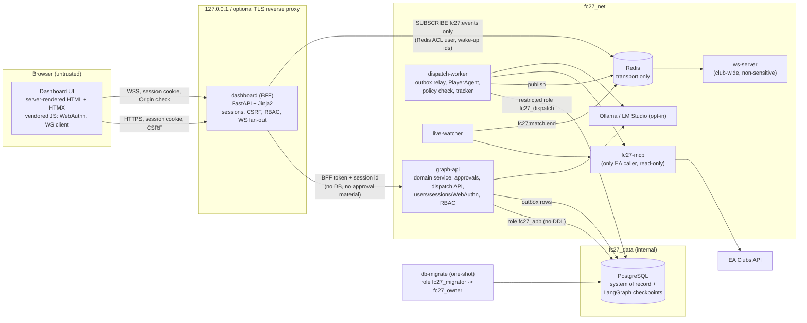
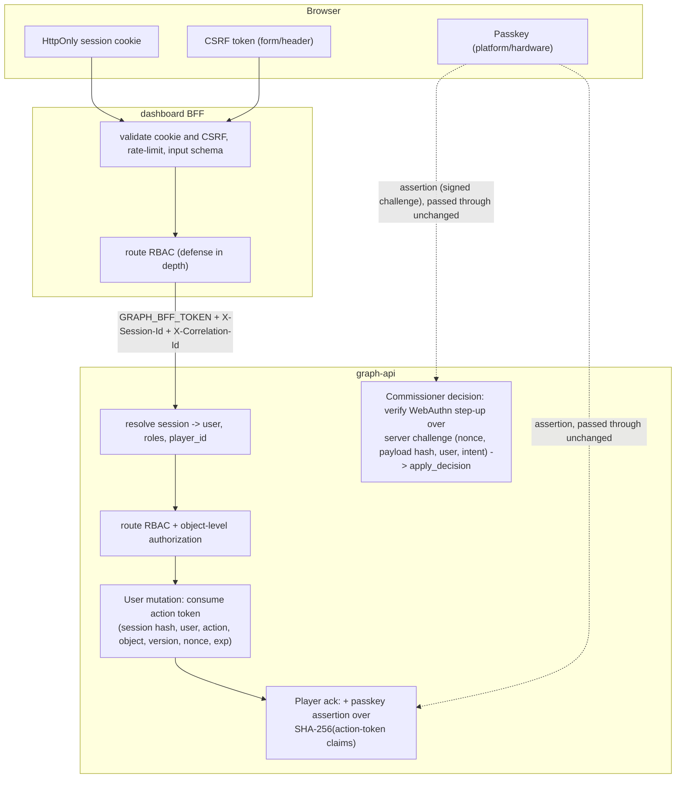

# Player dispatch, observer agents and Commissioner dashboard: architecture specification

| | |
|---|---|
| Status | **v2.1. Architecture APPROVED WITH AMENDMENTS (owner, 2026-10-02). Amendments AM-1 to AM-15 are incorporated below. Implementation is limited to Phase 1 (§31), and only after the Phase 1 plan is reviewed.** |
| Date | 2026-10-02 |
| Supersedes | v2 (`c8de704`) and v1 (`8051741`) of this file. Both stay in git history for review. |
| Repository | `iwa-ojuidc/iwa.dev.fcbuild`, base `main` @ `13a6d19` |
| Scope tags | `fc_version: "27"`, `platform: "common-gen5"` |
| Phase 1 plan | `docs/design/player-dispatch-phase1-plan.md` |

**Labels.**
- **[A-n]** marks an assumption.
- **[D-n]** marks a decision. Each decision lists the approved or recommended default and the alternative considered.
- **[AM-n]** marks an owner amendment. The owner's review numbered them A-1 to A-15. They are renamed AM-n here so they do not collide with the assumptions.
- **[G-n]** marks a rollout or activation gate (§31.2).
- MUST, MUST NOT and SHOULD are normative.

**Revision history.**

| Rev | Commit | Change |
|---|---|---|
| v1 | `8051741` | Dispatch-only, API-first draft |
| v2 | `c8de704` | Dashboard as the primary interface; 31 sections and the approval gate |
| v2.1 | this commit | Owner amendments AM-1 to AM-15; acceptance criteria AC-38 to AC-58; Phase 1 scope narrowed |

**Amendment index.**

| AM | Topic | Main sections |
|---|---|---|
| AM-1 | SECURITY DEFINER hardening and DB role ownership | §11.3, §14.0, §14.7, §25 |
| AM-2 | BFF session impersonation: action tokens and player user-presence | §6.2, §16, §18.5 |
| AM-3 | Audit source of truth | §22.1, §14.5 |
| AM-4 | Approval expiration and LangGraph state | §7.4, §21 |
| AM-5 | `DISPATCH_ENABLED` semantics | §7.5, §31.2 |
| AM-6 | Stable player ID activation gate | §13.1, §29, §31.2 |
| AM-7 | WebAuthn ceremonies | §18.4 |
| AM-8 | CLI HMAC controls | §18.6 |
| AM-9 | Identity secret storage | §18.7 |
| AM-10 | Redis and real-time data minimization | §17.5, §24 |
| AM-11 | Acknowledgment transition (model A) | §11, §19 |
| AM-12 | Personalization failure vs re-approval | §12.4 |
| AM-13 | Domain-event projection and authorization | §17.4 |
| AM-14 | One authoritative approval lifecycle record | §7.6, §14.2 |
| AM-15 | Phase gates | §31 |

---

## 1. Executive summary

When the Commissioner approves a recommendation today, the platform records a `dispatch` dictionary inside the graph thread state, and nothing ever consumes it. This specification turns an approval into an **immutable, auditable dispatch**. A constrained per-player agent **personalizes** it, a deterministic policy check **validates** it, and the result is **delivered on a dashboard**, **acknowledged** by the authenticated player, **tracked** against later matches with deterministic calculations, and **reported** back to the coach and analyst layers and to the dashboard.

A first-class **dashboard** becomes the primary human interface. It has four authorization-aware areas:

1. Commissioner
2. Coach and analyst
3. Player
4. Operations and audit

It is built as a **Python backend-for-frontend (BFF)** that serves server-rendered HTML with progressive enhancement. The BFF holds **no database credentials and no approval material**. Every action is authorized by the BFF and re-authorized by **graph-api**, the single domain service that owns PostgreSQL writes.

Commissioner decisions made in the dashboard are signed by the Commissioner's own **WebAuthn passkey**. Those signatures are verified by the same `apply_decision` service the CLI uses. A compromised BFF therefore cannot approve anything.

The EA Clubs API stays read-only. "Execution" means only that the system:

- creates an immutable dispatch;
- delivers the approved recommendation;
- generates an allowed personalized plan;
- obtains an authenticated acknowledgment;
- tracks the evidence that follows;
- reports the measured outcome.

No component may claim to have changed anything in FC27.

---

## 2. Existing-system assessment

This assessment is based on `main` @ `13a6d19`.

| Area | Current state | Consequence for this design |
|---|---|---|
| Stack | <ul><li>Python 3.11 throughout</li><li>FastAPI (graph-api, voice gateway)</li><li>stdlib HTTP (MCP)</li><li>`websockets` (ws-server)</li><li>no JavaScript toolchain anywhere in the repo</li></ul> | Favour a Python dashboard with minimal, vendored JavaScript (§28). |
| Approval | Signed decisions (`src/approval.py`): canonical JSON, HMAC-SHA256 over `SIGNED_FIELDS`, PostgreSQL nonce bound to payload hash and package version, single atomic transaction in `ApprovalStore.apply_decision` | Reuse it, and add a WebAuthn proof type to the same service (§18.4). |
| Roles | `security.py` has two roles (`service`, `commissioner`); commissioner identity comes from the credential (`COMMISSIONER_ID`) | Extend to user accounts with explicit role assignments (§10, §18). |
| Graph | LangGraph StateGraph with PostgresSaver (`durability="sync"`); approval `interrupt()`; resume re-reads the committed DB decision | The thread inspector reads real checkpoints through `GraphRunner.history` (§9 row 7). |
| Dispatch | `decision.apply_decision_to_state` writes `state["dispatch"]` and nothing consumes it | Replace it with a `dispatches` entity (§14). |
| Candidates | `Candidate` has free-text `action`/`rationale` and no measurable objective; `players_from_dashboard` falls back to gamertag keys | Add a structured objective (§12.1), and treat stable IDs as the only identity (§13.1). |
| Events | Redis pub/sub; `ws-server` broadcasts club-wide to holders of one shared token | Add per-user authorized WebSocket fan-out in the BFF; `ws-server` keeps club-wide, non-sensitive broadcasts (§17). |
| Watcher | Publishes `fc27:match:end` with `match_id`, type and payload; holds idempotent Redis state | The tracker consumes these and falls back to MCP polling (§19). |
| Data access | PostgreSQL is on the internal network `fc27_data`, reachable only by graph-api; MCP is the only EA caller | Keep both. The dispatch worker gets a restricted DB role, and the dashboard gets none (§6). |
| Tests | pytest with real PostgreSQL; Compose isolation tests; Chromium/Playwright is available in the dev environment | Add Playwright end-to-end and axe-core accessibility tests (§26). |

---

## 3. Goals and non-goals

### Goals
- **G1.** Approval of a recommendation and creation of its dispatch commit atomically, together with a transactional outbox event.
- **G2.** A per-player agent produces a personalized plan inside the approved objective. Any material change requires re-approval.
- **G3.** The dashboard is the primary interface. It delivers plans, collects authenticated acknowledgments, visualizes tracking, and supports every Commissioner, coach, analyst, operator and auditor task in §9.
- **G4.** Tracking computes measured outcomes deterministically from stored match observations, and reports them to the dashboard and to the coach and analyst graph nodes.
- **G5.** Every workflow transition and every privileged dashboard action is auditable, with a correlation ID.
- **G6.** Authorization is enforced server-side at two layers, the BFF and the domain service. The browser never holds privileged credentials.

### Non-goals
- **N1.** No writes to EA or FC27, and no wording that claims a change was made in the game.
- **N2.** No Discord delivery. An adapter seam is defined for later (§8.6).
- **N3.** Voice cannot approve, modify, acknowledge, complete or cancel anything (§8.7).
- **N4.** No per-player long-running process or model instance.
- **N5.** No public internet exposure in this phase. Bindings stay on `127.0.0.1` behind an optional TLS reverse proxy (§24).
- **N6.** No single-page-application build toolchain (§28).

---

## 4. Architectural principles

1. **PostgreSQL is the system of record.** Redis and WebSocket are transport only. The UI refetches authoritative state after events.
2. **One domain service per invariant.** Approvals go only through `ApprovalStore.apply_decision`. Dispatch status changes go only through `public.fc27_dispatch_transition()`. There is no second implementation for the dashboard.
3. **Proof, not position.** The ability to approve comes from a Commissioner proof (an HMAC signature from the CLI, or a WebAuthn assertion from the dashboard) over a server-issued, nonce-bound challenge. Network location, infrastructure access or holding a service token never grants it.
4. **Deny by default; authorize every object.** Each route declares its roles and an object-level rule. Failures return 403 or 404 without leaking whether an object exists.
5. **Deterministic numbers, advisory prose.** Measurements, thresholds and completion come from code. Model text is labelled as explanation and never changes a result.
6. **Immutability with explicit transitions.** Terminal records are immutable. Revisions, retries, cancellations and supersessions create explicit transitions and new records, never silent edits.
7. **Least data.** Every component, model prompt, event and screen receives the minimum data it needs. Gamertags and model output are always treated as untrusted text. Redis carries wake-up signals only, and every viewer sees events through an authorized projection (AM-10, AM-13).
8. **Least privilege inside PostgreSQL (AM-1).**
   - Schema objects are owned by a NOLOGIN role, `fc27_owner`.
   - Only the one-shot migration job (`fc27_migrator`) can act as that owner.
   - The runtime roles (`fc27_app` for graph-api, `fc27_dispatch` for the worker) can neither own, alter nor replace any table or function.
   - The database superuser is used only for role bootstrap.
9. **One authoritative record per fact (AM-3, AM-14).**
   - `approval_requests` owns the approval lifecycle.
   - `approval_audit` owns decisions and their cryptographic proofs.
   - `dispatch_acknowledgments` owns acknowledgments.
   - `dispatch_assessments` owns measured outcomes.
   - `domain_events` is a normalized index that points back to these records.
   - `outbox` is delivery plumbing only.
10. **Fail closed.**
    - A mismatch between linked records aborts the transaction at commit.
    - Configured flags are evaluated by graph-api, never by the BFF or browser, and stay inert until their activation gates pass.
    - Unknown identities, actors and patch keys are rejected rather than defaulted (AM-5, AM-6, AM-14).
11. **Every mutation carries a scoped, single-use proof (AM-2, AM-7).**
    - Commissioner decisions need a WebAuthn step-up or a CLI HMAC.
    - Player acknowledgments need an action token plus the player's passkey assertion.
    - Other user mutations need a session-bound action token.
    - Each proof names its subject, action, object and version, and is consumed in the same transaction as the change it authorizes.

---

## 5. Proposed component architecture



---

## 6. Trust boundaries

| Zone | Holds | Must not hold | Can do |
|---|---|---|---|
| Browser | Session cookie (HttpOnly; not readable by JavaScript); CSRF token; the user's WebAuthn authenticator (OS/hardware) | Any service token, DB/Redis credentials, signing secret or model credential | Calls BFF routes only |
| dashboard (BFF) | <ul><li>`GRAPH_BFF_TOKEN` (role `bff`)</li><li>Redis ACL user `fc27_dashboard`, limited to `SUBSCRIBE fc27:events`</li></ul> | <ul><li>DB credentials</li><li>`APPROVAL_SIGNING_SECRET`</li><li>Commissioner token or hash</li><li>MCP or model credentials</li><li>`IDENTITY_ENCRYPTION_KEY`</li><li>Any Redis right beyond that single subscription</li></ul> | <ul><li>Relays authenticated user context, action tokens and WebAuthn assertions to graph-api.</li><li>**Cannot** produce Commissioner proofs or player presence proofs.</li><li>Cannot read raw events; it receives authorized projections from graph-api (§17.4).</li></ul> |
| graph-api | <ul><li>DB role `fc27_app` (DML only; owns nothing)</li><li>Commissioner-token hash</li><li>`APPROVAL_SIGNING_SECRET`, a symmetric shared secret for CLI HMAC-SHA256 verification (AM-8); HMAC is not a public key authentication method</li><li>WebAuthn public keys, used only for WebAuthn verification</li><li>`IDENTITY_ENCRYPTION_KEY` (AM-9)</li></ul> | DDL rights; ownership of any DB object | <ul><li>The only writer of approvals, users, sessions, action tokens and dispatch creation</li><li>The only evaluator of `DISPATCH_ENABLED`</li></ul> |
| db-migrate (one-shot job) | DB role `fc27_migrator`, a member of `fc27_owner` | Runtime secrets | Applies migrations and LangGraph checkpoint setup, then exits |
| dispatch-worker | <ul><li>DB role `fc27_dispatch`</li><li>`MCP_API_TOKEN`</li><li>Redis publish credential</li><li>Model endpoints</li></ul> | Commissioner or signing material; rights on approval, identity or session tables | Personalize, validate, store-deliver, track, relay the outbox |
| MCP | EA access (read) | DB access | Read EA |
| Redis | Wake-up signals carrying `event_id` only | Plan text, comments, metrics, gamertags, approval evidence, WebAuthn material, session data | Transport |

### 6.1 The `bff` service role
`bff` is the third graph-api service role, alongside `service` and `commissioner`.

- It **may** forward the raw session ID that the browser presented. graph-api hashes it, resolves the user, the roles and the linked `player_id`, and authorizes the call as that user.
- It **may not**:
  - act without a valid session;
  - call `service`-only routes;
  - perform any mutation without the scoped proof in §6.2.

### 6.2 Session-bound action tokens and user presence (AM-2)
**Every user mutation** needs an action token that graph-api issues and later consumes. This covers acknowledgments, comments, retries, analyst notes and role changes.

**Issuing a token.**
- The BFF calls `POST /v1/action-tokens {action, object_type, object_id, expected_version}`, sending its token, the raw session ID and the CSRF token.
- graph-api checks the session, RBAC and object rules.
- It stores the token's claims server-side: `{token_id, user_id, session_id_sha256, action, object_type, object_id, entity_version, issued_at, expires_at (≤120 s), nonce}`.
- It returns an opaque random token. Only its SHA-256 is stored.

**Using a token.**
- The BFF relays the token unchanged with the mutation.
- graph-api consumes it in the mutation's own transaction: `consumed_at IS NULL`, not expired, same session hash, same user, and the same action, object and version as the request.
- The BFF cannot change the subject or the scope, because the claims are stored server-side and the token is opaque.

**Proof needed per mutation.**

| Mutation | Proof |
|---|---|
| Commissioner decision, plan decision, cancel, role grant | WebAuthn step-up (§18.4). AM-2 does not weaken this. |
| Player acknowledgment | Action token **plus** a WebAuthn assertion from the player's own passkey, with user presence required and user verification preferred. Its challenge is `SHA-256(canonical action-token claims)`, so it covers the dispatch, plan version and nonce. |
| Retry (operator) | Action token plus a staff second factor no older than 5 minutes |
| Comment, analyst note | Action token |

**What this prevents.**
- Using a stolen `GRAPH_BFF_TOKEN` together with a session hash, or with a session ID that is no longer live.
- Replaying a token.
- Using a token issued for dispatch A, or for plan version N, on dispatch B or version N+1.
- **Acknowledging any dispatch without the player's own authenticator**, even with a known live session ID.

**Remaining limitation, documented and accepted.**
- The BFF terminates browser sessions. A *fully compromised* BFF process therefore sees the raw session IDs of users who are active, and can obtain action tokens for them.
- For acknowledgment this gains it nothing, because the passkey assertion cannot be forged.
- For comments and analyst notes, it could create informational records as a live user. These are audited with `session_id_sha256`, carry no workflow effect, and are rate-limited.
- For operator retries, it could capture and use a fresh second factor once. The effect is bounded to re-queuing an existing retryable dispatch.
- Players without a passkey can view their plans but cannot acknowledge them. The dashboard prompts them to register a passkey [D-24].

### 6.3 Authorization boundary



---

## 7. Approval-to-dispatch workflow

### 7.1 Semantics
An `APPROVE` decision authorizes exactly three things:

1. **The recommendation:** the persisted candidate `(owner, selection, candidate_id)` in the lead package at `package_version`, including its structured objective.
2. **The permitted target:** `player_id`.
3. **Delivery** to that player of a plan that satisfies §12.

A dispatch is created only when dispatch is **effectively enabled** (§7.5). Otherwise the approval records the selection only.

Two other decisions create no dispatch:

- **`REJECT`** is terminal.
- **`REQUEST_REVISION`** is a new terminal decision that records a reason (§7.3).

### 7.2 Atomic creation
`apply_decision` already performs these steps in one transaction:

1. lock and consume the nonce;
2. lock the thread;
3. run the conditional `awaiting_approval → approved` update;
4. insert into `approval_audit`.

From Phase 1 the **same transaction** also, for every decision:

1. **Lock and check the approval request.** After the nonce and before the thread (§7.6 lock order), lock `approval_requests` `FOR UPDATE` and require `status = 'awaiting_approval' AND expires_at > now()`. Otherwise return 409 `approval_expired` or `invalid_transition`. These checks, and the nonce's `revoked_at`, are evaluated **before** the nonce-expiry check, so an expired approval always reports `approval_expired`.
2. **Update both records.** Set `approval_requests.status` to the same decision status as `graph_threads` (§7.6).
3. **Record the decision.** Insert `domain_events` (`approval.decided`, with `source_table = 'approval_audit'` and `source_id = <audit id>`) and `outbox`.

When dispatch is effectively enabled, the **same transaction** MUST also run these steps for `APPROVE`:

1. Check dispatchability (§12.1, §13.1). If the dispatch is not allowed, return 409 `not_dispatchable` and roll back the whole decision.
2. Take `pg_advisory_xact_lock` on a hash of `(player_id, owner, metric)`, then supersede any active dispatch for that key through `fc27_dispatch_transition` (§21). A concurrent approval for the same key waits on the lock and then supersedes the winner's dispatch, so it never surfaces a unique violation.
3. Insert into `dispatches` with status `pending`.
4. Insert into `domain_events` (`dispatch.created`, with `source_table = 'dispatches'`) and into `outbox`.

Any failure rolls back all of it.

```mermaid
sequenceDiagram
  autonumber
  actor C as Commissioner (browser + passkey)
  participant B as dashboard BFF
  participant G as graph-api
  participant P as PostgreSQL
  participant W as dispatch-worker
  participant R as Redis
  C->>B: open approval (GET /api/approvals/{id})
  B->>G: GET (bff token, session)
  G->>P: read approval_request, candidate, evidence, version
  G-->>B: item + version
  C->>B: Approve (POST .../decision {decision, expected_version})
  B->>G: POST decision-challenge (session)
  G->>P: insert nonce (payload hash, package_version, TTL 120s)
  G-->>B: challenge {payload, webauthn options(challenge = sha256({intent, subject, payload_sha256,<br/>nonce, user_id, rp_id, origin, expires_at}), allowCredentials = this Commissioner only)}
  B-->>C: WebAuthn get() options
  C->>C: user verification on passkey
  C->>B: assertion
  B->>G: POST decision {payload, assertion, expected_version}
  G->>G: py_webauthn verify (UV required, stored challenge record, rpId, origin, sign count per library)
  G->>P: BEGIN; lock nonce, approval_request (not expired), thread; version check;<br/>request+thread awaiting_approval->approved; approval_audit;<br/>[if dispatch effectively enabled] dispatches(pending);<br/>domain_events; outbox; COMMIT (deferred consistency check)
  G-->>B: 200 {approval, dispatch_id}
  W->>P: claim outbox rows (SKIP LOCKED)
  W->>R: publish dispatch.created / approval.decided (IDs only)
  R-->>B: event -> authorized WS clients
  B-->>C: WS approval.decided -> UI refetches
  W->>P: queued -> personalize -> validate -> delivered
```

### 7.3 Request revision
- **What it is:** `REQUEST_REVISION` is a signed decision exactly like the others. It uses the same nonce, payload binding and proof.
- **Effect on the thread:** the thread moves `awaiting_approval → revision_requested`, a terminal status for that thread. An `approval_audit` row records `decision = 'REQUEST_REVISION'` and `notes` (required, at most 2,000 characters).
- **What it does not change:** the original recommendation, its package and its version.
- **Follow-up run:** a later run may reference it with `revises_thread_id`. That run is a new thread with a new package and needs its own approval. Creating it is out of scope here [D-12].
- **Graph resume:** a `revision_requested` thread is resumed exactly like `approved` and `rejected`. The approval node accepts the three decision statuses and `finalize_decision` records the outcome.

### 7.4 Approval expiration (AM-4)
This replaces the earlier D-20 behaviour, in which a thread "stays at its interrupt and is marked terminal for the dashboard".

1. **Deadline.** `approval_requests.expires_at = created_at + APPROVAL_REQUEST_TTL_HOURS` (default 72). The deadline is set when `complete_run` creates the request.
2. **Expiry transaction.** graph-api's `ApprovalStore.expire_due()` handles each due request in **one transaction**:
   1. Lock the thread's open nonces (§7.6 lock order).
   2. Lock the request `FOR UPDATE` and re-check `status = 'awaiting_approval' AND expires_at <= now()`.
   3. Set `approval_requests.status = 'expired'` and `expired_at = now()`.
   4. Set `graph_threads.status = 'expired'`. The guard trigger allows only `awaiting_approval → expired`, and `expired` is terminal and immutable.
   5. Mark every unconsumed nonce for the thread `revoked_at = now()`.
   6. Insert a `domain_events` row `approval.expired` (with `source_table = 'approval_requests'`) and an `outbox` row.
3. **When `expire_due()` runs:**
   - at graph-api startup;
   - every 60 s from a background task;
   - lazily, in its own transaction, before `issue_challenge` and `apply_decision` touch a request.
4. **Decision and resume refusal.**
   - `issue_challenge` and `apply_decision` refuse any request that is not `awaiting_approval` or is past `expires_at`, with 409 `approval_expired`. This check is made inside the locked decision transaction, so a nonce issued before expiry cannot be used after it, and neither can its package or page.
   - Startup reconciliation resumes only threads in `approved`, `rejected` or `revision_requested`.
   - `GraphRunner.resume` is a no-op unless the DB status is one of those three.
   - The approval node raises `ApprovalNotCommitted` for any other status, including `expired`, so even a manual `Command(resume=…)` cannot proceed.
5. **Audit retention.** The checkpoint and its pending interrupt are **kept** for audit. The thread inspector shows them with an `expired` banner. They are never deleted or resumed.
6. **New approval.** A new approval needs a new run (`POST /run`). An explicitly authorized regeneration flow (a new thread with `regenerates_thread_id`) is out of scope [D-25].

### 7.5 Dispatch feature flag (AM-5)
**Evaluation.** graph-api reads `DISPATCH_ENABLED` (default `false`) at startup only. It computes `dispatch_effective = DISPATCH_ENABLED AND all activation gates pass` (§31.2):
- at startup;
- every 60 s from the same background task as approval expiry.

If a gate fails later, for example because the worker heartbeat is older than 5 minutes once active, `dispatch_effective` turns `false`. From then on, approvals record the selection only and say so, until the gate passes again. This fails closed and needs no restart ordering between graph-api and the worker.
- No request field, header, BFF setting or browser state can change it.
- `GET /v1/config/dispatch` reports `{configured, effective, gates[{id, status, evidence_ref}]}` for display only.

**While `dispatch_effective = false`:**
- Approvals keep their current secure behaviour: nonce, signature or WebAuthn proof, atomic transaction, `approval_requests` and `approval_audit`.
- **No** `dispatches` row is created, and `apply_decision_to_state` **no longer writes** the legacy `state["dispatch"]` dictionary.
- The decision response states the disabled condition explicitly:

  ```json
  {"dispatch": {"enabled": false, "created": false,
   "message": "Dispatch is disabled. This approval records the selection only; nothing was delivered to any player."}}
  ```
- Threads decided before v2.1 that contain a legacy `dispatch` key are returned as `legacy_selection_record` with the note "recorded selection only; never delivered". The stored state is not modified.
- The dashboard never shows delivery, execution or player-agent wording for these approvals.

**Configured `true` but a gate fails.** `dispatch_effective` stays `false`. The process logs a critical message naming the failing gate, health reports `dispatch: blocked (<gate>)`, and approvals behave as disabled.

### 7.6 One approval lifecycle record (AM-14)
- **Authority.** `approval_requests` is authoritative for the approval lifecycle: awaiting, decided or expired, deadline, and the decision time. `graph_threads` stores graph execution state and references the request through `graph_threads.approval_request_id`.
- **Paired updates.** Every status change that affects both records happens in one transaction, in `complete_run`, `apply_decision` or `expire_due`.
- **Global lock order.** Every writer locks in this order: open `approval_nonces` rows for the thread (in nonce order), then `approval_requests`, then `graph_threads`. Reads that only check status use `FOR SHARE` in the same order. This order rules out deadlocks between decisions and expiry.
- **Consistency trigger.** A `DEFERRABLE INITIALLY DEFERRED` constraint trigger on both tables checks at commit that each linked pair maps one-to-one:

  | `approval_requests.status` | `graph_threads.status` |
  |---|---|
  | `awaiting_approval` | `awaiting_approval` |
  | `approved` | `approved` |
  | `rejected` | `rejected` |
  | `revision_requested` | `revision_requested` |
  | `expired` | `expired` |

  Any transaction that changes one side without the other fails at commit, so the check fails closed.
- **Required link.** A thread that reaches `awaiting_approval` with a `package_version` MUST have an `approval_request_id`. This is enforced by a trigger.
- **Reconciliation.** The view `public.fc27_approval_inconsistencies` lists any mismatch, including legacy rows. graph-api checks it at startup and on `/health`. A non-empty result makes health `degraded` and blocks decisions on the affected threads with 409 `inconsistent_state`.
- **Inbox query.** The approval inbox reads `approval_requests JOIN graph_threads` and filters on **both** statuses. Together with the commit-time trigger, this means the inbox can never show a pending approval whose thread is terminal.

---

## 8. Dashboard architecture

### 8.1 Components
- **Browser frontend.** Server-rendered HTML (Jinja2) with HTMX for partial updates. Two small vendored JavaScript modules handle the WebAuthn ceremony and the WebSocket client with live-region announcements. There is no build step and no CDN. Assets are pinned, hashed and served by the BFF (§28).
- **Dashboard BFF.** A FastAPI application in its own container. It provides:
  - sessions, CSRF, rate limiting and input validation;
  - route RBAC and rendering;
  - WebSocket fan-out;
  - a typed graph-api client.

  It never proxies arbitrary requests: every outbound call is a named, typed client method.
- **graph-api additions (`src/identity/`, `src/dispatch/`).** Users, role assignments, sessions, WebAuthn credentials, the dispatch query and command API, and the dashboard read models.

### 8.2 Request handling
1. **Session.** Validate the session (cookie `__Host-fc27s`: HttpOnly, Secure, SameSite=Strict, Path=/), then check idle and absolute timeouts.
2. **CSRF.** For unsafe methods, require the synchronizer CSRF token from a header or form field, and check Origin and Sec-Fetch-Site.
3. **Rate limit.** Apply limits per session and per IP (§16.3).
4. **Input.** Validate with Pydantic models (`extra="forbid"`).
5. **Route RBAC.** The BFF applies the route's role check.
6. **Domain call.** Call graph-api with `X-Session-Id`, `X-Correlation-Id`, and `If-Match` when versioned.
7. **Domain authorization.** graph-api applies RBAC and object-level authorization again.
8. **Response.** Map domain errors to explicit responses (§16.2), redact internals, and render the page or return JSON.

### 8.3 Rendering safety
- Jinja2 autoescaping is on, and the BFF has no `|safe` on untrusted data. This is enforced by a lint test.
- Model text, gamertags, comments and EA strings render as text only. No Markdown is rendered in this phase [D-13].
- Responses carry these headers:
  - `Content-Security-Policy: default-src 'none'; script-src 'self'; style-src 'self'; img-src 'self' data:; connect-src 'self'; form-action 'self'; frame-ancestors 'none'; base-uri 'none'`
  - `X-Content-Type-Options: nosniff`
  - `Referrer-Policy: no-referrer`
  - `Permissions-Policy` (empty allow-list)
  - `Cross-Origin-Opener-Policy: same-origin`
- No inline scripts or styles are allowed, so the CSP needs no exceptions. Charts are server-rendered SVG (§19.5).

### 8.4 Concurrency in the UI
- Every mutable entity carries a `version` (integer), and mutations send `If-Match: "<version>"`.
- A 409 response makes the UI:
  1. refetch the entity;
  2. replace the form with the current state;
  3. announce "This item changed. The current decision is …" through the live region.
- The UI never retries a decision automatically.
- Buttons disable on submit, and the database still enforces a single winner (§14).

### 8.5 Accessibility and responsiveness
- WCAG 2.2 AA is the target.
- Interaction requirements:
  - semantic HTML controls;
  - keyboard navigation for all workflows, including the WebAuthn prompt trigger;
  - visible `:focus-visible` styling;
  - labels on all inputs;
  - status chips with text and icon, never colour alone.
- Live updates use an `aria-live="polite"` region (assertive only for 409 conflicts).
- `prefers-reduced-motion` disables transitions.
- Layouts are responsive for desktop and tablet. The player acknowledgment flow works at a 360px width.
- Every chart has an adjacent data table and a text summary.

### 8.6 Discord seam
Delivery uses the `DeliveryAdapter` protocol (§13.5). Its `channel` enum already includes `discord`. Implementing Discord requires a bot secret, a Commissioner-verified mapping from player to Discord user, a DM or channel policy, and an acknowledgment interaction that resolves to the same acknowledgment rules. None of these exist yet, so Discord stays out of scope.

### 8.7 Voice
- The voice gateway may fetch `GET /api/players/me/plans/{dispatch_id}/briefing`. This needs a player session delegated to the voice device, which in turn needs a separate pairing flow [D-14]. The default is that voice is **disabled for dispatches** in this phase.
- The voice command blocklist is extended with `acknowledge`, `ack`, `complete`, `done`, `confirm`, `accept`, `cancel` and `retry`.
- Voice has no mutation route.

### 8.8 Design direction
- **Visual style:** a neutral, data-focused system with light and dark themes (`prefers-color-scheme` plus a toggle), a compact left navigation, and status chips. Brand colour is restrained, and football identity appears only in the header mark and pitch-neutral accents.
- **States:** consistent states for empty, loading (skeleton without motion when reduced), degraded (banner), unauthorized (403 page with role hint, no data) and error (correlation ID shown).
- **Approval screens:** these screens prioritise consequence text, for example "Approving creates an immutable dispatch to <player> for <objective>", over decoration.

---

## 9. Dashboard screen map

The roles referenced here are defined in §10.

| # | Screen | Primary roles | Content (all from authoritative backend queries) | Actions |
|---|---|---|---|---|
| 1 | **Overview** | all signed-in staff; players are redirected to Player workspace | <ul><li>Health summary (§9 row 9)</li><li>Counts: pending approvals, awaiting acknowledgment (`delivered`), active tracking, failed deliveries (`failed` plus attempts with `error` in 24h)</li><li>Recent completed outcomes</li><li>Recent warnings</li><li>Active `fc_version`/`platform` filter</li></ul>Counts come from SQL, never from Redis. | — |
| 2 | **Approval inbox** | commissioner (decide); coach and analyst (read) | Per item: thread ID, approval-request ID, club ID, FC version, platform, owner, candidate, player (stable ID plus display name as text), category, objective, evidence refs and metrics, model/prompt/policy versions, created and expires timestamps, validation status, audit history | <ul><li>Approve / Reject / Request revision (WebAuthn)</li><li>Inspect evidence</li></ul>Terminal items show an immutable banner. |
| 3 | **Dispatch center** | commissioner, coach, analyst, operator, auditor (by scope) | Lists by state; detail shows dispatch ID, source thread and approval, player, approved instruction, plan status and versions, channels, delivery attempts, acknowledgment, tracking window, latest outcome, failure info and event timeline | <ul><li>Retry failed delivery (operator, commissioner)</li><li>Cancel (commissioner, WebAuthn)</li><li>Supersede plan (commissioner, WebAuthn)</li><li>Approve or reject re-personalized plan (commissioner, WebAuthn)</li><li>Inspect audit</li></ul> |
| 4 | **Player workspace** | player (own only) | Approved instruction, plan, steps, practice suggestions, baseline, targets, window, completion criteria, delivered time, acknowledgment status, observations, supporting matches, current assessment, and labels separating measured / target / explanation / unavailable / insufficient | Acknowledge receipt; optional comment (§12.6) |
| 5 | **Player agent view** | commissioner, coach, analyst, operator | Per player: stable ID, display name, plans by state, observation windows, recent measured metrics, plan, model, prompt and policy versions, last successful evaluation, validation failures | Read-only. No prompts, secrets or model controls. |
| 6 | **Team and player analytics** | coach, analyst, commissioner; player for self | Baseline vs current, target progress, match-by-match trend (only when ≥ `min_trend_points`, default 3), recommendation and acknowledgment status, sufficiency, outcome categories, match IDs | Filters, CSV export (authorized, audited) [D-15] |
| 7 | **Thread and graph inspector** | commissioner, analyst, operator, auditor | Thread metadata, current or next node, completed nodes, checkpoints (step, source, metadata), approval interrupt, resume event, validation errors, terminal status, versions, code revision — read via `GraphRunner.history`, never from logs | Read-only |
| 8 | **Audit explorer** | auditor, commissioner; operator (operational scope only) | Filters: thread, approval, dispatch, player, event type, actor, status, date range, FC version, platform. Rows show what, actor, entity, from→to, at, correlation ID, versions. | Export: authorized, redacted, itself audited |
| 9 | **Operational health** | operator, commissioner, auditor | Status per component: BFF, graph-api, PostgreSQL, Redis, WS delivery, MCP, model provider, Langfuse (profile), dispatch-worker, watcher, OCR (profile). Each is `healthy`, `degraded`, `unavailable`, `disabled` or `unknown`. | — |
| 10 | **Configuration summary** | operator, commissioner, auditor | Redacted effective config: FC version, platform, delivery adapters, LM Studio fallback, profiles, tracking defaults, retry policy, window defaults, WS origins, app version, policy versions | Read-only |

**Empty and insufficient states.**
- Analytics show "Not enough observations (n of m)" rather than a line chart when data is below the threshold.
- Health shows `disabled` (profile off) separately from `unavailable` (expected but failing).

---

## 10. Role and authorization matrix

**Roles:**
- `commissioner`
- `coach`
- `analyst`
- `player` (linked to exactly one `player_id`)
- `operator`
- `auditor`

**Assignment rules:**
- Roles live in `user_roles`.
- A user may hold several roles.
- **Infrastructure access never implies Commissioner authority.**
- Granting or revoking `commissioner` requires an existing Commissioner's WebAuthn proof, or the bootstrap CLI on the host for the first Commissioner (§18.8).

| Capability | commissioner | coach | analyst | player | operator | auditor | object rule |
|---|---|---|---|---|---|---|---|
| View overview | ✓ | ✓ | ✓ | — (redirect) | ✓ | ✓ | club scope |
| View approval inbox and evidence | ✓ | ✓ | ✓ | — | — | ✓ | club scope |
| Approve, reject or request revision | ✓ (+WebAuthn) | — | — | — | — | — | item awaiting, version match |
| Start a graph run | ✓ | ✓ [D-16] | — | — | — | — | club scope |
| Create advisory analyst note | ✓ | ✓ | ✓ | — | — | — | informational only |
| View dispatch center | ✓ | ✓ | ✓ | — | ✓ (status/ops fields) | ✓ | club scope |
| Retry failed delivery | ✓ | — | — | — | ✓ | — | status `failed` with retryable reason |
| Cancel dispatch / supersede plan / approve re-personalized plan | ✓ (+WebAuthn) | — | — | — | — | — | non-terminal, version match |
| View own plans, progress, matches | — | — | — | ✓ | — | — | `dispatch.player_id = user.player_id` |
| Acknowledge | — | — | — | ✓ (+passkey, action token) | — | — | own, `delivered`, plan_version match |
| Comment on own plan | — | — | — | ✓ | — | — | own; informational |
| View any player's plans and progress | ✓ | ✓ | ✓ | — | — | ✓ (audit scope) | club scope |
| Player agent view, analytics | ✓ | ✓ | ✓ | self (analytics only) | ✓ (agent ops) | ✓ | — |
| Thread and graph inspector | ✓ | — | ✓ | — | ✓ | ✓ | club scope |
| Audit explorer | ✓ | — | — | — | ops scope | ✓ | redacted |
| Audit export | ✓ | — | — | — | — | ✓ | audited |
| Health, config summary | ✓ | — | — | — | ✓ | ✓ | redacted |
| Manage users and non-commissioner roles | ✓ | — | — | — | ✓ (non-privileged roles only) | — | operator cannot grant commissioner or auditor |
| Grant commissioner | ✓ (+WebAuthn) | — | — | — | — | — | — |

---

## 11. Dispatch state machine

```mermaid
stateDiagram-v2
    [*] --> pending: APPROVE (same txn, dispatch effective)
    pending --> queued: outbox relayed (worker)
    queued --> delivered: valid plan stored, visible on dashboard (worker)
    queued --> requires_reapproval: valid plan, material change (worker)
    queued --> failed: schema-invalid / policy-invalid / model unavailable / not enrolled (worker)
    requires_reapproval --> delivered: Commissioner approves plan vN (app; plan stored, no re-personalization)
    requires_reapproval --> cancelled: Commissioner rejects plan (app)
    delivered --> acknowledged: player ack + passkey (app)
    acknowledged --> tracking: baseline validated and frozen (worker)
    tracking --> completed: final assessment, sufficient data (worker)
    tracking --> expired: window closed, insufficient data (worker)
    delivered --> expired: acknowledgment deadline passed (worker)
    failed --> queued: retry, retryable reason only (app)
    pending --> cancelled: Commissioner cancel (app)
    queued --> cancelled
    delivered --> cancelled
    acknowledged --> cancelled
    tracking --> cancelled
    failed --> cancelled
    pending --> superseded: newer approval, same player+owner+metric (app, approval txn)
    queued --> superseded
    delivered --> superseded
    acknowledged --> superseded
    tracking --> superseded
    requires_reapproval --> superseded
    failed --> superseded
    completed --> [*]
    expired --> [*]
    cancelled --> [*]
    superseded --> [*]
```

### 11.1 Acknowledgment model (AM-11, model A)
The approved model is A: two separate transitions, each its own audited event.

1. **Player acknowledges.** The player's acknowledgment transaction inserts `dispatch_acknowledgments` and performs `delivered → acknowledged`. That is the only status change in that transaction, and the only event is `dispatch.acknowledged`.
2. **Tracker starts tracking.** The tracker (dispatch-worker) later validates baseline availability (§19.2), freezes the baseline values and match IDs, and only then performs `acknowledged → tracking`, emitting `tracking.started`.
3. **If baseline initialization fails**, for example because MCP is unavailable, the dispatch **stays `acknowledged`**. The tracker retries with backoff, and each retry is idempotent because the baseline is written only in the same transaction as the transition. No `tracking.started` event exists until it succeeds. After 24 h of failures it emits `system.degraded`. The dashboard shows "Acknowledged; tracking not started yet".

### 11.2 Failure reasons (AM-12)
`failed` always carries a `failure_reason`. `failure_retryable` is **derived by the transition function from the reason**; the caller never supplies it.

| `failure_reason` | Retryable | Cause |
|---|---|---|
| `personalization_unavailable` | yes | Model endpoint unavailable after 3 attempts |
| `plan_schema_invalid` | yes | Output still not schema-conforming after 2 corrective retries |
| `plan_policy_invalid` | **no** | Output still policy-invalid after 2 corrective retries (§12.3). Needs cancel plus a new run. |
| `player_not_enrolled` | yes | No active enrolled player for `player_id` |
| `player_identity_unverified` | **no** | Activation gate G-ID not satisfied for this player (§13.1) |
| `delivery_store_error` | yes | Dashboard store failed |

Tracking-source errors do **not** fail a dispatch. They produce `tracking_error` assessments (§19.4).

### 11.3 Single write path: `fc27_dispatch_transition` (AM-1)

```sql
public.fc27_dispatch_transition(
    p_dispatch_id      uuid,
    p_expected_status  text,
    p_expected_version integer,
    p_to_status        text,
    p_reason           text,     -- ≤ 500 chars, may be NULL
    p_correlation_id   uuid,     -- NOT NULL
    p_patch            jsonb     -- allowlisted keys only, default '{}'
) RETURNS integer               -- the new version
```

**Function attributes**
- `LANGUAGE plpgsql`, `SECURITY DEFINER`, `SET search_path = pg_catalog, pg_temp`.
- Every table, function and sequence it references is schema-qualified (`public.dispatches`, `public.domain_events`, `pg_catalog.now()`, and so on). Operators on built-in types resolve through `pg_catalog`, which is first in the path; `pg_temp` is last, so temporary objects cannot shadow anything.
- **No dynamic SQL**: no `EXECUTE`, no `format()` of identifiers. Each patchable column has a static assignment guarded by `CASE` or `IF` on the edge.
- Ownership and privileges:
  - **Owner:** `fc27_owner` (NOLOGIN).
  - `REVOKE ALL ON FUNCTION … FROM PUBLIC`.
  - `GRANT EXECUTE` only to `fc27_app` and `fc27_dispatch`.

**Actor derivation.** The caller cannot pass an actor.

| `session_user` | Actor recorded | Notes |
|---|---|---|
| `fc27_dispatch` | Always `service:dispatch-worker` | If the transaction-local setting `fc27.actor` is set to anything else, the function raises. |
| `fc27_app` | The transaction-local setting `fc27.actor` | graph-api sets it with `SELECT set_config('fc27.actor', $1, true)` after authenticating the principal. It MUST match `^(service:graph-api\|commissioner:[A-Za-z0-9._-]{1,64}\|user:[0-9a-f-]{36})$`. A `user:` actor must exist and be active in `public.users` (Phase 2 replaces the function in migration 0004 to add this check). Until then, `user:` actors are rejected. |
| any other role | — | `insufficient_privilege` |

`session_user` is unaffected by SECURITY DEFINER, so the function sees the real login role.

**Edge allowlist.** `public.dispatch_transition_rules(from_status, to_status, db_role, actor_kind)` is owned by `fc27_owner` and is read-only to runtime roles. A transition is permitted only when a row matches `(expected_status, to_status, session_user, actor kind)`.

| from → to | `db_role` | `actor_kind` |
|---|---|---|
| pending → queued; queued → delivered, requires_reapproval, failed; delivered → expired; acknowledged → tracking; tracking → completed, expired | `fc27_dispatch` | service |
| requires_reapproval → delivered (approved plan), cancelled; failed → queued; any non-terminal → cancelled | `fc27_app` | commissioner (cancel, plan decision); commissioner or user with operator role (retry) |
| any non-terminal → superseded | `fc27_app` | commissioner (inside the approval transaction) |
| delivered → acknowledged | `fc27_app` | user (the player linked to the dispatch; Phase 2+) |

**Validation, in order.** Each failure raises a distinct SQLSTATE (`FC001` to `FC007`, see the Phase 1 plan), which graph-api maps to 409 or 422.
1. Derive and validate the actor (`FC004`).
2. `p_correlation_id IS NOT NULL` (`FC005`). A malformed value cannot reach the function, because the parameter is `uuid`.
3. `p_reason` is at most 500 characters (`FC007`).
4. Lock the row `FOR UPDATE`. Require `dispatch_status = p_expected_status AND version = p_expected_version`; otherwise raise `version_conflict` (`FC001`).
5. Look up the edge in the allowlist (`FC002`).
6. **Commissioner proof in the same transaction** (residual trust in graph-api reduced):
   - A `commissioner` actor may supersede only if an `approval_audit` row created in the current transaction (`xmin = pg_current_xact_id()::xid`) has `approved_by` equal to the actor's ID.
   - In Phase 1, every other `commissioner` edge raises `FC004`.
   - Phase 2 replaces the function to require a consumed `approval_nonces` row of the matching `subject_type` in the current transaction.
7. The `p_patch` keys are a subset of the allowlist for this edge (`FC003`):

   | to_status | Allowed patch keys (typed) | Set by the function |
   |---|---|---|
   | queued | none | — |
   | delivered | `plan_version` (int > 0). From `queued`, the plan must exist with status `valid`. From `requires_reapproval`, it must exist with status `material_change` **and** have an approving `dispatch_plan_decisions` row. | `delivered_at` |
   | requires_reapproval | `plan_version` (int > 0, plan status `material_change`) | — |
   | failed | `failure_reason` (enum §11.2), `last_error` (text ≤ 500) | `failure_retryable` |
   | acknowledged | none; a `dispatch_acknowledgments` row with the current `plan_version` must exist | `acknowledged_at` |
   | tracking | `baseline_metrics` (object), `baseline_match_ids` (array of numeric strings, ≤ 10) | `tracking_started_at` |
   | completed | `final_assessment_id` (uuid of an `is_final` assessment for this dispatch with a non-`insufficient_data` result) | `outcome` (copied from the assessment), `tracking_ended_at` |
   | expired | `expiry_reason` (`ack_deadline` from `delivered`; `insufficient_data` from `tracking`) | `tracking_ended_at` when from `tracking` |
   | cancelled | `cancel_reason` (text ≤ 500) | — |
   | superseded | `superseded_by`: a uuid that does **not yet** exist in `dispatches`. The new dispatch is inserted immediately afterwards in the same approval transaction, and the deferred FK guarantees it exists at commit. | — |

8. Check preconditions for the edge: an acknowledgment row, a final assessment, or a plan with its decision (`FC006`).
9. Apply the static column assignments and `version = version + 1`. Insert `public.domain_events` (with the source reference, §22.1) and `public.outbox` in the same transaction.

**Actor kinds for dashboard users (Phase 2).** A `user:<uuid>` actor's kind is derived from `public.user_roles` inside the function: a user holding `commissioner` matches `commissioner` rules, and so on. The rule seed therefore needs no change in Phase 2.

**Direct writes are impossible for runtime roles.**
- `fc27_dispatch` has no `INSERT`, `UPDATE` or `DELETE` on `dispatches`.
- `fc27_app` has `INSERT` on `dispatches` (creation inside the approval transaction, which a trigger forces to status `pending`, version 1) but no `UPDATE` or `DELETE`.
- All status changes go through the function.

### 11.4 Other rules
- **Immutable fields.** Triggers keep these fields immutable at all times: `approved_instruction`, `player_id`, `candidate_id`, `owner`, `approval_id`, `approval_payload_hash`, `source_thread_id`.
- **Frozen terminal rows.** Terminal rows are frozen. The only exception is `superseded_by`, which is set once, in the transition.
- **`failed` is semi-terminal.** Its exits are retry (only when `failure_retryable`), cancel and supersede.
- **`completed` requires a matching final tracker assessment** (§19.4), checked by the function.
- **`acknowledged` requires a matching `dispatch_acknowledgments` row**, checked by the function.

---

## 12. Personalization and reapproval rules

### 12.1 Structured objective (prerequisite) [D-4]
`RoleOutput.assessments[]` gains an optional `objective`:

```text
objective = {
  metric:       allowlist (§19.1),
  direction:    "increase" | "decrease",
  target_delta: bounded per metric,
  min_matches,
  max_matches        # 1 ≤ min_matches ≤ max_matches ≤ 10
}
```

`target_delta` bounds (`METRIC_BOUNDS`, Phase 1 plan; confirm at plan review):

| Metric | Bounds |
|---|---|
| `pass_accuracy` | 1–25 |
| `rating` | 0.1–2.0 |
| `goals` | 1–5 |
| `assists` | 1–5 |
| `tackle_success` | 1–25 |
| `shot_accuracy` | 1–25 |

`lead_packages` copies the owner role's objective onto the `Candidate`, so it is covered by `package_version` and the signature. Approving a candidate that has no objective, or that is keyed by gamertag, returns 409 `not_dispatchable`.

### 12.2 PersonalizedPlan contract
The contract is a Pydantic model with `extra="forbid"`:

- `approved_objective` (MUST equal the frozen objective)
- `player_summary` (≤600 characters)
- `action_steps` (1–6 items, each `{title ≤80, detail ≤400, metric?}`)
- `practice_suggestions` (≤6 items, each ≤300 characters)
- `target_metrics`
- `baseline_metrics` (system-filled)
- `observation_window` (`{min_matches, max_matches, max_days ≤ 30}`)
- `completion_criteria` (`{metric, comparator, threshold, aggregate: mean|last_n_mean, n}`)
- `explanation` (≤1200 characters)
- `source_approval_id` and `source_payload_hash` (system-filled; must match)
- `material_change_detected`
- `material_change_reason`

### 12.3 Deterministic policy check (`dispatch-policy-v1`)
The check is a pure function, `check_plan(dispatch, plan, bounds) -> {status, findings[]}`.

**`material_change`** if any of these hold:
- the target player changed, or another enrolled player's ID or display name is mentioned;
- the category (`owner`) changed;
- the objective (metric, direction or delta) changed;
- `candidate_id` changed, or another candidate is referenced;
- a target lies outside `baseline + target_delta ± tolerance[metric]` or outside the metric's physical range;
- the window lies outside the approved bounds, or `max_days` is over 30;
- the model sets `material_change_detected`.

**`invalid`** if the plan contains any of:
- prohibited claims of FC27 or EA changes ("changed", "updated", "set", "applied", "has been" plus build, position, tactic, instruction or setting; case-insensitive phrase list);
- self-approval or self-completion language;
- URLs;
- credentials or contact requests;
- instructions aimed at other players.

**`valid`** otherwise. Suggesting that the player *consider* a change within the objective is allowed.

The policy check runs **only on schema-conforming plans**. A plan that fails Pydantic validation is classified `schema_invalid` before the check. `invalid` is evaluated before `material_change`: a plan that is both is `invalid`.

### 12.4 Outcomes (AM-12)
Four outcomes are kept separate. **Only a valid, schema-conforming plan that materially changes the approved objective may reach the Commissioner as an approvable plan.**

| Outcome | Detection | What happens | Stored plan status |
|---|---|---|---|
| **Model unavailable** | Timeout, connection error or router exhaustion | 3 attempts with backoff, then `queued → failed` (`personalization_unavailable`, retryable) | none |
| **Schema-invalid output** | Pydantic `extra="forbid"` validation fails | 2 corrective retries (the validation errors are fed back), then `queued → failed` (`plan_schema_invalid`, retryable) | `schema_invalid`, kept for diagnostics only and **never shown as approvable** |
| **Policy-invalid content** | `check_plan → invalid` | 2 corrective retries with the findings, then `queued → failed` (`plan_policy_invalid`, **non-retryable**) | `invalid`, diagnostics only |
| **Valid, material change** | `check_plan → material_change` | `queued → requires_reapproval`; outbox `plan.requires_reapproval`. **Never delivered under the original approval.** | `material_change`, the only status the plan-decision routes accept |
| **Valid** | `check_plan → valid` | Store the plan, then `queued → delivered` | `valid` |

The plan-decision challenge (§12.5) refuses any plan whose stored status is not `material_change`, with 409 `not_approvable_plan`.

### 12.5 Re-approval
1. A Commissioner approves or rejects a specific `(dispatch_id, plan_version, plan_sha256)` through the same challenge, proof and nonce mechanism.
2. The nonce subject is `dispatch_plan`, and the signed fields are `dispatch_id`, `plan_version`, `plan_sha256`, `decision`, `nonce`, `issued_at`, `expires_at` and `notes`.
3. On approval, that exact plan is delivered with no further personalization.
4. Changing the player, candidate or objective is never possible here; it requires a new graph run and a new approval.

### 12.6 Player comments [D-17]
- **Format:** plain text, at most 1,000 characters, untrusted, stored with author and time. **Informational by default.**
- **Coach review:** a comment can carry a `request_coach_review` flag, which raises a coach notification and an overview counter.
- **Limits:** comments never change the objective, plan, status or tracking, and are never passed to models without the same untrusted-data wrapping as the rest of the prompt.

---

## 13. Player-agent design

### 13.1 Identity
- `player_id` is the stable EA player identifier: the key of `match.players[<clubId>]` [A-2]. **This is an activation gate (G-ID, AM-6), not merely an assumption.** Until G-ID passes, dispatch stays disabled (§7.5). Approving a candidate whose player is not verified returns 409 `not_dispatchable`, and no dispatch is created. `failed` (`player_identity_unverified`) applies only when a verification is revoked after the dispatch was created.
- The `players` table records `identity_verified_at` and `identity_evidence_ref` for each player. Only players with a verification record are dispatchable.
- **Per-player verification** is set by a Commissioner with proof through `POST /v1/players/{player_id}/identity-verification` (HMAC-signed in Phase 3; WebAuthn step-up once Phase 2 exists). It references the evidence in `docs/EA_PLAYER_IDENTITY_VERIFICATION.md`. Phase 1 has no such route: tests seed players directly.
- **There is no fallback to gamertags, ever.** A candidate keyed by anything other than a verified numeric `player_id` is `not_dispatchable`.
- `display_name` holds the gamertag as untrusted presentation data, at most 64 characters, rendered as escaped text.
- Gamertags are never used for identity, authentication or authorization.

### 13.2 Logical agent
A `PlayerAgent(player_id)` is constructed **per job** inside dispatch-worker from persistent state. There is no long-running per-player process.

### 13.3 Per-job rules
1. Load the dispatch and assert `dispatch.player_id == agent.player_id`. A mismatch aborts the job and records a `security.agent_mismatch` event.
2. Serialise jobs per player with `pg_advisory_xact_lock(hash(player_id))`. Global concurrency is limited by `DISPATCH_WORKER_CONCURRENCY` (default 2).
3. Inputs are limited to the frozen objective, policy bounds and this player's allowlisted recent metrics. No other players' data, no gamertags and no approval material beyond IDs and hashes.
4. Invoke the model through `invoke_role("player", …)`. The existing router, timeouts and LM Studio policy apply.
5. Return a `PersonalizedPlan`. The agent cannot persist anything; the worker persists the plan after the check.
6. Record `model`, `prompt_version`, `policy_version` and `code_revision`.

### 13.4 Agent view data
The Player agent view (§9 row 5) reads **persisted** data only:
- plans
- validation findings
- evaluations
- versions

It never exposes prompts.

### 13.5 Delivery adapter
```python
class DeliveryAdapter(Protocol):
    channel: str                       # 'dashboard' | 'websocket' | future 'discord'
    def deliver(self, dispatch: DispatchView, plan_version: int) -> DeliveryResult
```

- **`dashboard`** is authoritative. The plan is stored and visible in the Player workspace, with result `stored`.
- **`websocket`** sends an ID-only notification (`pushed` or `no_subscriber`).
- `delivered` requires `dashboard = stored`.

---

## 14. Database schema

**Migrations.**
- Phase 1 delivers `0003_dispatch_foundation.sql` (§14.2 to §14.7).
- Phase 2 delivers `0004_identity.sql` (§14.1). It adds the foreign keys from dispatch and approval tables to `users`, and replaces `fc27_dispatch_transition` to validate `user:` actors.

**Conventions.**
- `timestamptz` everywhere.
- `version integer NOT NULL DEFAULT 1` on every mutable entity.
- Parameterized SQL only.
- Every object is schema-qualified in functions and triggers.
- Append-only tables are protected by triggers that reject `UPDATE` and `DELETE`.

### 14.0 Roles, ownership and deployment (AM-1)

| Role | Login | Owns | Used by | Can |
|---|---|---|---|---|
| postgres superuser (the image's `POSTGRES_USER`, `fc27` in existing deployments) | yes | the database | the operator, once, for `python -m src.db_roles bootstrap` | Create the roles below; `REASSIGN OWNED` legacy objects to `fc27_owner`; grant `CREATE, USAGE ON SCHEMA public` to `fc27_owner`; `REVOKE CREATE ON SCHEMA public FROM PUBLIC`. **No service uses it at runtime.** |
| `fc27_owner` | **no** | all application tables, sequences, views and functions, including SECURITY DEFINER functions | nobody directly | — |
| `fc27_migrator` | yes | nothing | the `db-migrate` one-shot Compose job only | Member of `fc27_owner`. Migrations run `SET ROLE fc27_owner`, so new objects are owned by `fc27_owner`. Also runs LangGraph `PostgresSaver.setup()` as owner. |
| `fc27_app` | yes | nothing | graph-api | DML grants listed per table (§14.7); `EXECUTE` on the transition function; **not** a member of `fc27_owner`; no `CREATE` on any schema |
| `fc27_dispatch` | yes | nothing | dispatch-worker | Grants in §14.7 |

**Why the application role cannot replace the function.**
- `CREATE OR REPLACE FUNCTION`, `ALTER FUNCTION` and `DROP FUNCTION` require ownership or membership in the owning role, and `fc27_app` and `fc27_dispatch` have neither.
- They also have no `CREATE` on `public`, so they cannot plant a shadowing object.
- `fc27_migrator` credentials are mounted only into the `db-migrate` job, which exits after running.

**Deployment order.**
1. `bootstrap`: superuser, once, idempotent.
2. `db-migrate`: `fc27_migrator`. The `depends_on` condition is `service_completed_successfully`.
3. graph-api: `fc27_app`, with `GRAPH_RUN_MIGRATIONS=false` and `GRAPH_CHECKPOINT_SETUP=false`.
4. dispatch-worker: `fc27_dispatch`.

**Verification.** graph-api refuses to start if:
- `pg_has_role('fc27_app', 'fc27_owner', 'MEMBER')` is true; or
- `fc27_app` is a superuser; or
- `has_schema_privilege('fc27_app', 'public', 'CREATE')` is true.

### 14.1 Identity and sessions (Phase 2, `0004_identity.sql`)
```sql
users(user_id uuid PK, username citext UNIQUE CHECK (username ~ '^[a-z0-9._-]{3,40}$'),
      display_name text, password_hash text,          -- argon2id only; NULL when passkey-only
      webauthn_user_handle bytea UNIQUE,              -- 64 random bytes, never the user_id
      player_id text UNIQUE REFERENCES players NULL, status text CHECK (status IN ('active','disabled')),
      created_at, updated_at, version)
user_roles(user_id uuid REFERENCES users, role text CHECK (role IN
      ('commissioner','coach','analyst','player','operator','auditor')),
      granted_by uuid, granted_at, PRIMARY KEY(user_id, role))
      -- role='player' iff users.player_id IS NOT NULL (trigger)
webauthn_credentials(credential_id bytea PK, user_id uuid REFERENCES users, public_key bytea NOT NULL,
      sign_count bigint NOT NULL, transports text[], aaguid uuid, device_type text, backed_up boolean,
      status text CHECK (status IN ('active','suspect','revoked')), created_at, last_used_at, revoked_at)
webauthn_challenges(challenge_id uuid PK, challenge_sha256 text UNIQUE, user_id uuid NULL, ceremony text CHECK
      (ceremony IN ('registration','authentication','decision_step_up','ack_presence')),
      subject_type text NULL, subject_id text NULL, subject_hash text NULL,
      rp_id text, origin text, issued_at, expires_at, consumed_at)          -- single-use (§18.4)
totp_credentials(user_id uuid PK REFERENCES users, seed_ciphertext bytea, seed_nonce bytea,
      key_id text, last_used_step bigint, created_at)                       -- AES-256-GCM (§18.7)
user_sessions(session_id_sha256 text PK, user_id uuid REFERENCES users, created_at, last_seen_at,
      expires_at, idle_timeout_s int, ip_hash text, user_agent_hash text,
      step_up_at timestamptz, step_up_method text, revoked_at)
action_tokens(token_sha256 text PK, user_id uuid, session_id_sha256 text, action text, object_type text,
      object_id text, entity_version int, nonce text UNIQUE, issued_at, expires_at, consumed_at,
      CHECK (expires_at <= issued_at + interval '120 seconds'))              -- AM-2
invitations(invite_id uuid PK, token_sha256 text UNIQUE, user_id uuid NULL REFERENCES users,  -- set for recovery re-invites
      role text, player_id text NULL,
      created_by uuid, expires_at, used_at)
```

### 14.2 Approvals (Phase 1; extends 0001 and 0002)
```sql
approval_requests(approval_request_id uuid PK DEFAULT gen_random_uuid(),
      thread_id text UNIQUE NOT NULL REFERENCES graph_threads,
      package_version text NOT NULL CHECK (package_version ~ '^[0-9a-f]{64}$'),
      status text NOT NULL CHECK (status IN
            ('awaiting_approval','approved','rejected','revision_requested','expired')),
      created_at timestamptz NOT NULL DEFAULT now(), expires_at timestamptz NOT NULL,
      decided_at timestamptz, expired_at timestamptz, version int NOT NULL DEFAULT 1,
      CHECK (expires_at > created_at),
      CHECK ((status = 'expired') = (expired_at IS NOT NULL)),
      CHECK ((status IN ('approved','rejected','revision_requested')) = (decided_at IS NOT NULL)))
      -- authoritative approval lifecycle (AM-14); terminal rows immutable (trigger)
graph_threads ADD approval_request_id uuid UNIQUE REFERENCES approval_requests
graph_threads.status CHECK adds 'revision_requested','expired'
graph_threads_terminal_fields_chk becomes:
      (status IN ('approved','rejected','revision_requested'))
        = (approved_by IS NOT NULL AND approved_at IS NOT NULL AND decision_payload IS NOT NULL)
fc27_guard_thread_transition(): terminal = approved, rejected, revision_requested, expired;
      allows awaiting_approval -> approved | rejected | revision_requested | expired;
      package_version immutable once awaiting_approval; approval_request_id set at most once
fc27_approval_pair_check  -- CONSTRAINT TRIGGER … DEFERRABLE INITIALLY DEFERRED on both tables (§7.6)
fc27_approval_inconsistencies  -- VIEW listing mismatched or missing links
approval_audit.decision CHECK adds 'REQUEST_REVISION'; ADD proof_type text NOT NULL DEFAULT 'hmac'
      CHECK (proof_type IN ('hmac','webauthn')), actor_user_id uuid NULL, webauthn_credential_id bytea NULL,
      correlation_id uuid NULL, approval_request_id uuid NULL REFERENCES approval_requests
approval_nonces ADD revoked_at timestamptz, subject_type text NOT NULL DEFAULT 'thread' CHECK (subject_type IN
      ('thread','dispatch_plan','dispatch_cancel','role_grant','activation_gate')), dispatch_id uuid NULL, user_id uuid NULL;
      thread_id and package_version become NULLable; CHECK: thread subjects require thread_id and package_version,
      dispatch subjects require dispatch_id, role_grant requires user_id; Phase 1 issues only 'thread'
```

### 14.3 Dispatch (Phase 1)
```sql
players(player_id text PK CHECK (player_id ~ '^[0-9]{1,20}$'), club_id text NOT NULL CHECK (club_id ~ '^[0-9]+$'),
      platform text NOT NULL DEFAULT 'common-gen5' CHECK (platform = 'common-gen5'),
      display_name text CHECK (char_length(display_name) <= 64), active boolean NOT NULL DEFAULT true,
      identity_verified_at timestamptz, identity_evidence_ref text, created_at, version)
dispatches(dispatch_id uuid PK DEFAULT gen_random_uuid(), source_thread_id text NOT NULL REFERENCES graph_threads,
      approval_id bigint UNIQUE NOT NULL REFERENCES approval_audit(id),
      approval_request_id uuid NOT NULL REFERENCES approval_requests,
      approval_payload_hash text NOT NULL, player_id text NOT NULL REFERENCES players,
      candidate_id text NOT NULL, owner text NOT NULL, selection text NOT NULL,
      club_id text NOT NULL CHECK (club_id ~ '^[0-9]+$'),           -- event scoping (§17.4)
      approved_instruction jsonb NOT NULL, plan_version int NOT NULL DEFAULT 0,
      delivery_channels text[] NOT NULL DEFAULT '{dashboard,websocket}',
      dispatch_status text NOT NULL CHECK (dispatch_status IN ('pending','queued','delivered','requires_reapproval',
            'failed','acknowledged','tracking','completed','expired','cancelled','superseded')),
      version int NOT NULL DEFAULT 1,
      created_at, delivered_at, acknowledged_at, tracking_started_at, tracking_ended_at, acknowledgment_deadline,
      baseline_metrics jsonb, baseline_match_ids text[], target_metrics jsonb, observation_window jsonb,
      failure_reason text CHECK (failure_reason IN (… §11.2 …)), failure_retryable boolean, last_error text,
      expiry_reason text, cancel_reason text,
      created_by_principal text NOT NULL,
      outcome text CHECK (outcome IN ('target_met','improving','no_change','regressed')),   -- completed only
      final_assessment_id uuid,
      superseded_by uuid REFERENCES dispatches DEFERRABLE INITIALLY DEFERRED,  -- the new dispatch is inserted after the supersede
      fc_version text NOT NULL DEFAULT '27' CHECK (fc_version = '27'),
      platform text NOT NULL DEFAULT 'common-gen5' CHECK (platform = 'common-gen5'))
-- partial UNIQUE (player_id, owner, (approved_instruction->'objective'->>'metric'))
--      WHERE dispatch_status NOT IN ('completed','expired','cancelled','superseded')
-- INSERT trigger: dispatch_status must be 'pending' and version 1
dispatch_transition_rules(from_status text, to_status text, db_role name, actor_kind text,
      PRIMARY KEY (from_status, to_status, db_role, actor_kind))      -- static, seeded by 0003
dispatch_plans(dispatch_id, plan_version, plan jsonb, plan_sha256,
      status CHECK IN ('valid','material_change','invalid','schema_invalid'),   -- immutable; decisions live in dispatch_plan_decisions
      validation jsonb, model, prompt_version, policy_version, code_revision, created_at,
      PK(dispatch_id, plan_version))                                                   -- append-only
dispatch_plan_decisions(dispatch_id, plan_version, decision, approval_nonce, proof_type, actor, decided_at)  -- append-only
dispatch_delivery_attempts(attempt_id PK, dispatch_id, channel, plan_version, attempted_at,
      result CHECK IN ('stored','pushed','no_subscriber','error'), error, idempotency_key)  -- append-only
dispatch_acknowledgments(dispatch_id PK, player_id, user_id uuid, session_id_sha256, plan_version,
      action_token_sha256 text UNIQUE, webauthn_credential_id bytea, acknowledged_at)    -- append-only; authoritative
dispatch_comments(comment_id PK, dispatch_id, user_id, body text CHECK (length(body) <= 1000),
      request_coach_review boolean, created_at)                                         -- append-only
analyst_notes(note_id PK, entity_type, entity_id, user_id, body text <= 4000, created_at)  -- append-only
idempotency_keys(key text, principal text, route text, request_sha256, response jsonb, created_at,
      PRIMARY KEY(principal, route, key))                                               -- 24 h retention
```

In Phase 1 the user columns (`user_id`) exist without foreign keys. Phase 2 adds the foreign keys.

### 14.4 Tracking (tables in Phase 1, code in Phase 5)
```sql
player_observations(player_id, match_id, match_type, match_ts, metrics jsonb, source, ingested_at,
      PRIMARY KEY(player_id, match_id))                      -- append-only, allowlisted metrics only
dispatch_assessments(assessment_id uuid PK, dispatch_id, assessed_at, result CHECK IN ('tracking_error',
      'insufficient_data','target_met','regressed','improving','no_change'),
      match_ids text[], calculated jsonb, is_final boolean, explanation text, explanation_model text)  -- append-only; authoritative
```

### 14.5 Events and outbox (Phase 1)
```sql
domain_events(event_id bigserial PK, event_type text NOT NULL, entity_type text NOT NULL, entity_id text NOT NULL,
      entity_version int, actor text NOT NULL, from_status text, to_status text, reason text,
      correlation_id uuid NOT NULL, occurred_at timestamptz NOT NULL DEFAULT now(),
      source_table text CHECK (source_table IN ('approval_audit','approval_requests','dispatches',
            'dispatch_acknowledgments','dispatch_assessments','dispatch_plans','dispatch_plan_decisions',
            'dispatch_delivery_attempts','user_roles','activation_gate_log')),
      -- composite keys use '<dispatch_id>:<plan_version>' as source_id
      source_id text,                                        -- AM-3: authoritative record, when one exists
      scope_club_id text, scope_player_id text,              -- AM-13: projection keys
      visibility text NOT NULL CHECK (visibility IN ('staff','player_owner','audit_only','ops')),
      fc_version text NOT NULL DEFAULT '27', platform text NOT NULL DEFAULT 'common-gen5',
      policy_version text, code_revision text,
      CHECK ((source_table IS NULL) = (source_id IS NULL)))  -- append-only
      -- trigger fc27_check_event_source():
      --   mandatory sources: approval.created/approval.expired -> approval_requests;
      --   approval.decided -> approval_audit; dispatch.created -> dispatches;
      --   dispatch.delivered, plan.requires_reapproval -> dispatch_plans;
      --   dispatch.acknowledged -> dispatch_acknowledgments; tracking.updated/completed -> dispatch_assessments;
      --   activation.gate_recorded -> activation_gate_log
      --   the source row must exist AND belong to entity_id (same thread / approval request / dispatch)
      --   dispatch.* (except dispatch.created), plan.* and tracking.* may only be inserted by the
      --   SECURITY DEFINER transition function (current_user = fc27_owner)
outbox(outbox_id bigserial PK, domain_event_id bigint NOT NULL REFERENCES domain_events, channel text NOT NULL,
      created_at, published_at, attempts int NOT NULL DEFAULT 0, last_error text, locked_until timestamptz)
      -- no payload column: the relay publishes {"event_id": n} only (AM-10)
activation_gate_log(id bigserial PK, gate_id text CHECK (gate_id IN ('G-ID','G-ATOMIC','G-OUTBOX')),
      status text CHECK (status IN ('passed','failed')), evidence_ref text NOT NULL, signature_sha256 text UNIQUE NOT NULL,
      recorded_by text NOT NULL, recorded_at timestamptz NOT NULL DEFAULT now())   -- append-only; manual gates only
activation_gates  -- VIEW: latest activation_gate_log row per gate_id
service_heartbeats(service text PK, instance text, seen_at timestamptz, code_revision text)
```

### 14.6 Database roles summary [D-1]
See §14.0 for ownership. The dashboard BFF has **no** database role.

### 14.7 Grants (Phase 1)
| Object | `fc27_app` | `fc27_dispatch` |
|---|---|---|
| `graph_threads`, `approval_nonces`, `run_sequences`, `approval_requests` | SELECT, INSERT, UPDATE; no DELETE | none |
| `approval_audit` | SELECT, INSERT (append-only trigger added in 0003) | none |
| LangGraph `checkpoint*` tables | SELECT, INSERT, UPDATE, DELETE (required by PostgresSaver) | none |
| `players` | SELECT, INSERT, UPDATE | SELECT |
| `dispatches` | SELECT, INSERT (pending only) | SELECT |
| `dispatch_transition_rules` | SELECT | SELECT |
| `dispatch_plans`, `dispatch_delivery_attempts`, `dispatch_assessments`, `player_observations` | SELECT | SELECT, INSERT |
| `dispatch_plan_decisions`, `dispatch_acknowledgments`, `dispatch_comments`, `analyst_notes`, `idempotency_keys` | SELECT, INSERT | SELECT (`dispatch_acknowledgments` only) |
| `domain_events` | SELECT, INSERT (the source trigger restricts types) | SELECT only. Worker events are written by SECURITY DEFINER functions. |
| `outbox` | INSERT | SELECT; UPDATE on (`published_at`, `attempts`, `last_error`, `locked_until`) only |
| `activation_gate_log` (and view `activation_gates`) | SELECT, INSERT; SELECT on the view | none |
| `schema_migrations`; view `fc27_approval_inconsistencies` | SELECT | none |
| `service_heartbeats` | SELECT | SELECT, INSERT, UPDATE |
| sequences | USAGE on the sequences of tables it inserts into | same |
| `fc27_dispatch_transition` | EXECUTE | EXECUTE |

`fc27_dispatch` has no rights on approval, identity, session, nonce or checkpoint tables.

---

## 15. Transactional outbox design

1. **Write.** Every state change that needs notification inserts a `domain_events` row and an `outbox` row in the **same transaction** as the change. That transaction is the approval transaction or `fc27_dispatch_transition`.
2. **Role of the outbox (AM-3).** The outbox is delivery infrastructure only. It holds no payload and is **not** an audit source: audit reads `domain_events` and the authoritative tables (§22.1). Published outbox rows may be pruned after 7 days; `domain_events` rows are never pruned.
3. **Relay (dispatch-worker, role `fc27_dispatch`):**
   1. Claim rows with `SELECT outbox_id, domain_event_id FROM public.outbox WHERE published_at IS NULL AND (locked_until IS NULL OR locked_until < now()) ORDER BY outbox_id FOR UPDATE SKIP LOCKED LIMIT 50`.
   2. Set `locked_until = now() + 30 s`.
   3. Publish to Redis channel `fc27:events` the message `{"event_id": <domain_event_id>}` and **nothing else** (AM-10).
   4. Set `published_at`.
   5. On error, back off exponentially up to 5 minutes. After 20 attempts, emit `system.degraded` and keep trying.

   Until Phase 3 ships the worker, outbox rows accumulate unpublished. That is harmless, because nothing consumes them before the dashboard exists.
4. **At-least-once delivery.** Consumers are idempotent, keyed on `event_id`.
5. **Reconciliation** (worker startup and every 5 minutes):
   - re-enqueue `pending` and `queued` dispatches that have no in-flight job;
   - clear stale `locked_until` values;
   - report any `domain_events` row without a matching outbox row as an invariant violation.
6. **Redis loss never loses state.** The WebSocket resync (§17.3) reads authorized `domain_events` projections through graph-api.

---

## 16. REST API contracts

### 16.1 Conventions
These apply to every route.

- **Mounts.** BFF routes are mounted at `/api/*`. They call graph-api routes at `/v1/*`, which mirror them one-to-one with typed clients. The CLI keeps the existing graph-api routes; the Commissioner HMAC path is unchanged.
- **Content.** Requests and responses are JSON (`application/json`). HTML pages are at `/app/*` and are rendered from the same BFF service functions.
- **Common response fields.** Every response includes `fc_version`, `platform` and `correlation_id`. Every entity includes `version`.
- **Pagination.** Cursor-based: `?limit=` (default 25, maximum 100) and `?cursor=` (opaque). Responses return `next_cursor`.
- **Filters.** Filters are allowlisted per route. Unknown filters return 422.
- **Mutations.** Unsafe methods require CSRF, plus `If-Match` where versioned and `Idempotency-Key` where noted.
- **Errors.**

  | Code | Meaning |
  |---|---|
  | 400 | Malformed |
  | 401 | No or expired session |
  | 403 | Role forbidden |
  | 404 | Not found or not authorized for this object |
  | 409 | `version_conflict`, `invalid_transition`, `not_dispatchable`, `stale_plan`, `approval_expired`, `inconsistent_state`, `not_approvable_plan` or `token_used` |
  | 412 | Missing `If-Match` |
  | 422 | Schema |
  | 428 | WebAuthn step-up, player presence or action token required |
  | 429 | Rate limit |
  | 503 | Dependency unavailable |

  Error body: `{error, message, correlation_id}`, with no internals.

### 16.2 Routes
Route-level rate limits are in addition to the baseline (§16.3).

| Route | Roles | Object rule | Request → Response | Idempotency / audit / rate |
|---|---|---|---|---|
| `GET /api/dashboard/overview` | staff roles | club | → `{counts{pending_approvals, awaiting_ack, tracking, failed_delivery}, recent_outcomes[], warnings[], health_summary, filters}` | read; 60/min |
| `GET /api/approvals?status=&owner=&player_id=&cursor=` | commissioner, coach, analyst, auditor | club | → `{items[ApprovalSummary], next_cursor}` | read |
| `GET /api/approvals/{approval_request_id}` | same | club | → `ApprovalDetail{…all §9 row 2 fields, audit[]}` | read |
| `POST /api/approvals/{id}/decision-challenge` | commissioner | awaiting; `If-Match` | `{decision: APPROVE\|REJECT, notes}` → `{payload, webauthn_request_options, expires_at}` | creates a nonce; audited `approval.challenge`; 10/min |
| `POST /api/approvals/{id}/decision` | commissioner | awaiting; `If-Match`; nonce owner = session user | `{payload, webauthn_assertion}` → `{approval, dispatch_id?}` | single winner (DB); replay → 409; audited; 10/min |
| `POST /api/approvals/{id}/request-revision` | commissioner | same as decision | Same two-step challenge, with `decision: REQUEST_REVISION`, `notes` required | Same as decision |
| `GET /api/dispatches?status=&player_id=&owner=&cursor=` | commissioner, coach, analyst, operator, auditor | club; operator sees ops projection | → `{items[DispatchSummary]}` | read |
| `GET /api/dispatches/{dispatch_id}` | same + player (own only) | player: `player_id` match, else 404 | → `DispatchDetail{…§9 row 3 fields, timeline[]}` (player projection omits internal findings) | read |
| `POST /api/action-tokens` | any user | per action: same role and object rule as the target mutation | `{action, object_type, object_id, expected_version}` → `{action_token, expires_at, presence_challenge?}`. `presence_challenge` holds WebAuthn options for acknowledgment. | Issues a single-use, session-bound token (§6.2); audited `action_token.issued`; 30/min |
| `POST /api/dispatches/{id}/acknowledge` | player | own; status `delivered`; `plan_version` match; action token for `acknowledge` on this dispatch and version | `{plan_version, action_token, webauthn_assertion}` → `{acknowledged_at, status: "acknowledged"}` | Needs the player's passkey (AM-2). A repeat after success returns the original. Audited; 20/min |
| `POST /api/dispatches/{id}/retry` | operator, commissioner | status `failed` and `failure_retryable`; `If-Match`; action token; second factor within 5 min | `{action_token}` + `Idempotency-Key` → `{status: "queued"}` | Same logical dispatch, never a new one; audited |
| `POST /api/dispatches/{id}/cancel-challenge` → `POST /api/dispatches/{id}/cancel` | commissioner | non-terminal; `If-Match` | `{reason}` → challenge → `{assertion}` → `{status: "cancelled"}` | WebAuthn; audited |
| `POST /api/dispatches/{id}/plan-challenge` → `.../plan-decision` | commissioner | `requires_reapproval`; plan_version and sha | approve or reject a plan version | WebAuthn; audited |
| `POST /api/dispatches/{id}/comments` | player (own) | own; action token | `{body, request_coach_review, action_token}` → `{comment_id}` | 10/hour; audited |
| `GET /api/players/me/plans` | player | own `player_id` | → `{items[PlayerPlanSummary]}` | read |
| `GET /api/players/{player_id}` | commissioner, coach, analyst, auditor; player if self | self or club | → `{player_id, display_name, active, agent_view}` | read |
| `GET /api/players/{player_id}/plans` | same | same | → `{items[PlanSummary]}` | read |
| `GET /api/players/{player_id}/progress?metric=` | same | same | → `{baseline, observations[{match_id, ts, value}], assessments[], sufficiency, trend?}` (`trend` only when n ≥ `min_trend_points`) | read |
| `GET /api/threads/{thread_id}` | commissioner, analyst, operator, auditor | club | → `{metadata, status, next_nodes, completed_nodes[], interrupt?, versions}` | read |
| `GET /api/threads/{thread_id}/checkpoints?cursor=` | same | same | → `{items[{checkpoint_id, step, source, created_at, next, interrupted, metadata{fc_version, platform, club_id}}]}` | read |
| `GET /api/audit?thread_id=&approval_id=&dispatch_id=&player_id=&event_type=&actor=&status=&from=&to=&fc_version=&platform=` | auditor, commissioner; operator (ops scope) | redacted projection | → `{items[AuditEvent]}` | read; export via `GET /api/audit/export` (CSV, audited, 5/hour) |
| `GET /api/health/summary` | operator, commissioner, auditor; others get an aggregate only | — | → `{components[{name, status, checked_at, detail_redacted}]}` | cached 10 s |
| `GET /api/config/summary` | operator, commissioner, auditor | — | → redacted map (§9 row 10) | read |
| `GET /api/ws` | any session | per-subscription rules (§17) | WebSocket upgrade | §17 |

### 16.3 Rate limits and sizes
- Baseline per session: 120 requests per minute. Per IP for unauthenticated routes: 10 logins per 10 minutes.
- Body limit 64 KiB, and WebSocket message limit 4 KiB.
- Limits are enforced in the BFF. graph-api keeps its own coarse limits.

---

## 17. WebSocket event contracts

### 17.1 Connection
- **Endpoint:** `wss://<host>/api/ws`, using the same-origin session cookie. The handshake checks:
  - the session, validated through graph-api;
  - Origin against an exact allowlist (`DASHBOARD_ALLOWED_ORIGINS`);
  - per-user connection caps (3) and a global cap.
- **Failure codes:** a missing or invalid session gets 401 before the upgrade; a bad Origin gets 403.
- **Limits:** idle timeout 120 s with ping/pong; server messages at most 4 KiB.

### 17.2 Subscriptions
The client sends `{op: "subscribe", topics: [...]}`. The BFF forwards the request to graph-api, which authorizes each topic for the session's user. A refused topic returns `{op: "error", topic, error: "forbidden"}`.

| Topic | Roles |
|---|---|
| `approvals` | commissioner, coach, analyst, auditor |
| `dispatches` | staff roles |
| `player:me` | player. graph-api binds it to `user.player_id`. |
| `player:<id>` | staff only. Players are refused, even for their own ID; they must use `player:me`. |
| `system` | operator, commissioner, auditor |

### 17.3 Events, resync and envelope
**Delivery path.**
1. Redis delivers only the wake-up `{"event_id": n}` to the BFF.
2. The BFF then calls `GET /v1/events?cursor=<opaque>&topics=…` **for each connected session**.
3. graph-api returns that viewer's authorized projection (§17.4).

The BFF never sees an event that its viewers are not authorized to see.

**Projected event envelope**, as returned to the viewer:

```json
{"event_type": "dispatch.delivered", "entity_type": "dispatch",
 "entity_id": "…", "version": 4, "occurred_at": "…", "correlation_id": "…",
 "payload": {"status": "delivered", "plan_version": 1},
 "cursor": "<opaque>"}
```

**Event types:**
- `approval.created`, `approval.decided`, `approval.expired`
- `dispatch.created`, `dispatch.queued`, `dispatch.delivered`, `dispatch.acknowledged`, `dispatch.failed`, `dispatch.expired`, `dispatch.cancelled`, `dispatch.superseded`
- `tracking.started`, `tracking.updated`, `tracking.completed`
- `plan.requires_reapproval`
- `system.degraded`
- `audit_only` types: `activation.gate_recorded`, `approval.challenge_issued`, `action_token.issued`, `action_token.consumed`, `audit.exported`, `security.*`

**Payload rules:** payloads never contain plan text, display names, comments, metrics, tokens, approval evidence or WebAuthn material. The UI refetches over REST.

**Resync:**
1. On reconnect the client sends `{op: "resume", cursor}`.
2. graph-api replays the viewer's authorized events after the cursor, up to 500 events or 24 hours.
3. Beyond that, or for any invalid, foreign or expired cursor, the server sends `{op: "resync_required"}` and the client refetches its views.

### 17.4 Event projection layer (AM-13)
graph-api owns `EventProjection.for_viewer(user, topics, cursor)`. It is the **only** reader of raw `domain_events` for non-audit purposes. **The BFF never queries or filters raw event rows.**

**Filtering** by role and object scope:

| Viewer | Sees |
|---|---|
| Player | Only events with `visibility = 'player_owner' AND scope_player_id = user.player_id`. They never see other players' IDs, other dispatches or their existence, approvals, system or audit events. |
| Staff (coach, analyst, commissioner) | `visibility IN ('staff','player_owner')` within `scope_club_id` |
| Operator | `ops`, plus dispatch-entity events (`entity_type = 'dispatch'`) with visibility `staff` or `player_owner`. **Not** `approval.*` events, matching §10. |
| Auditor and commissioner audit views | Everything, through the audit explorer (§9 row 8), which is a separate route with its own authorization |

**Actor redaction.** `actor` is removed unless the viewer holds `auditor` or `commissioner`. Other viewers get `actor_kind` only (`service`, `commissioner` or `user`), and never a user ID.

**Hidden objects.** Requests for hidden objects return 404, or an empty authorized stream, with the same shape, timing class and headers as a genuinely empty result.

**Opaque cursors**, which prevent enumeration:
- A cursor is `AES-256-GCM(EVENTS_CURSOR_KEY, {viewer_user_id, session_id_sha256, last_visible_event_id, topics_hash, issued_at})`.
- The key is held by graph-api only.
- Viewers never see raw `event_id` values, so they cannot infer global event counts, rates or gaps.
- A cursor is valid only for the same user and session, and for 24 hours.
- Any decryption, binding or age failure gives `resync_required`, with no further detail.

### 17.5 Redis channel and credentials (AM-10)
- **Scope of AM-10.** The restriction applies to the **Redis and real-time event path**. Over that path the BFF never receives plan text, comments, metrics, gamertags, approval evidence, WebAuthn material or session information.
  - The BFF does handle the user's own page data over authorized REST calls in order to render it.
  - It relays WebAuthn assertions opaquely.
  - It never receives approval evidence (signatures, nonces) or credential material.
- **Channel.** A single channel, `fc27:events`. Messages are `{"event_id": <bigint>}` only.
- **Redis ACL users** (Redis 7.4 in Compose, which supports ACL selectors and channel patterns):

  | User | ACL | Holder |
  |---|---|---|
  | `fc27_dashboard` | `on >… resetkeys resetchannels &fc27:events -@all +subscribe +unsubscribe +ping` | dashboard BFF |
  | `fc27_relay` | `on >… resetkeys resetchannels &fc27:events -@all +publish +ping` | dispatch-worker |
  | `default` | as today, `requirepass` | existing services, unchanged |

- **Configuration.** ACLs come from `redis/users.acl`, generated from secret files by a repository-owned ACL generator and mounted read-only.
- **Fallback.** If ACL enforcement is unavailable in a deployment, for example on a managed Redis without ACLs, the BFF **does not** get a Redis credential. It long-polls `GET /v1/events/wait?cursor=…` on graph-api instead. This is configured with `DASHBOARD_EVENT_SOURCE=graph-api`.

---

## 18. Authentication and session design

### 18.1 Identities
- Every human is a `users` row. A player's account is linked to exactly one verified `player_id` (§13.1).
- Enrolment is by **single-use invitation**, created by a Commissioner or, for non-privileged roles, by an operator. The invitation is a link containing a 32-byte token that is stored only as a hash and is valid for 72 hours.
- The invitee sets a password and/or registers a passkey:
  - passwords use argon2id, need at least 12 characters, and are checked against a local breached-password list [D-18];
  - Commissioners register a passkey only.

### 18.2 Authentication methods [D-2, D-24]
| Role | Sign-in | Additional proof |
|---|---|---|
| Commissioner | Passkey (user verification required) | WebAuthn decision step-up for every decision, plan decision, cancel and role grant |
| Operator, auditor | Password + passkey, or password + TOTP | Second factor within 5 minutes for retry and export |
| Coach, analyst | Password; passkey optional | — |
| Player | Password or passkey | **A passkey is required to acknowledge** (AM-2). Players are not shown TOTP. |

Alternative: OIDC sign-in through the owner's Entra ID or Google Workspace (§28.3).

### 18.3 Sessions
- **Storage.** Sessions are server-side, in `user_sessions` in graph-api. The cookie carries a random 32-byte session ID; the database stores only its SHA-256.
- **Timeouts** [D-19]:

  | Users | Idle | Absolute |
  |---|---|---|
  | Staff | 30 minutes | 12 hours |
  | Players | 7 days | 30 days |

- **Lifecycle.** Sessions rotate on login and on privilege change. Logout revokes them server-side.
- **Validation.** The BFF validates every request through graph-api, with at most a 5-second positive cache. Revocation takes effect within 5 seconds.
- **CSRF.** The CSRF token is **derived, not stored**: `HMAC-SHA256(CSRF_KEY, session_id_sha256)`.
  - graph-api returns it with every session validation, so the BFF holds it only in memory for the current request and embeds it in the rendered page.
  - For unsafe methods, graph-api recomputes it and compares it with `hmac.compare_digest`.
  - `CSRF_KEY` is a graph-api secret file. The BFF holds no session or CSRF key.

### 18.4 WebAuthn ceremonies (AM-7)
**Library.** All verification uses **`py_webauthn` (`webauthn` on PyPI), pinned**:
- `generate_registration_options`, `verify_registration_response`;
- `generate_authentication_options`, `verify_authentication_response`.

**No low-level WebAuthn parsing or verification is implemented outside the pinned library.** The project code only builds challenges, stores them, selects credentials and applies policy to the library's results.

**Challenge records.** Every ceremony uses a server-side `webauthn_challenges` record with these properties:
- It is created by graph-api, holds 32 random bytes or a derived challenge, and stores the challenge SHA-256.
- It is **single-use**: `consumed_at` is set in the same transaction as verification.
- It expires: registration and sign-in after 5 minutes, step-up and presence after 120 seconds.
- It is bound to `rp_id` (`WEBAUTHN_RP_ID`) and `origin` (`WEBAUTHN_ORIGIN`), which are passed to the library as `expected_rp_id` and `expected_origin`.

| Ceremony | When | Challenge | Options | Result handling |
|---|---|---|---|---|
| **Registration** | Invitation acceptance; adding a passkey (needs an existing session plus step-up) | Random 32 bytes | `user_verification=required` for commissioner, operator and auditor, `preferred` for others; `resident_key=preferred`; `exclude_credentials` = the user's existing credentials; `user_id` = `users.webauthn_user_handle` | Store `credential_id`, `public_key`, `sign_count`, `aaguid`, `transports`, `device_type`, `backed_up` from the library result. Status `active`. |
| **Sign-in authentication** | Login | Random 32 bytes | `user_verification=required` for commissioner, operator and auditor; `allow_credentials` = empty (discoverable) or the username's active credentials | Verify, update `sign_count`, `backed_up` and `last_used_at`, then create a session |
| **Decision step-up** | Commissioner decision, plan decision, cancel, role grant | `SHA-256(canonical JSON of {intent: "decision_step_up", subject_type, subject_id, payload_sha256, nonce, user_id, rp_id, origin, expires_at})` | `user_verification=required`; `allow_credentials` = **only active credentials of that Commissioner user** | Verify with `require_user_verification=True`, using the stored public key and the current sign count. Then consume the challenge **and** the approval nonce, and run `apply_decision` in the **same transaction**. |
| **Acknowledgment presence** (AM-2) | Player acknowledgment | `SHA-256(canonical action-token claims)` | `user_verification=preferred` (user presence always required); `allow_credentials` = the player's active credentials | Verify, then consume the challenge, the action token and the acknowledgment in one transaction |

**Binding rules.**
- The step-up challenge commits to the payload hash, nonce, user, intent, rpId, origin and expiry.
- A stored assertion therefore cannot be replayed for another decision, another thread, another plan version or another user. The challenge record is consumed, and a different subject derives a different challenge.
- graph-api recomputes the expected challenge from the stored record. It never trusts a challenge echoed by the client.

**Sign-count and clone policy.**
- Sign-count behaviour follows the pinned library's verification model. `verify_authentication_response` accepts an authenticator whose stored and reported counts are both `0`, which is common for synced passkeys. Otherwise it requires the reported count to be strictly greater, and raises `InvalidAuthenticationResponse`.
- graph-api never adds a stricter rule. **Zero or non-incrementing synced passkeys at 0/0 are therefore not rejected.**
- When the library rejects an assertion for a count regression (the possible-clone signal):
  1. The assertion is refused.
  2. A `security.webauthn_counter_regression` event is recorded (`audit_only`).
  3. The credential is set to `suspect`.
  4. A `suspect` credential cannot be used for step-up or presence until a Commissioner, using a different active credential, either reinstates it or revokes it.
  5. For the last remaining Commissioner credential, recovery is the host bootstrap CLI (§18.8).
- `backed_up` and `device_type` are stored for display and policy. In this phase, backup-eligible passkeys are allowed for all roles [D-26].

### 18.5 Player presence and action tokens
See §6.2. Acknowledgment = action token + presence assertion + `delivered` status + `plan_version` match, all checked and consumed in one transaction.

### 18.6 CLI HMAC path (AM-8)
The CLI path is kept as a **controlled fallback**, and only under these conditions:

1. **Secret isolation.** `APPROVAL_SIGNING_SECRET` exists only in graph-api and on the Commissioner workstation. It MUST NOT be present in these containers:
   - dashboard
   - dispatch-worker
   - db-migrate
   - voice gateway and STT/TTS
   - MCP
   - live-watcher, rundown and RTSP
   - ws-server
   - Ollama
   - Langfuse

   This is enforced by `tests/test_compose_isolation.py` across every Compose file and profile.
2. **Same mechanism as WebAuthn.** CLI decisions use the same persisted nonce, payload hash, package version, approval-request expiry check, atomic transaction and audit rows as WebAuthn decisions.
3. **Audit fields.** Each CLI decision records `proof_type = 'hmac'`, the authenticated principal (`commissioner:<COMMISSIONER_ID>`) and a `correlation_id` from the request header, or one generated by the server.
4. **Comparison.** Signatures are compared with `hmac.compare_digest` (already the case in `src/approval.py`).
5. **Rotation.** This is documented in `docs/APPROVAL_SECURITY.md`:
   1. Generate a new secret.
   2. Update graph-api and the workstation together.
   3. Restart graph-api.
   4. Outstanding nonces (TTL at most 300 s) simply fail and are re-requested.
6. **Kill switch.** `APPROVAL_CLI_HMAC_ENABLED` (default `true` until passkey rollout, then `false`). When `false`, graph-api:
   - does not require `APPROVAL_SIGNING_SECRET`;
   - returns 403 `proof_type_disabled` for HMAC decisions;
   - logs the disabled state at startup.

### 18.7 Identity secret storage (AM-9)
| Material | Storage |
|---|---|
| Passwords | argon2id hash only (`argon2-cffi`, pinned). Never recoverable. |
| TOTP seeds | AES-256-GCM (`cryptography` `AESGCM`) with a random 96-bit nonce per seed and `key_id`. The key `IDENTITY_ENCRYPTION_KEY` is a graph-api secret file, **not stored in PostgreSQL**. `last_used_step` prevents code reuse. |
| Invitation tokens | SHA-256 only |
| Session IDs | SHA-256 only |
| CSRF tokens | Not stored. Derived from `CSRF_KEY` and the session hash (§18.3). |
| Action tokens | SHA-256 only (§6.2) |
| WebAuthn | Public key, credential ID, counters, flags and AAGUID. None of these is secret. The user handle is random, not `user_id`. No private material exists server-side. |
| `EVENTS_CURSOR_KEY`, `IDENTITY_ENCRYPTION_KEY`, `CSRF_KEY` | graph-api secret files. Rotation is keyed by `key_id`; old keys are kept read-only until re-encryption completes. |

### 18.8 Recovery and bootstrap
**Out of scope:** email and self-service password reset. There is no SMTP and no reset tokens [D-18].

**Operator-assisted recovery** (coach and analyst):
1. An operator disables the user.
2. The operator revokes all of the user's sessions.
3. The operator issues a new invitation for the same `user_id`.

All three steps are audited, and the old password and credentials are revoked.

**Player recovery** also needs a **Commissioner step-up** to issue the re-invite. Otherwise an operator could enrol their own passkey for the player and acknowledge as that player, which would break §6.2. An operator can only disable the player and revoke their sessions.

**Privileged users** (commissioner, operator, auditor) need a Commissioner's step-up to re-invite. An operator cannot recover a Commissioner.

**Lost last Commissioner credential.** The host CLI handles this. It requires host access and database credentials, and it is audited:
```text
python -m src.identity.admin recover-commissioner --username …
```
It does the following:
- revokes all of that user's credentials and sessions;
- prints a one-time passkey enrolment link that is valid for 15 minutes;
- records `security.commissioner_recovered`.

**Bootstrap.**
- `python -m src.identity.admin create-commissioner --username …` runs on the host and prints a one-time passkey enrolment link.
- It refuses to run if a Commissioner already exists, unless `--add` is given together with an existing Commissioner's step-up.

---

## 19. Tracking and analytics design

### 19.1 Metric allowlist [D-6]
Each metric is computed per player per match from `players[clubId][player_id]`.

| Metric | Formula | Range |
|---|---|---|
| `pass_accuracy` | passesmade / passattempts × 100 | 0–100 |
| `rating` | — | 0–10 |
| `goals` | — | 0–30 |
| `assists` | — | 0–30 |
| `tackle_success` | tacklesmade / tackleattempts × 100 | 0–100 |
| `shot_accuracy` | shotsontarget / shots × 100 | 0–100 |

For ratio metrics, a match with a zero denominator is **excluded** for that metric rather than counted as zero.

### 19.2 Baseline
- The baseline is the mean of the last **5** matches before `dispatches.created_at`. The tracker validates and freezes it, together with its match IDs, in the same transaction as `acknowledged → tracking` (AM-11). If the source is unavailable, the dispatch stays `acknowledged` and the tracker retries (§11.1).
- With fewer than 3 baseline matches, the baseline is marked `provisional`, and the best possible final result is `insufficient_data`.

### 19.3 Observations
- dispatch-worker consumes the `fc27:match:end` event, with an MCP `get_matches` poll as a fallback.
- Observations insert idempotently on `(player_id, match_id)`, only for matches after `tracking_started_at`.
- Raw values are stored, with no model involved.

### 19.4 Assessment (`tracker-v1`, a pure function)
The function computes:
- `noise = max(min_delta[metric], stdev(baseline))`
- the window aggregate, according to `completion_criteria`

It then returns the first matching result:

1. `tracking_error`: the data source failed. The dispatch stays in `tracking`, and health reports `degraded` after 5 consecutive errors. Tracking errors never fail a dispatch. A window that closes without enough data ends as `expired` (`insufficient_data`).
2. `insufficient_data`: fewer than `min_matches` observations.
3. `target_met`: the threshold is met over at least `min_matches`, or over a single match only if `n == 1` was approved.
4. `regressed`: the aggregate is worse than baseline by more than `noise`.
5. `improving`: the aggregate is better than baseline by more than `noise`, but the target is not met.
6. `no_change`: otherwise.

**At window close** (`max_matches` reached or `max_days` elapsed):
- If the final result is `insufficient_data`, the dispatch moves to `expired`.
- Otherwise it moves to `completed` with that `outcome`.
- `target_met` may close the window early once `min_matches` is satisfied.

Every assessment stores its match IDs and the `calculated` values: per-match values, aggregate, baseline, delta, noise and threshold. Optional model prose is stored separately as `explanation`.

### 19.5 Analytics presentation
- **Charts:** server-rendered SVG built from `calculated` and `player_observations`, with an adjacent table and a text summary.
- **Trend lines:** shown only when there are at least 3 points. Otherwise the view shows "Insufficient observations (n/3)".
- **Labels:** every value is labelled as one of:
  - **Measured** (from observations);
  - **Target** (configured);
  - **Explanation** (model, italic, with a "model-generated" tag);
  - **Unavailable**;
  - **Insufficient evidence**.

### 19.6 Reporting to the coach and analyst layers
- The tracker emits `tracking.updated` and `tracking.completed` events.
- The graph's `coach` and `analyst` nodes receive the player's recent outcomes, as labels and numbers only, inside the untrusted data block.

```mermaid
sequenceDiagram
  autonumber
  actor Pl as Player (browser)
  participant B as dashboard BFF
  participant G as graph-api
  participant P as PostgreSQL
  participant W as dispatch-worker
  participant L as live-watcher / MCP
  W->>P: queued -> delivered (plan v1 stored), outbox dispatch.delivered
  W-->>B: (via Redis) dispatch.delivered
  B-->>Pl: WS player:me -> UI refetches GET /api/dispatches/{id}
  Pl->>B: POST /api/action-tokens {acknowledge, dispatch, version}; passkey prompt
  Pl->>B: POST /api/dispatches/{id}/acknowledge {plan_version:1, action_token, assertion} (+CSRF)
  B->>G: POST /v1/dispatches/{id}/acknowledge (bff token, session)
  G->>P: BEGIN; consume action token + presence challenge; read dispatch (no lock);<br/>check player_id=session.player_id, status=delivered, plan_version;<br/>insert ack (first wins); fc27_dispatch_transition(delivered->acknowledged) locks inside; COMMIT
  G-->>B: {acknowledged_at, status: acknowledged}
  W->>L: get_matches for baseline (MCP, read-only)
  W->>P: BEGIN; validate+freeze baseline; acknowledged->tracking; event tracking.started; COMMIT<br/>(on failure: stays acknowledged, retried)
  L-->>W: fc27:match:end {match_id}
  W->>L: get_matches (MCP, read-only)
  W->>P: insert player_observations (idempotent)
  W->>W: tracker-v1 assessment (deterministic)
  W->>P: dispatch_assessments; on window close tracking->completed|expired; outbox
  W-->>B: tracking.updated / tracking.completed
  B-->>Pl: WS -> UI refetches progress
```

---

## 20. Threat model

| # | Threat | Vector | Controls |
|---|---|---|---|
| T1 | Unapproved instruction delivered | The model alters the objective or target | Frozen objective; system-owned fields; deterministic check; re-approval; immutability triggers |
| T2 | Approval forged through the dashboard | Compromised BFF, XSS, CSRF | <ul><li>WebAuthn assertion bound to SHA-256 of the payload, verified in graph-api</li><li>BFF holds no approval material</li><li>CSP with no inline script; autoescaping</li><li>SameSite=Strict + CSRF token + Origin check</li></ul> |
| T3 | Broken object-level authorization or IDOR | Player requests another player's dispatch | Server-side `player_id` binding; 404 for others; tests at both layers |
| T4 | Privilege escalation through infrastructure | Operator grants self commissioner | Role-grant rules; granting commissioner needs a Commissioner's WebAuthn proof; audited |
| T5 | Duplicate or stale decisions | Double click, two tabs, old page | DB single winner (conditional update, nonce); `If-Match` versions → 409; no client retry of decisions |
| T6 | Replay | Re-submitted challenge or assertion | Single-use nonce bound to subject, payload hash, TTL; WebAuthn `sign_count` |
| T7 | BFF compromise impersonates users | Stolen `GRAPH_BFF_TOKEN`, or a compromised BFF process that observes raw session IDs | <ul><li>Every mutation needs a single-use, session-bound action token whose claims are stored server-side (§6.2).</li><li>Acknowledgment additionally needs the player's passkey assertion, so a compromised BFF **cannot acknowledge**.</li><li>Decisions need a Commissioner step-up.</li><li>Residual risk: informational comments and notes for live sessions, and one operator retry with a captured fresh second factor. These are documented, audited and rate-limited (AM-2).</li></ul> |
| T8 | Stored or reflected XSS | Gamertag, model output, comments, EA strings | Escaped text only; no Markdown or HTML rendering; CSP; tests with hostile strings |
| T9 | Clickjacking | Framing of approval pages | `frame-ancestors 'none'` |
| T10 | WebSocket subscription escalation | `subscribe player:<other>` | Server-side topic authorization; players limited to `player:me` |
| T11 | Excessive data exposure | API returns internal fields | Role projections; explicit response models; no prompts; redaction tests |
| T12 | Session theft | Cookie exfiltration | HttpOnly, Secure, `__Host-` prefix, rotation, server-side revocation, idle timeout |
| T13 | False completion | Model or player claims success | Only a tracker assessment can move a dispatch to `completed` |
| T14 | Lost or duplicated events | Redis outage, crash | Outbox; idempotent consumers; WS resume from `domain_events` |
| T15 | Credential leakage into the browser | Misconfigured template or asset | Build-time secret scan of rendered pages and assets; no secrets in templates |
| T16 | Brute force | Login guessing | Rate limits, argon2id, lockout backoff, passkeys for privileged roles |
| T17 | SECURITY DEFINER abuse | <ul><li>search_path hijack</li><li>Caller-supplied actor</li><li>Patch injection</li><li>Replacing the function</li></ul> | <ul><li>`SET search_path = pg_catalog, pg_temp` and fully qualified names</li><li>No dynamic SQL</li><li>Patch-key allowlist per edge</li><li>Actor derived from `session_user` and a validated setting</li><li>`EXECUTE` revoked from PUBLIC</li><li>Owner `fc27_owner` (NOLOGIN); runtime roles are not members and have no `CREATE` (AM-1)</li></ul> |
| T18 | Runtime role escalation through DDL | graph-api compromise alters tables or triggers | <ul><li>graph-api runs as `fc27_app`: DML only, owns nothing</li><li>Migrations run in a separate one-shot job</li><li>Startup refuses superuser or owner membership</li></ul> |
| T19 | Event enumeration | Cursor manipulation; inferring other players' activity | <ul><li>Per-viewer projection</li><li>Opaque, encrypted, session-bound cursors</li><li>No raw event IDs exposed</li><li>Identical empty and hidden responses (AM-13)</li></ul> |
| T20 | Redis credential misuse by the BFF | Reading or writing other keys or channels | <ul><li>ACL user limited to `SUBSCRIBE fc27:events`</li><li>Messages are event IDs only</li><li>Fallback to the graph-api event endpoint when ACLs are unavailable (AM-10)</li></ul> |
| T21 | Cloned or replayed passkey | Copied credential; assertion reuse | <ul><li>Library sign-count model</li><li>Regression marks the credential `suspect` and records an event</li><li>Single-use challenge records bound to subject, intent and expiry (AM-7)</li></ul> |
| T22 | Expired approval executed | Old nonce, old page or manual graph resume | <ul><li>`approval_requests` expiry is checked inside the decision transaction</li><li>Nonces are revoked</li><li>Resume only for decided statuses</li><li>The approval node refuses `expired` (AM-4)</li></ul> |
| T23 | Feature-flag bypass | Client or BFF claims dispatch is enabled | <ul><li>The flag is evaluated only in graph-api</li><li>Gates are checked at startup</li><li>No request input affects it (AM-5)</li></ul> |
| T24 | Wrong player targeted | Gamertag reuse, rename or transfer | <ul><li>Only verified numeric `player_id`; no gamertag fallback</li><li>Activation gate G-ID</li><li>Per-player `identity_verified_at` (AM-6)</li></ul> |
| T25 | Approval and thread state drift | Partial update or bug in one writer | <ul><li>Deferred pair-consistency trigger</li><li>Inconsistency view checked at startup and in health</li><li>Decisions blocked with 409 `inconsistent_state` (AM-14)</li></ul> |
| T26 | Identity secret theft from a DB dump | Backup leak | <ul><li>Only hashes for tokens and sessions</li><li>TOTP seeds encrypted with a key held outside the database</li><li>No recoverable passwords (AM-9)</li></ul> |
| T27 | Unreviewed model output presented as approvable | Retries exhausted on malformed or policy-invalid output | <ul><li>Only valid `material_change` plans reach the plan-decision routes</li><li>Invalid outputs go to `failed` (AM-12)</li></ul> |

---

## 21. Failure and recovery behavior

| Situation | Behavior |
|---|---|
| Redis down | <ul><li>Outbox rows accumulate.</li><li>The WebSocket shows "live updates paused".</li><li>REST stays authoritative.</li><li>Events replay after recovery through the projection cursor.</li></ul> |
| PostgreSQL down | <ul><li>graph-api and BFF return 503.</li><li>The dashboard shows "unavailable".</li><li>No writes are queued client-side.</li></ul> |
| Model unavailable | 3 attempts with backoff, then `failed` (`personalization_unavailable`, retryable) (§12.4). |
| Schema-invalid output after retries | `failed` (`plan_schema_invalid`, retryable). Never shown as approvable. |
| Policy-invalid output after retries | `failed` (`plan_policy_invalid`, non-retryable). The Commissioner can cancel and start a new run. |
| Player not enrolled | `failed` (`player_not_enrolled`, retryable after enrolment). |
| Player identity not verified | `failed` (`player_identity_unverified`, non-retryable) (§13.1). |
| WebSocket push failure | Recorded. Delivery still counts because the dashboard copy is stored. |
| Acknowledgment deadline (`delivered_at` + 7 days) | `delivered → expired` (`ack_deadline`). |
| Baseline initialization fails after acknowledgment | The dispatch stays `acknowledged`. The tracker retries with backoff. After 24 h, `system.degraded`. No `tracking.started` event is emitted (§11.1). |
| Tracking data source fails | `tracking_error` assessment. The dispatch stays in `tracking` and health shows `degraded`. |
| Cancel | Commissioner proof, from any non-terminal state including `failed`. In-flight jobs see the status under lock and stop. |
| Supersede | <ul><li>A new approval for the same player, owner and metric supersedes the old dispatch in the same transaction.</li><li>The old dispatch keeps its full history, with `superseded_by` set.</li></ul> |
| Retry | Same `dispatch_id`. Needs an `Idempotency-Key` and an action token. Allowed only when `failure_retryable`. Audited. |
| **Approval request reaches `expires_at`** (default 72 h) | `expire_due()` sets both `approval_requests` and `graph_threads` to `expired` in one transaction and revokes outstanding nonces. Later decisions return 409 `approval_expired`. The graph is never resumed; the checkpoint and interrupt are kept for audit. A new approval needs a new run (§7.4). |
| Approval and thread mismatch detected | The commit fails (deferred trigger). For legacy rows, the inconsistency view makes health `degraded`, and decisions on the affected thread return 409 `inconsistent_state` until an operator repairs it through a documented migration (§7.6). |
| `DISPATCH_ENABLED=true` but a gate fails | Dispatch stays effectively disabled. A critical log names the gate, health shows `dispatch: blocked (<gate>)`, and approvals record the selection only (§7.5). |
| Crash between the decision commit and graph resume | Existing startup reconciliation, now limited to `approved`, `rejected` and `revision_requested`. |
| Crash inside the approval transaction | Full rollback: approval, request, audit, dispatch, events and outbox. The nonce stays unconsumed until its TTL. |
| Code rollback to a pre-v2.1 graph-api against a 0003 schema | Its decisions fail closed: the deferred trigger rejects a thread decision that is not paired with an `approval_requests` update. Rolling back requires a DB restore from the pre-migration dump (§25). |

---

## 22. Observability and audit

### 22.1 Audit sources of truth (AM-3)
| Record | Authoritative for | Notes |
|---|---|---|
| `approval_audit` (+ `approval_nonces`) | **Approval decisions and their proofs**: decision, principal, `proof_type`, signature hash or WebAuthn credential, nonce, package version, correlation ID | The security record. Append-only. |
| `approval_requests` | The approval **lifecycle**: created, deadline, decided or expired | AM-14 |
| `dispatch_plan_decisions` | Plan re-approval decisions and their proofs | Append-only |
| `dispatch_acknowledgments` | **Player acknowledgment**: who, session hash, action token hash, passkey credential, plan version, time | Append-only |
| `dispatch_assessments` | **Measured tracking outcomes**: match IDs and calculated values | Append-only |
| `dispatches` | Current dispatch status and provenance | Changed only through `fc27_dispatch_transition` |
| `domain_events` | The **normalized cross-domain audit and notification index** | Append-only. Points to its authoritative record through `source_table` and `source_id` whenever one exists (a CHECK pairs them). Event types that always have a source cannot be inserted without an existing source row (trigger). |
| `outbox` | Nothing. It is delivery infrastructure (§15). | Prunable |

**Audit explorer rules.**
- The audit explorer joins `domain_events` to its source rows.
- For approvals it shows the `approval_audit` evidence (proof type, signature hash or credential ID, nonce, package version), labelled **"Approval evidence (authoritative)"**.
- The event row is labelled **"Event index"**.
- An event without its source row is shown as an integrity warning. It is never shown as evidence of a decision.
- No screen or export presents a generated domain event as a substitute for cryptographic approval evidence.

### 22.2 Audit events
`domain_events` indexes:
- workflow transitions;
- auth events: login success and failure, step-up, session revoke;
- authorization denials;
- role grants;
- approval challenges and decisions;
- approval expiry;
- action-token issue and consumption;
- acknowledgments, retries, cancellations;
- WebAuthn counter regressions;
- WebSocket connect and authorization failures;
- 409 conflicts;
- activation-gate records;
- exports.

### 22.3 Structured logs (JSON)
- **Fields:** `correlation_id`, `actor` (`user_id` or service), `route`, `status`, `latency_ms`.
- **Never logged:** tokens, cookies, signatures, assertions, passwords, TOTP codes, plan text, comments or display names.

### 22.4 Frontend errors
- Posted to `POST /api/telemetry/client-error`: message hash, route and `correlation_id`.
- Rate-limited. No free text from model data.

### 22.5 Langfuse (optional)
- Spans `dispatch.personalize`, `dispatch.policy_check`, `dispatch.deliver` and `dispatch.assess`, keyed to the `dispatch_id` trace and linked to `source_thread_id`.
- Metadata `{"fc_version": "27", "platform": "common-gen5", "dispatch_id", "policy_version"}`.
- Content capture is off by default.

### 22.6 Audit export
- CSV, authorized and redacted. Approval evidence columns come from `approval_audit`.
- Recorded as an `audit.exported` event with the filter hash and row count.

### 22.7 Health signals added in Phase 1
- `approval_consistency`: the row count of `fc27_approval_inconsistencies`.
- `dispatch`: `disabled`, `blocked (<gate>)` or `enabled`.
- `db_role_posture`: the startup check from §14.0.

---

## 23. Privacy and data minimization

### Data stored per player
- stable ID
- optional display name
- user account
- allowlisted per-match metrics
- dispatch artefacts
- comments

Not stored: real names, email (unless the operator opts in for invitations [D-18]), EA account data or chat.

### Model inputs
- The frozen objective, bounds and that player's metrics only.
- No display names, comments or other players' data.

### Retention [D-8]

| Data | Retention |
|---|---|
| Raw observations | 180 days unless referenced by an active dispatch |
| Sessions | 30 days after expiry |
| Idempotency keys | 24 h |
| Audit | Retained |

Display names and comments can be erased on request; audit rows keep IDs only.

### Visibility
Players see only their own data. Staff views are club-scoped.

---

## 24. Deployment and Compose changes

### New services
| Service | Build and command | Networks and ports | Environment |
|---|---|---|---|
| `dashboard` | `Dockerfile.dashboard` (`python:3.11.16-slim@sha256:…`), Jinja2 + FastAPI + vendored static assets; runs `uvicorn src.dashboard.app:create_app --factory` | `fc27_net` only, **not** `fc27_data`; published `127.0.0.1:${DASHBOARD_HOST_PORT:-8080}` | `GRAPH_URL`, `GRAPH_BFF_TOKEN`, `DASHBOARD_ALLOWED_ORIGINS`, `REDIS_URL` (ACL user `fc27_dashboard`) |
| `dispatch-worker` (Phase 3) | `Dockerfile.graph`; runs `python -m src.dispatch.worker` | `fc27_net` + `fc27_data` | `POSTGRES_URI` (role `fc27_dispatch`), `MCP_API_TOKEN`, `REDIS_URL` (ACL user `fc27_relay`), model config |
| `db-migrate` (**Phase 1**) | `Dockerfile.graph`; one-shot `python -m src.db_migrate` (applies migrations and checkpoint setup as `fc27_owner`) | `fc27_data` only | `POSTGRES_URI` (role `fc27_migrator`); no other secrets |

No new service receives commissioner or signing secrets.

**Phase 1 changes to existing services.**
- graph-api switches to `POSTGRES_URI` with role `fc27_app`, `GRAPH_RUN_MIGRATIONS=false` and `GRAPH_CHECKPOINT_SETUP=false`.
- graph-api gets `depends_on: db-migrate: {condition: service_completed_successfully}`.
- graph-api gets `DISPATCH_ENABLED=false` and `APPROVAL_REQUEST_TTL_HOURS=72`.
- The operator runs `python -m src.db_roles bootstrap` once with the superuser (§25).

**Phase 4: Redis ACL file.** `redis/users.acl` is mounted read-only and Redis starts with `--aclfile`. The dashboard's `REDIS_URL` uses user `fc27_dashboard` (§17.5).

### graph-api additions
- environment: `GRAPH_BFF_TOKEN`, `WEBAUTHN_RP_ID`, `WEBAUTHN_ORIGIN`
- new dependencies: `py_webauthn`, `argon2-cffi`, both pinned

### Edge and TLS
- WebAuthn requires a secure context. `http://localhost` qualifies for local use.
- For LAN or phone access, an optional `docker-compose.edge.yml` adds a TLS reverse proxy (Caddy, pinned digest) with a private CA or a DNS-validated certificate.
- `WEBAUTHN_RP_ID` must match the hostname, for example a subdomain of the owner's domain [D-21].

### Tests
`tests/test_compose_isolation.py` is extended to assert:
- the dashboard has no DB network;
- no service other than graph-api holds approval material: `APPROVAL_SIGNING_SECRET`, the commissioner token hash, `IDENTITY_ENCRYPTION_KEY` and `EVENTS_CURSOR_KEY` (AM-8);
- only `db-migrate` holds the `fc27_migrator` credential, and graph-api's URI uses `fc27_app`;
- the published dashboard port binds to loopback.

---

## 25. Migration strategy

1. **Pre-migration backup.** Run `pg_dump -Fc` before any step. This is the only rollback path for approval data.
2. **Role bootstrap**: `python -m src.db_roles bootstrap` (Compose: `docker compose --profile bootstrap run --rm db-bootstrap`). It is new in Phase 1, run by the operator with the superuser URI, and idempotent. It is required on **fresh installs and upgrades alike**, before the first `db-migrate`. It:
   - creates `fc27_owner` (NOLOGIN), `fc27_migrator`, `fc27_app` and `fc27_dispatch`, with passwords read from `*_PASSWORD_FILE` secrets;
   - makes `fc27_migrator` a member of `fc27_owner`;
   - grants `CONNECT` on the database to the login roles;
   - grants `USAGE, CREATE ON SCHEMA public` to `fc27_owner`, and only `USAGE` to `fc27_app` and `fc27_dispatch`;
   - runs `REVOKE CREATE ON SCHEMA public FROM PUBLIC`;
   - transfers existing application objects in `public` (0001/0002 tables, functions, `schema_migrations` and LangGraph checkpoint tables) to `fc27_owner` with **one `ALTER … OWNER TO` per object**. Extension members are excluded.
     - `REASSIGN OWNED` is not used, because it fails when the legacy owner is the bootstrap superuser, which it is when the image's `POSTGRES_USER=fc27`.
     - The command lists the objects first and needs `--confirm`.
3. **Migration framework.** The `src/db_migrate.py` changes keep the existing file naming, SHA-256 tamper check and advisory lock. In addition:
   - When connected as a non-superuser, it requires membership in `fc27_owner` and runs each migration under `SET LOCAL ROLE fc27_owner`.
   - It runs LangGraph `PostgresSaver.setup()` as `fc27_owner`.
   - It ends by running the grant script `migrations/post/grants.sql` (outside the versioned file pattern). It is idempotent, skips objects that do not exist yet (`to_regclass` guards), re-applied on every run, and checksum-free, so grant changes need no new migration.
   - It verifies the post-conditions in §14.0 and exits non-zero on any violation.
   - graph-api stops migrating at startup in Compose (`GRAPH_RUN_MIGRATIONS=false`). Tests and single-process development may still call `migrate()` directly.
4. **`0003_dispatch_foundation.sql`** is forward-only and transactional. It adds:
   - **Approval lifecycle:** `approval_requests`; `graph_threads.approval_request_id`; status CHECK extensions (`revision_requested`, `expired`); the replaced terminal-field CHECK; the updated guard trigger; the pair-consistency constraint trigger; the inconsistency view; the `approval_audit` and `approval_nonces` column additions and `approval_audit` append-only trigger.
   - **Dispatch data:** `players` and the dispatch tables, `dispatch_transition_rules` seeded with the §11.3 edges, and the hardened `fc27_dispatch_transition`.
   - **Events and gates:** `domain_events` with its source-existence trigger, `outbox`, `activation_gates`, `activation_gate_log` and `service_heartbeats`.
   - **Infrastructure:** append-only triggers, indexes, and `REVOKE ALL ON FUNCTION … FROM PUBLIC`.
5. **Backfill inside 0003.**
   - For each `graph_threads` row with `status = 'awaiting_approval' AND package_version IS NOT NULL`, insert an `approval_requests` row (`expires_at = greatest(created_at + 72 h, now() + 1 h)`) and link it.
   - Terminal and legacy rows are **not** modified: the terminal guard forbids it, and it is not needed. Their `approval_request_id` stays NULL, and the inconsistency view classifies them as `legacy` (informational), not as mismatches.
6. **Phase 2:** `0004_identity.sql` adds the identity tables, the foreign keys from user columns, and a replacement `fc27_dispatch_transition` that validates `user:` actors.
7. **Feature flag.** `DISPATCH_ENABLED=false` in every Compose file. Enabling it follows §31.2.
8. **Rollback.** Restore from the pre-migration dump. Down-migrations are never run against approval data. A pre-v2.1 graph-api against a 0003 schema fails closed on decisions (§21).

---

## 26. Test strategy

| Layer | Tooling | Scope |
|---|---|---|
| Unit | pytest | Policy check (§12.3) including the four-way outcome split; tracker; state-edge allowlist; role matrix; redaction; schema models; event projection rules |
| DB integration | pytest + real PostgreSQL (existing harness) | <ul><li>Atomic approval + approval request + audit + dispatch + events + outbox, with injected failures</li><li>Pair-consistency trigger; triggers; transition function (all edges, all patch keys, actor derivation, NULL correlation ID)</li><li>Concurrency with parallel connections</li><li>Expiry</li><li>`DISPATCH_ENABLED` behaviour</li></ul> |
| **DB privilege and migration** (Phase 1) | pytest + real PostgreSQL, connecting **as each runtime role** | <ul><li>`pg_proc` attributes of the SECURITY DEFINER function (owner, `prosecdef`, `proconfig` search_path, ACL without PUBLIC)</li><li>`fc27_dispatch` cannot `INSERT`/`UPDATE`/`DELETE` `dispatches`, cannot `CREATE OR REPLACE` or `ALTER` the function, cannot write approval tables, and cannot set a foreign actor</li><li>`fc27_app` cannot run DDL or replace the function, and is not a superuser or owner member</li><li>A search_path hijack attempt (temp-schema object named like a referenced function or table) has no effect</li><li>Migration replay is idempotent; the tamper check still works; grants re-apply</li><li>0003 applies cleanly on a database holding legacy 0002 data</li></ul> |
| API | pytest + FastAPI TestClient against BFF and graph-api | <ul><li>Every route × role matrix (generated table tests)</li><li>Object rules; 404 vs 403; 409/412/428</li><li>Idempotency</li><li>Action-token scope, single use and session binding</li></ul> |
| WebAuthn | pytest with a pinned software authenticator fixture, verification through `py_webauthn` only | <ul><li>Registration, sign-in and step-up</li><li>Wrong user, wrong credential (not in `allowCredentials`), wrong origin or rpId</li><li>Replay, cross-decision and cross-plan-version reuse</li><li>UV flag missing</li><li>0/0 sign count accepted; regression sets `suspect`</li></ul> |
| WebSocket and events | pytest + `websockets` client | Auth, Origin, topic authorization, projection filtering, actor redaction, cursor tampering, resume and resync |
| Redis ACL | pytest against a real `redis:7.4` (CI service or skip with reason) | The dashboard user can only `SUBSCRIBE fc27:events`; `PUBLISH`, `GET`, `KEYS` and other channels are denied |
| End to end | Playwright (Chromium, already available) | <ul><li>Commissioner approve flow with a virtual authenticator</li><li>Player acknowledgment with a virtual authenticator at 360px</li><li>Keyboard-only approval; reduced motion; conflict UI; expired approval page</li></ul> |
| Accessibility | axe-core (vendored, pinned) inside Playwright | No serious or critical violations on the 10 screens, in light and dark themes |
| Security | pytest | <ul><li>Hostile strings render inert; CSP headers present</li><li>Secret scan of HTML and assets; no `\|safe` on untrusted data</li><li>DB scan finds no plaintext secrets (AM-9)</li></ul> |
| Compose | `test_compose_isolation` | <ul><li>New services' secret and network isolation</li><li>`APPROVAL_SIGNING_SECRET` only in graph-api</li><li>Migrator credential only in `db-migrate`</li><li>`DISPATCH_ENABLED=false`</li></ul> |

**Test database roles.**
- The `pg_admin_uri` fixture bootstraps the four roles once per test session. They are cluster-global, idempotent, and use the trust-auth test server.
- Each test database is migrated as `fc27_migrator`.
- The `pg_uri` fixture yields an **`fc27_app`** connection URI, so the existing suite proves that the app works with least privilege.
- `pg_migrator_uri` (which runs `SET ROLE fc27_owner` where owner rights are needed; `fc27_owner` itself is NOLOGIN), `pg_admin_db_uri` and `pg_dispatch_uri` fixtures cover privilege tests.

---

## 27. Acceptance criteria

Every criterion is automated unless it is marked (manual).

### Workflow and data
1. **AC-1.** [P1; the `REQUEST_REVISION` clause is P2] With dispatch effectively enabled, `APPROVE` writes the approval, the approval-request update, the dispatch (`pending`), `domain_events` and the outbox in one transaction. Injected failure in any write rolls all of them back. `REJECT` and `REQUEST_REVISION` create no dispatch.
2. **AC-2.** Dispatch provenance equals the signed payload and persisted candidate, and the immutable columns reject updates.
3. **AC-3.** Outbox delivery is at-least-once and idempotent, survives a relay crash and a Redis outage, and the WebSocket resume replays missed events.
4. **AC-4.** Every allowed state edge succeeds, and every other edge is rejected (an exhaustive matrix).
5. **AC-5.** A candidate without an objective, or keyed by gamertag, returns 409 `not_dispatchable`.
6. **AC-6.** Each material-change rule alone, on an otherwise valid plan, sends the dispatch to `requires_reapproval` without delivery. Each invalid rule alone leads to `failed` (§12.4, AC-53). A valid plan is delivered.
7. **AC-7.** A re-approved plan delivers exactly the approved `(version, sha)`. Tampering, replay and expiry are rejected.
8. **AC-8.** The tracker produces each of the six results (§14.4) from fixtures, with match IDs and numbers. Model prose never changes the result, and only an assessment can move a dispatch to `completed`.
9. **AC-9.** Supersession is atomic. A retry does not create a new `dispatch_id`.

### Dashboard (all items from the brief)
10. **AC-10.** A Commissioner can view and decide a pending approval, using a virtual authenticator in Playwright.
11. **AC-11.** A service-role caller and the `bff` token without a Commissioner WebAuthn proof cannot approve.
12. **AC-12.** A coach cannot approve unless separately assigned `commissioner`.
13. **AC-13.** A player cannot view another player's dispatch (404 at both layers).
14. **AC-14.** A player cannot acknowledge another player's dispatch.
15. **AC-15.** Player acknowledgment is idempotent: a repeat after success returns the original record and preserves the first timestamp. A repeat with a new token creates nothing.
16. **AC-16.** An auditor cannot mutate workflow state: every mutation route returns 403.
17. **AC-17.** Operator access does not imply approval authority.
18. **AC-18.** Ten parallel duplicate approval submissions produce exactly one terminal winner and one audit row.
19. **AC-19.** A stale approval page receives a 409 and the UI shows the current terminal decision.
20. **AC-20.** Terminal decisions render as immutable, with no action controls, and the server rejects actions anyway.
21. **AC-21.** A failed dispatch can be retried only by an operator or Commissioner, and only when retryable.
22. **AC-22.** A retry does not duplicate the logical dispatch.
23. **AC-23.** The WebSocket rejects a missing session.
24. **AC-24.** The WebSocket rejects an untrusted Origin.
25. **AC-25.** The WebSocket refuses `player:<other>` and `player:<self>` for players; only `player:me` is allowed.
26. **AC-26.** Missed events are recoverable via `resume` or `resync_required` plus a refetch.
27. **AC-27.** Malicious gamertags, for example `` or `"}{{7*7}}`, render as literal text.
28. **AC-28.** Model output cannot inject markup or script.
29. **AC-29.** Rendered pages and static assets contain no privileged credentials (secret scan).
30. **AC-30.** The configuration API returns only redacted values.
31. **AC-31.** The health UI distinguishes `disabled` from `unavailable`.
32. **AC-32.** Overview counts equal direct SQL counts in fixtures.
33. **AC-33.** Keyboard-only approval review and decision are usable (Playwright keyboard script plus axe).
34. **AC-34.** Mobile player acknowledgment is usable at a 360×740 viewport.
35. **AC-35.** `prefers-reduced-motion` disables transitions.
36. **AC-36.** The Compose isolation tests pass for the new services.
37. **AC-37 (manual).** End to end on the real stack: approve with a passkey; the player acknowledges on a phone through the TLS edge; 3 fixture matches flow through the watcher; the outcome appears in the dashboard and in the next graph run's coach input.

### Owner amendments (v2.1)
Each criterion is automated unless marked (manual). The phase that delivers it is in brackets.

**AM-1: SECURITY DEFINER hardening**
38. **AC-38** [P1]. `pg_proc` for `public.fc27_dispatch_transition` shows:
    - `prosecdef = true`;
    - owner `fc27_owner`;
    - `proconfig` containing `search_path=pg_catalog, pg_temp`;
    - an ACL granting `EXECUTE` only to `fc27_app` and `fc27_dispatch`, with no PUBLIC entry.

    The function body contains no `EXECUTE` statement, and every relation reference is schema-qualified (static source check).
39. **AC-39** [P1]. Connected as `fc27_dispatch`, these all fail with `insufficient_privilege`:
    - `INSERT`, `UPDATE` and `DELETE` on `public.dispatches`;
    - `CREATE OR REPLACE FUNCTION public.fc27_dispatch_transition`;
    - `ALTER FUNCTION`;
    - writes to `approval_audit`, `approval_requests` and `graph_threads`.

    Connected as `fc27_app`: `UPDATE public.dispatches` fails; `CREATE OR REPLACE` and `ALTER` of the function fail; `CREATE TABLE` in `public` fails; `pg_has_role('fc27_app','fc27_owner','MEMBER')` is false.
40. **AC-40** [P1]. The transition function rejects each of these with a distinct error:
    - a NULL correlation ID;
    - an unknown or wrongly typed patch key;
    - an `fc27.actor` setting from `fc27_dispatch`;
    - a malformed actor from `fc27_app`;
    - a `user:` actor before Phase 2;
    - an edge not in the allowlist for the caller's role;
    - a stale version.

    A temp-schema function or table that shadows a name the function uses does not change its behaviour. The recorded actor for worker transitions is always `service:dispatch-worker`.

**AM-2: Action tokens and player presence**
41. **AC-41** [P2/P4]. A caller holding `GRAPH_BFF_TOKEN` and a known live session ID, but no action token, cannot acknowledge (428). A valid token cannot acknowledge without the player's passkey assertion over its claims (428). The following are all rejected:
    - a token for dispatch A used on dispatch B;
    - a token for plan version 1 used after plan version 2;
    - a token used twice;
    - a token from another session;
    - an expired token.

    Successful acknowledgments record `action_token_sha256` and `webauthn_credential_id`.

**AM-3: Audit sources of truth**
42. **AC-42** [P1]. Each `domain_events` row of a sourced type has a `source_table` and `source_id` that resolve to an existing row; the insert fails otherwise. An `approval.decided` event must reference `approval_audit`. [P6] The audit explorer renders approval evidence from `approval_audit`, labels events as an index, and flags an event without a source as an integrity warning.

**AM-4: Approval expiration**
43. **AC-43** [P1; dashboard part P4]. After `expires_at`:
    - `expire_due()` sets `approval_requests` and `graph_threads` to `expired` in one transaction and revokes nonces;
    - a decision using a nonce issued **before** expiry, with the original package version and signature, returns 409 `approval_expired`;
    - a new challenge returns 409;
    - `GraphRunner.resume` returns without invoking the graph;
    - a direct `Command(resume=…)` raises `ApprovalNotCommitted`;
    - the checkpoint history still contains the approval interrupt;
    - startup reconciliation does not resume the thread.

    [P4] The approval page for that request shows `expired`, has no action controls, and its stale form submission returns 409.

**AM-5: Feature-flag semantics**
44. **AC-44** [P1]. With `DISPATCH_ENABLED=false`, an `APPROVE`:
    - creates no `dispatches` row;
    - writes no `dispatch` key into the thread state;
    - returns `dispatch.enabled=false` with the disabled message.

    The thread API presents legacy `dispatch` keys as `legacy_selection_record`.
45. **AC-45** [P1]. With `DISPATCH_ENABLED=true` and any gate unmet, `dispatch_effective` is false, health reports `blocked (<gate>)`, and behaviour equals AC-44. No request body, header or query parameter changes `dispatch_effective`. [P1] With all gates recorded as passed in a test database, `APPROVE` creates exactly one `pending` dispatch.

**AM-6: Stable player ID gate**
46. **AC-46** [P1]. Gate G-ID is unmet unless an `activation_gates` record exists with status `passed` and an evidence reference. A candidate whose `player_id` is non-numeric, absent from `players`, or has NULL `identity_verified_at` is `not_dispatchable` (409) and is never resolved through a gamertag.
47. **AC-47 (manual)** [before P3]. `docs/EA_PLAYER_IDENTITY_VERIFICATION.md` records:
    - captured, redacted `clubs/matches` and `members/stats` structures;
    - the same identifier across at least 3 separate matches;
    - an unchanged identifier across a gamertag change (or documented evidence of this);
    - club and platform scoping;
    - handling of transferred, removed, duplicate and unavailable players.

    If any item is unproven, G-ID stays unmet and dispatch stays disabled.

**AM-7: WebAuthn ceremonies**
48. **AC-48** [P2]. All of the following hold:
    - Registration, sign-in and step-up use separate challenge records, each consumed once.
    - The step-up challenge equals `SHA-256` of the canonical `{intent, subject, payload_sha256, nonce, user_id, rp_id, origin, expires_at}`.
    - `allowCredentials` lists only the deciding Commissioner's active credentials.
    - An assertion without UV is refused.
    - An assertion for decision X is refused for decision Y and for plan version N+1.
    - 0/0 sign counts verify.
    - A regression is refused, records `security.webauthn_counter_regression` and sets the credential to `suspect`.
    - All verification calls go through `py_webauthn` (static check: no CBOR or COSE parsing in project code).

**AM-8: CLI HMAC control**
49. **AC-49** [P1]. The Compose isolation test proves that `APPROVAL_SIGNING_SECRET` appears only in graph-api across all Compose files and profiles. HMAC decisions record `proof_type='hmac'`, the principal and a correlation ID. With `APPROVAL_CLI_HMAC_ENABLED=false`, HMAC decisions return 403 `proof_type_disabled` and graph-api starts without the secret.

**AM-9: Identity secret storage**
50. **AC-50** [P2]. A scan of every text and bytea column after an identity test run finds no plaintext session ID, CSRF token, invitation token, action token or TOTP seed. TOTP seeds do not decrypt without `IDENTITY_ENCRYPTION_KEY`. No password-reset route exists. The operator recovery procedure works for a player and is refused for a Commissioner.

**AM-10: Redis minimization**
51. **AC-51** [P4]. The `fc27_dashboard` Redis user can `SUBSCRIBE fc27:events`. `PUBLISH`, `GET`, `SET`, `KEYS`, `PSUBSCRIBE *` and `SUBSCRIBE` on other channels are refused. Every message on `fc27:events` is exactly `{"event_id": <int>}`. With `DASHBOARD_EVENT_SOURCE=graph-api`, the BFF has no Redis URL.

**AM-11: Acknowledgment transition**
52. **AC-52** [P1: `tracking` needs the baseline patch and is worker-only; P2: the acknowledgment half; P5: the tracker]. An acknowledgment produces exactly one status change (`delivered → acknowledged`) and one `dispatch.acknowledged` event. `acknowledged → tracking` requires the baseline patch and is performed only by `fc27_dispatch`. A simulated baseline failure leaves the dispatch `acknowledged` with no `tracking.started` event, and a later retry succeeds once.

**AM-12: Personalization outcomes**
53. **AC-53** [P3]:
    - Schema-invalid output after retries leads to `failed` (`plan_schema_invalid`, retryable).
    - Policy-invalid output leads to `failed` (`plan_policy_invalid`, non-retryable).
    - An unavailable model leads to `failed` (`personalization_unavailable`, retryable).
    - Only a valid `material_change` plan reaches `requires_reapproval`.
    - The plan-decision challenge refuses any plan not in `material_change` (409 `not_approvable_plan`).

    [P1] The transition function derives `failure_retryable` from the reason.

**AM-13: Event projection**
54. **AC-54** [P4]:
    - A player's event stream and resume contain only events for their own dispatches, and no other player IDs.
    - Non-audit viewers receive `actor_kind`, never actor IDs.
    - A hidden object returns the same 404 or empty shape as a missing one.
    - A modified, foreign-session or expired cursor yields `resync_required` only.
    - The BFF code has no SQL or Redis access to raw events (static check plus Compose network test).

**AM-14: Approval consistency**
55. **AC-55** [P1]:
    - A transaction that changes `graph_threads.status` to a decision status without the matching `approval_requests` change fails at commit, and so does the reverse.
    - A thread reaching `awaiting_approval` with a `package_version` gets exactly one linked request.
    - `fc27_approval_inconsistencies` is empty after the full suite.
    - The inbox query never returns an `awaiting_approval` request whose thread is terminal.

**AM-15 and migration**
56. **AC-56** [P1]. `python -m src.db_roles bootstrap` is idempotent. 0003 applies to a database containing representative 0002 data:
    - awaiting threads with and without `package_version`;
    - approved and rejected threads;
    - consumed and unconsumed nonces.

    It backfills only eligible awaiting threads and leaves terminal rows untouched. The full existing test suite passes with the app connected as `fc27_app`.
57. **AC-57** [P1]. graph-api refuses to start as a superuser, as a member of `fc27_owner`, or with `CREATE` on `public`. The `db-migrate` job exits non-zero if the post-conditions fail.
58. **AC-58** [P1]. Phase 1 adds no BFF, WebAuthn, player-agent, personalization or tracking code. A repository check finds no dashboard source tree, no `src/identity` and no `src/dispatch/worker.py`.

---

## 28. Alternatives considered

### 28.1 Frontend and BFF
| Option | Python integration | Typed API | Sessions / identity | WebSocket | Testing | Image size | Local-first | Maintenance and security burden | Verdict |
|---|---|---|---|---|---|---|---|---|---|
| **A. FastAPI BFF + Jinja2 + HTMX (vendored) + small JS modules (recommended)** | Native; shares Pydantic models with graph-api | Shared Python models; graph-api client generated from OpenAPI or hand-typed | Server-side sessions, cookie + CSRF | FastAPI/Starlette WebSocket | pytest + Playwright + axe; no Node | ~+30 MB on the slim base | Fully offline; no CDN | Small dependency surface; Python-only patching | **Recommended** |
| B. React + TypeScript SPA (Vite) + FastAPI BFF | Separate toolchain | OpenAPI → TS types | Cookie BFF still required | Yes | Vitest + Playwright | Node build stage; static bundle | Offline after build | npm supply chain; two ecosystems to patch | Viable later if UI complexity grows [D-22] |
| C. Streamlit or Dash | Python | Weak | Limited control over sessions, CSRF and object-level checks | Built-in, non-standard | Harder to e2e-test securely | Large | Yes | Framework controls request flow and rendering | Rejected: auth and rendering model conflicts with §8.2/§8.3 |
| D. Extend graph-api to serve the UI directly (no BFF) | Native | — | Puts browser sessions on the approval service | Yes | Same as A | Smallest | Yes | Enlarges approval service attack surface | Rejected: keep the domain service off browser traffic |

### 28.2 Commissioner approval from the browser
| Option | Notes | Verdict |
|---|---|---|
| **WebAuthn assertion over the payload hash** | Asymmetric key never leaves the authenticator; BFF compromise cannot approve | **Recommended** |
| BFF holds the HMAC secret and signs after TOTP step-up | BFF becomes approval-capable | Rejected |
| Commissioner copies a CLI-signed payload into the UI | Safe but poor usability | Fallback only |

### 28.3 Identity
| Option | Notes | Verdict |
|---|---|---|
| **Local accounts + passkeys (+ TOTP for staff)** | Local-first, no external dependency | **Recommended** |
| OIDC (Entra ID or Google Workspace) | Fits the owner's existing tenant; adds an external dependency and redirect configuration; players would need tenant guest accounts | Alternative [D-2] |

### 28.4 Player WebSocket host
| Option | Verdict |
|---|---|
| **BFF fan-out from Redis with DB-backed resync through graph-api** | **Recommended** |
| Extend `ws-server` | Rejected: no session or role knowledge |

---

## 29. Assumptions

- **[A-1]** A single club per deployment (`FC27_CLUB_ID`). All staff roles are club-scoped.
- **[A-2]** EA `clubs/matches` keys `players[clubId]` by a stable numeric player ID, with the gamertag (`playername`) as a separate field. **Since v2.1 this is no longer only an assumption. It is activation gate G-ID (AM-6, §31.2, AC-46, AC-47).** If it cannot be proven:
  - dispatch stays disabled;
  - the system never falls back to gamertags;
  - enrolment must find another provable identifier, which needs a spec amendment.
- **[A-3]** Users reach the dashboard on `localhost`, or through the optional TLS edge on a private network or VPN. There is no public exposure.
- **[A-4]** Players have modern browsers that support passkeys. A passkey is **required to acknowledge** (D-24). Phone access requires the TLS edge.
- **[A-5]** A club has at most 30 players, so per-player jobs, per-session event projection and server-rendered pages need no extra scaling work.
- **[A-6]** Playwright with Chromium is acceptable in CI. The GitHub runner installs it, pinned.
- **[A-7]** Redis is 7.4, as pinned in Compose, and supports ACL users with channel restrictions. If a deployment cannot use ACLs, the graph-api event endpoint fallback applies (§17.5).
- **[A-8]** The PostgreSQL superuser from the image (`POSTGRES_USER`) is available to the operator for one-time role bootstrap, and is then used by no service.
- **[A-9] Verified 2026-10-02 against PostgreSQL 16.** LangGraph `PostgresSaver` (`langgraph-checkpoint-postgres` 3.1.2) behaves as follows:
  - `setup()` always executes `CREATE TABLE IF NOT EXISTS checkpoint_migrations`, which fails without `CREATE` on `public`, even when the table exists.
  - Its runtime operations are DML only.
  - So `setup()` runs only in `db-migrate`, as `fc27_owner`. graph-api runs with `GRAPH_CHECKPOINT_SETUP=false` and DML grants on the checkpoint tables.

---

## 30. Decisions

**Status key.**
- **Approved**: the owner approved it on 2026-10-02, with the overall architecture.
- **Amended**: changed by an AM.
- **New**: added in v2.1, and confirmed by approving the Phase 1 plan or the phase that first needs it.

| ID | Decision | Default | Alternative | Status |
|---|---|---|---|---|
| D-1 | Separate DB role for dispatch-worker; no DB access for the dashboard | Yes, plus the owner/migrator/app split (§14.0) | Single shared role | Approved; amended by AM-1 |
| D-2 | Identity: local accounts and passkeys; passkey-only Commissioner; TOTP for operator and auditor | Yes | OIDC through Entra ID or Google | Approved |
| D-3 | Keep the CLI HMAC path alongside WebAuthn | Yes, as a controlled fallback with a kill switch | Dashboard-only | Approved; amended by AM-8 |
| D-4 | Structured objective in role output and candidates; no dispatch without it | Yes | Let personalization propose objectives, always needing re-approval | Approved |
| D-6 | Metric allowlist; N=5 baseline; 1–10 matches and ≤30 days; 7-day acknowledgment deadline; `min_trend_points` = 3 | As listed | Tune after data | Approved |
| D-7 | `failed → queued` retry only for retryable reasons, derived from `failure_reason` | Yes | Always a new dispatch | Approved; amended by AM-12 |
| D-8 | Retention: observations 180 days; expired sessions 30 days; idempotency keys 24 h; published outbox rows 7 days | As listed | — | Approved; amended by AM-3 |
| D-12 | Request revision terminates the thread; follow-up runs reference `revises_thread_id` | Yes | Re-open the same thread (rejected: mutates history) | Approved |
| D-13 | No Markdown rendering of model text | Plain text | Sanitized Markdown subset later | Approved |
| D-14 | Voice reading of dispatches disabled in this phase | Disabled | Device-pairing flow later | Approved |
| D-15 | CSV export of analytics for staff (audited) | Included | Omit | Approved |
| D-16 | Coaches can start graph runs | Yes | Commissioner only | Approved |
| D-17 | Player comments are informational, with an optional coach-review flag | Yes | No comments | Approved |
| D-18 | No email by default; invitations shared manually as links; local breached-password list; **no self-service reset** | Yes | SMTP invitations and reset | Approved; amended by AM-9 |
| D-19 | Session lifetimes: staff 30 min idle / 12 h absolute; players 7 days / 30 days | As listed | Shorter player sessions | Approved |
| D-20 | Approval requests expire after 72 h; **both** records become `expired`; never resumed | Yes | No expiry | Approved; amended by AM-4 |
| D-21 | TLS edge with Caddy and a private hostname for LAN or phone access | Optional overlay | Tailscale-only access | Approved |
| D-22 | Frontend approach A (Jinja2 + HTMX); revisit B if complexity grows | A | B | Approved |
| D-23 | `DISPATCH_ENABLED` defaults to false and is effective only when every gate in §31.2 passes | Yes | Ship enabled | Approved; amended by AM-5 |
| D-24 | A player passkey is required to acknowledge; password-only players can view but not acknowledge | Yes | Reauthentication with a password (rejected: a compromised BFF captures it) | New (AM-2) |
| D-25 | No regeneration flow for expired approvals in this programme; use a new run | Yes | Authorized regeneration creating `regenerates_thread_id` threads | New (AM-4) |
| D-26 | Backup-eligible (synced) passkeys are allowed for all roles | Allowed; stored and displayed | Require device-bound credentials for Commissioner | New (AM-7) |
| D-27 | Owner, migrator, app and dispatch DB roles; migrations as a one-shot job; graph-api no longer migrates in Compose | Yes | Keep the superuser and mark the function owner manually (rejected: the application could still replace it) | New (AM-1) |
| D-28 | Redis carries `{event_id}` wake-ups only; the BFF gets authorized projections from graph-api | Yes | Payload-bearing events filtered in the BFF (rejected by AM-10 and AM-13) | New |

---

## 31. Phased implementation plan

The writing-plans skill turns each phase into small PRs with tests. **Each phase needs its own reviewed plan before code is written (AM-15).** A phase starts only when the previous phase's acceptance criteria pass in CI.

### 31.1 Phases

| Phase | Content | Acceptance criteria | Entry gate |
|---|---|---|---|
| **1. Data foundation** | Only these ten items (AM-15):<ol><li>migration framework changes and role bootstrap</li><li>migration 0003</li><li>`approval_requests` consistency model and expiry</li><li>dispatch and objective schema</li><li>atomic approval-to-dispatch creation behind `DISPATCH_ENABLED=false`</li><li>hardened transition function</li><li>`domain_events` and outbox persistence</li><li>`fc27_dispatch` role and grants</li><li>rollback and reconciliation behaviour</li><li>database, concurrency, isolation and migration tests, plus documentation of the disabled state and activation gates</li></ol>**No** BFF, WebAuthn, identity, player agent, personalization, outbox relay or tracking code. | AC-1, AC-2, AC-4, AC-5, AC-9 (data); AC-38–AC-40; AC-42 (data); AC-43 (non-UI); AC-44–AC-46; AC-49; AC-52 (SQL); AC-53 (retryable derivation); AC-55–AC-58 | Spec v2.1 approved; Phase 1 plan reviewed |
| 2. Identity | `0004_identity.sql`; users, roles, invitations, sessions, CSRF; WebAuthn registration, sign-in and step-up; action tokens and acknowledgment presence; `apply_decision` WebAuthn proof; `REQUEST_REVISION`; `bff` role; Commissioner bootstrap and recovery CLI; TOTP with encrypted seeds | AC-11, AC-12, AC-16, AC-17, AC-41 (API), AC-48, AC-50 | Phase 1 merged |
| 3. Dispatch worker | Outbox relay (ID-only), PlayerAgent, four-way outcome handling, policy check, re-approval, dashboard and WebSocket delivery adapters, heartbeat | AC-3, AC-6, AC-7, AC-53 | **G-ID evidence (AC-47) documented**; Phase 2 merged |
| 4. Dashboard BFF core | App shell, auth pages, Overview, Approval inbox with WebAuthn decisions, Dispatch center, Player workspace with passkey acknowledgment, event projection, WebSocket with opaque cursors, Redis ACL | AC-10, AC-13–AC-15, AC-18–AC-29, AC-33–AC-35, AC-41 (UI), AC-43 (UI), AC-51, AC-54 | Phase 3 merged |
| 5. Tracking and analytics | Observations, baseline freeze (`acknowledged → tracking`), tracker, assessments, analytics screens (SVG plus tables), reporting into graph coach and analyst inputs | AC-8, AC-32, AC-52 (tracker) | Phase 4 merged |
| 6. Operations and audit | Player agent view, thread inspector (real checkpoints, expired banner), audit explorer with source-of-truth labelling and export, health, config summary, Langfuse spans, Compose and TLS overlay, docs | AC-30, AC-31, AC-36, AC-37, AC-42 (UI) | Phase 5 merged |

### 31.2 Activation gates for `DISPATCH_ENABLED` (AM-5, AM-6)
graph-api evaluates these gates at startup. `dispatch_effective` is true only if **all** pass.

| Gate | Check | How it is satisfied |
|---|---|---|
| **G-MIGRATION** | `schema_migrations` contains 0003 (and 0004 once Phase 2 is required by the code) | Automatic |
| **G-GRANTS** | Live privilege self-test: <ul><li>`fc27_dispatch` exists</li><li>`NOT has_table_privilege('fc27_dispatch','public.dispatches','UPDATE')` (and likewise `INSERT` and `DELETE`)</li><li>`has_function_privilege('fc27_dispatch','public.fc27_dispatch_transition(…)','EXECUTE')`</li><li>the function owner is `fc27_owner`</li><li>`fc27_app` is not an owner member</li></ul> | Automatic |
| **G-WORKER** | A `service_heartbeats` row for `dispatch-worker` newer than 60 s for activation, and 5 minutes once active (§7.5) | Automatic. Re-evaluated every 60 s. It cannot pass before Phase 3. |
| **G-ID** | An `activation_gates` row `G-ID = passed` with `evidence_ref` pointing to `docs/EA_PLAYER_IDENTITY_VERIFICATION.md` at a commit | Recorded by a Commissioner through `POST /v1/activation-gates/{gate_id}`:
  - Phase 1 needs the commissioner credential **plus** an HMAC signature (the CLI signing secret) over the canonical `{gate_id, status, evidence_ref, issued_at}`. `issued_at` must be within 120 s, and a replayed signature is rejected by a unique `signature_sha256`.
  - From Phase 2, a WebAuthn step-up replaces the HMAC.
  - The recording is documented as documented in `docs/DISPATCH_ACTIVATION.md`. A CLI wrapper may follow. Audited (`activation.gate_recorded`, `audit_only`). |
| **G-ATOMIC** | An `activation_gates` row with evidence: a CI run URL in which the Phase 1 approval-to-dispatch atomicity tests (AC-1, AC-9, AC-45, AC-55 and the data-level part of AC-18) passed on the deployed commit | Recorded as above |
| **G-OUTBOX** | An `activation_gates` row with evidence: a CI run URL in which the outbox reconciliation tests (AC-3) passed on the deployed commit | Recorded as above; possible only after Phase 3 |

Gate records are append-only (`activation_gate_log`). The latest record per gate wins, and recording `failed` blocks the gate again. Enabling dispatch is therefore impossible before Phase 3, which is intended.

---

## 32. SPECIFICATION APPROVAL GATE

### 32.1 Approval record
**The owner approved the v2 architecture with amendments on 2026-10-02.** The approval covers:

- a separate FastAPI dashboard BFF using Jinja2 and HTMX;
- no database access from the dashboard;
- all domain mutations through graph-api;
- Commissioner WebAuthn confirmation for browser decisions;
- the existing CLI HMAC approval kept as a controlled fallback;
- a persisted dispatch entity with atomic approval-to-dispatch creation;
- structured objectives and deterministic personalization policy checks;
- a transactional outbox and recoverable real-time events;
- a restricted dispatch-worker database account;
- deterministic tracking and evidence-based completion;
- Discord, dispatch voice playback and Markdown rendering staying out of scope;
- `DISPATCH_ENABLED` staying false until the rollout gates pass;
- stable EA player identifiers verified before dispatch activation.

Amendments AM-1 to AM-15 are incorporated in v2.1. The amendment index is in the document header.

### 32.2 Gates that remain before code
1. **Spec v2.1 review.** The owner confirms that the amendments are reflected correctly, including new decisions D-24 to D-28 and assumption A-9.
2. **Phase 1 plan review.** `docs/design/player-dispatch-phase1-plan.md` is reviewed and an execution method is chosen. **No production code is written before this.**
3. **Each later phase** needs its own plan review (§31.1).
4. **Dispatch activation** needs every gate in §31.2. G-ID needs the manual evidence in AC-47.

To proceed, reply with:
- "spec v2.1 approved, Phase 1 plan approved", with an execution method (subagent-driven or inline); or
- the changes you want.
